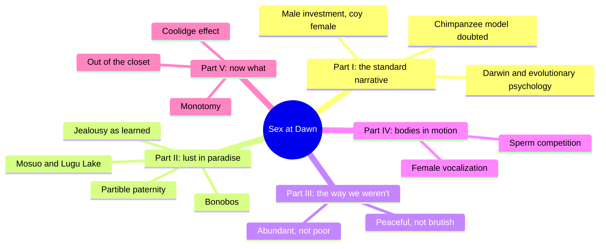
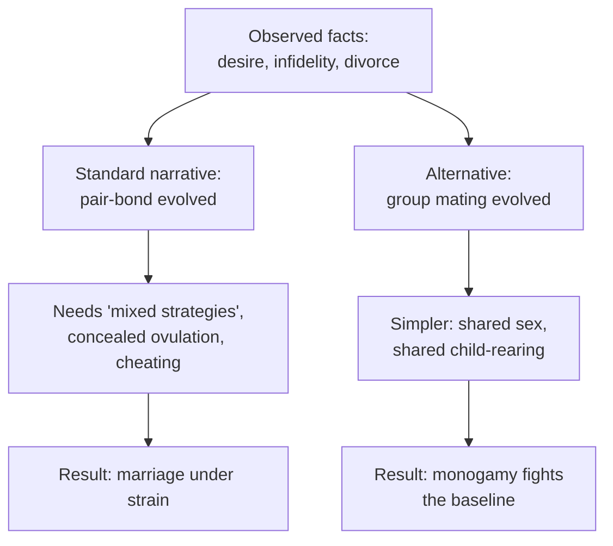
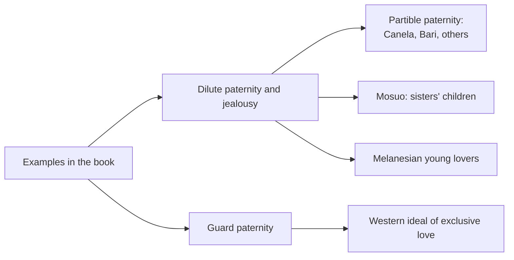
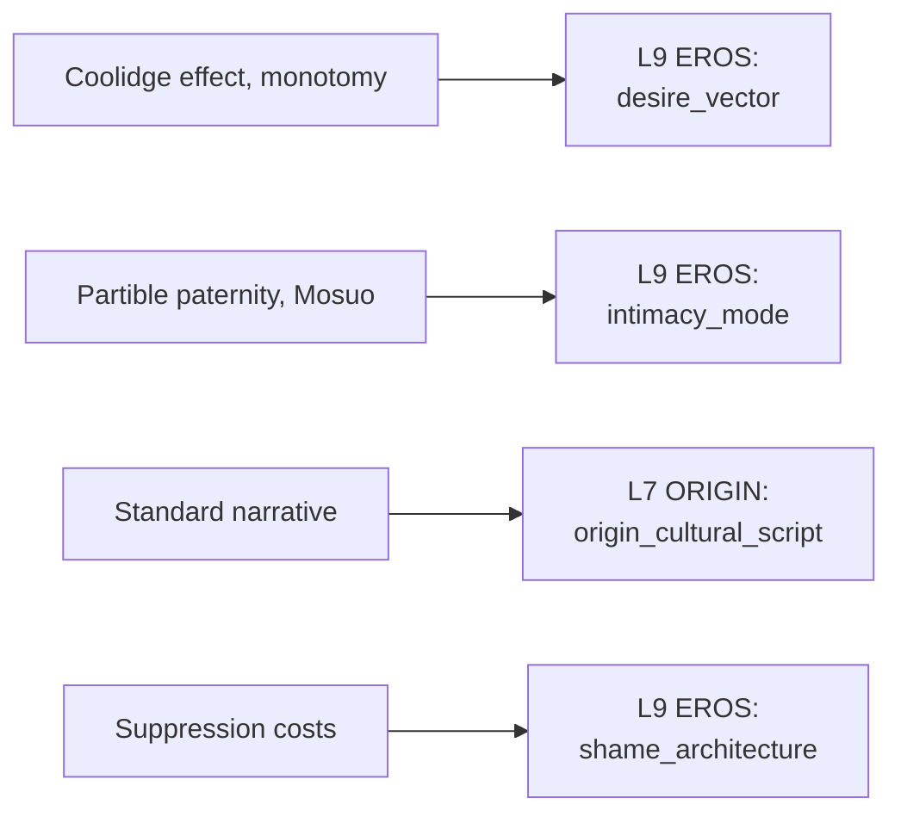

# 🧬 PSY.61 — Sex at Dawn — Ryan & Jethá (2010)
### Knowledge Entry — Distill

Ryan and Jethá's 2010 popular-science book argues that humans evolved in groups where sex was shared, and that modern monogamy fights that history. Its claims are contested, so treat it as one strong argument and not as settled fact.

## TABLE OF CONTENTS
- [Core Thesis](#1-core-thesis)
- [Mind Models](#2-mind-models)
- [Framework](#3-framework--structure)
- [Key Concepts](#4-key-concepts)
- [Heuristics](#5-heuristics--decision-rules)
- [Invariants](#6-invariants)
- [Pitfalls](#7-pitfalls--myths)
- [Application](#8-application)
- [Cross-References](#9-cross-references)
- [Provenance](#10-provenance--confidence)

---

## 1 · CORE THESIS

The standard story says humans evolved as pairs, with jealous men and choosy women. The authors say early humans lived in cooperative groups with shared sexual partners, and that strict monogamy runs against that history. They say suppressing it costs people happiness.

---

## 2 · MIND MODELS

**Diagram 1 — the whole argument.**
Caption: *five parts, one move: take apart the standard narrative, offer a group-mating alternative, and then argue the alternative on the body and on desire.*

**Diagram 2 — the central mechanism (standard narrative vs. the authors' model).**
Caption: *the same observations are explained two ways, and the authors say theirs needs fewer patches.*

**Diagram 3 — how societies handle jealousy and paternity.**
Caption: *the book's examples sort into groups that dilute paternity and jealousy, and a group that does the opposite.*

**Diagram 4 — mapped onto the 12-layer character stack.**
Caption: *the book feeds the variety drive, the relationship-structure menu, and the cultural script a character inherits.*

---

## 3 · FRAMEWORK / STRUCTURE

The book has five parts and 22 chapters, in a clear argument from refutation to alternative.

| Part | Governing move |
|---|---|
| Introduction, "Another Well-Intentioned Inquisition" | Compares the standard narrative to the Church's treatment of Galileo. Lists the symptoms: sexual frustration, failing marriages, hidden betrayals. |
| Part I, On the Origin of the Specious (chs. 1-4) | Chapter 1 opens with the Yucatan example. Chapter 2 attacks Darwin's assumptions and evolutionary psychology, and coins "Flintstonization of prehistory." Chapter 3 reviews the standard narrative's pieces (male parental investment, "mixed strategies," concealed ovulation). Chapter 4 doubts the chimpanzee model. |
| Part II, Lust in Paradise (Solitary?) (chs. 5-10) | Bonobos, partible paternity (ch. 6), the Mosuo (ch. 9), and jealousy (ch. 10). |
| Part III, The Way We Weren't (chs. 11-14) | Argues that foragers were not poor, nasty, brutish, or short-lived. |
| Part IV, Bodies in Motion (chs. 15-19) | Sperm competition, penis shape, and female copulatory vocalization as body evidence for multi-partner sex. |
| Part V, Men Are from Africa, Women Are from Africa (chs. 20-22) | Desire and its decline in marriage, then a call to take sex less seriously (ch. 22). |

---

## 4 · KEY CONCEPTS

| Concept | What it is | Why it matters |
|---|---|---|
| **Standard narrative** | The accepted account that humans evolved as pair-bonded couples, with men seeking variety and women seeking provision (intro, ch. 3). | It is the target. It sets what many people assume is natural. |
| **Flintstonization** | Projecting the modern nuclear family back into prehistory (ch. 2). | A character's picture of "how people always were" may be a projection. |
| **Partible paternity** | A belief that a fetus is built from accumulated semen, so several men can be fathers (ch. 6). | A culture that built its family system on shared fatherhood. Found among the Canela, Bari, Kulina, Yanomami, and others. |
| **S.E.Ex.** | The authors' term, Socio-Erotic Exchanges: ritual, sanctioned sex outside the couple (ch. 10). | They argue these reduced jealousy and blurred paternity to protect group peace. |
| **Mosuo** | A society in southwest China near Lugu Lake. Women and men do not marry, and men raise their sisters' children (ch. 9). | A working non-marital family structure with names, places, and a quote: "Women and men should not marry, for love is like the seasons." |
| **Sperm competition** | Sperm from several males compete to fertilize the egg (ch. 15). | The authors use it as body evidence that humans evolved with multiple partners. |
| **Coolidge effect** | Males of many mammal species recover interest with a new partner (ch. 21). | The book uses it for the claim that novelty is a normal drive. |
| **Monotomy** | Their word for monogamy plus monotony (ch. 21). | Names the boredom that long exclusive pairing can bring. |
| **Jealousy as shaped** | Jealousy can be reduced to "a minor irritant if consensus deems it so" (ch. 10). | Treats jealousy as modified by culture. The authors also note some cultures encourage it. |
| **Women's desire, not weak** | The authors reject the "famously flaccid female libido" and cite women's multiple orgasms and vocalization (chs. 3, 19). | Challenges a standard assumption about what women want. |
| **Take sex less seriously** | Their closing advice: "when it's just sex, that's all it is" (ch. 22). | A stance a character can hold or resist. |

---

## 5 · HEURISTICS & DECISION RULES

| Situation | Do this | Not this |
|---|---|---|
| Writing a character who says "people are naturally monogamous" | Treat it as a belief with a source: a family, a church, a book. | Treat it as a neutral fact. |
| Writing a character bored in a long relationship | Name the boredom and let him read it as a flaw or as a signal. | Use it only as a sign of a bad partner. |
| Writing a society with a different family structure | Use a real model (partible paternity, Mosuo) as the base. Give it its own rules and costs. | Invent a utopia with no friction. |
| Writing jealousy | Ask what the community teaches about it: encouraged, tolerated, or mocked. | Write it as the same in every setting. |
| Writing a character who gives up an exclusive-love script | Show what he loses as well as what he gains: stability, a shared story, family approval. | Treat the change as simple liberation. |
| Writing women's desire | Let women want variety, novelty, and speed, as men do. | Assign wanting to men and compliance to women by default. |
| Using the book's claims in dialogue | Let one character cite it and another challenge it. | Treat the book as the author's voice. |

---

## 6 · INVARIANTS

These are the book's own claims, and several are contested.

1. **Desire for sex is strong and constant in humans.** The book calls our species "shamelessly, undeniably, inescapably sexual" (ch. 3).
2. **Cultural scripts shape jealousy.** Some societies reduce it, others amplify it (ch. 10).
3. **Paternity certainty is not universal.** Several societies live without it (chs. 6, 9).
4. **The standard narrative is a story, not a finding.** The authors say it needs patches to explain basic facts (ch. 3).
5. **Suppression has costs.** The authors name frustration, boredom, betrayal and shame (intro, ch. 21).
6. **Variety is a drive for many mammals.** The Coolidge effect is the example (ch. 21).
7. **Sex can be taken less seriously.** The closing chapter says so directly (ch. 22).

---

## 7 · PITFALLS / MYTHS

- Treating the book as settled science. It is a popular argument by a psychologist and a physician, and the evidence it cites is selective. Evolutionary psychologists and anthropologists have published sharp critiques. This entry could not check the cited sources and rates its confidence low.
- Treating bonobos as a direct model for humans. The book argues that the chimpanzee model is wrong and the bonobo model is better. Both are analogies.
- Treating forager societies as a single type. The book's examples are a handful of named groups, and the authors themselves warn against assigning "nobility" to foragers (ch. 10).
- Reading "natural" as "good" or "required." The authors state that individuals can rise above their baseline, with cost (ch. 3).
- Reading its jealousy claims as a rule for all people. The authors also note that some cultures amplify jealousy, and that people in this culture feel it.
- Reading its closing claims about family outcomes as neutral. Chapter 22 cites data on single-parent households and argues from it. The data is American and dated to 2008.
- Tone: the book is jokey and polemical. A distill can make it sound more certain than it is.

---

## 8 · APPLICATION

*Proposed for the Command, not ruled.*

- **Spine level:** L5
- **12-layer character stack:** L9 EROS desire_vector (primary); L9 EROS intimacy_mode (primary); L7 ORIGIN origin_cultural_script (supporting); L9 EROS shame_architecture (supporting); L6 DRIVE drive_texture (contextual).
- **plot_systems:** a character who believes the "standard narrative" and a character who has read the book can argue. The argument itself is a scene, and neither needs to be right.
- **Setting:** partible paternity and the Mosuo are named, documented models for a fictional community that does not center the couple. Era 1 (Skeeter Creek) and the later lineages can use them as the founding culture of a subgroup.

Ryan and Jethá offer the 12 layers one thing the others lack: an argument that a character's sense of "normal" is a script, with a named alternative at the other end. For a character writing his own idea of love, this gives a reading list and a counterexample.

For the ORANGE work, the proposed addition is a "script inherited" field on the ORIGIN layer. It records which story about love, men, and women a character grew up inside, and who taught it to him. The book supplies the content of the dominant script, and the Mosuo and partible-paternity cases supply the alternatives. The distill does not endorse the book's science. It uses the book as a source of scripts a character can believe or reject.

Explicit content follows the standing prose ruling: fantasy first, with the container as the one-line front-matter disclaimer ("Fantasy, not a how-to: what happens in these pages stays in them. Reader discretion advised.", ruled 10/4).

---

## 9 · CROSS-REFERENCES

| Related entry | Relation |
|---|---|
| [[🧬 MSX.75 — Opening Up — Taormino (2008)]] | Taormino gives the practical guide. Ryan and Jethá give the evolutionary argument. |
| [[🧬 PSY.62 — Tell Me What You Want — Lehmiller (2018)]] | Lehmiller's survey data on what people fantasize about is a direct test of the variety claim. |
| [[🧬 MSX.17 — Mating in Captivity — Perel (2006)]] | Perel argues desire needs distance. Ryan and Jethá argue it needs novelty. |
| [[🧬 MSX.36 — The History of Sexuality — Foucault (1978)]] | Foucault says "sex" itself is a modern category. Ryan and Jethá treat it as a constant. The two disagree. |

---

## 10 · PROVENANCE & CONFIDENCE

Full text, pdftotext extraction of an ebook, 504 PDF pages. The extract has no printed page numbers, and the copyright page was not found. The year 2010 and the authors' credentials ("Christopher Ryan, PhD, and Cacilda Jethá, MD") come from the title page. The extract is the "P.S." paperback edition with extra material at the back. Citations are by chapter.

Read in full or near full: the Introduction, chapter 3's opening (the "good news and bad news" passage), chapter 6's opening (partible paternity), chapter 9's Mosuo section, chapter 10's opening and its jealousy examples (Siriono, Canela, the "When a Man Loves a Woman" passage), chapter 21's Coolidge effect and monotomy passages, and chapter 22's opening.

Not read: chapters 1, 2, 4, 5, 7, 8, 11 through 20 (the Part III and IV rows rest on the table of contents and on search hits for sperm competition), the notes, and the back matter. Chapter titles in the Framework come from the contents page.

The claims here are the authors' own. This entry did not check them against the primary sources, and the book's sourcing is disputed. The feeds keying is this distill's synthesis against the Command's 12-layer stack. The `spine: [L5]` value follows the assigning brief.

## META
- Template: BVX-LEARN-v4.0
- Source classification: full-text pdftotext of an ebook, targeted read on seven chapters, contents page for the rest
- Created / Updated: 2026-10-04
