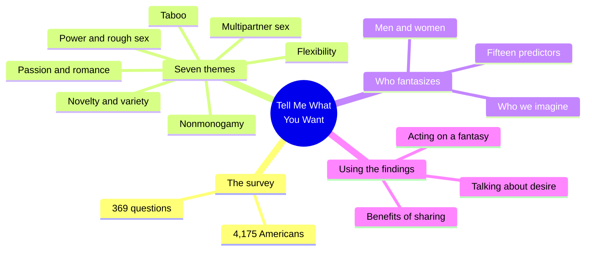
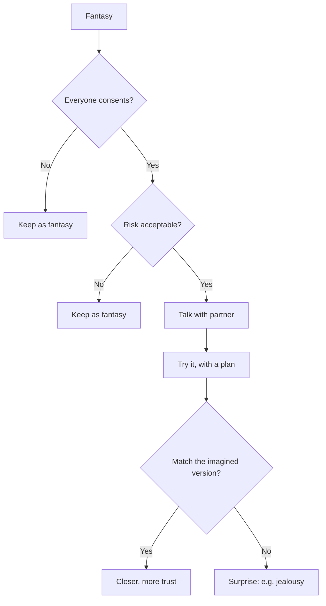
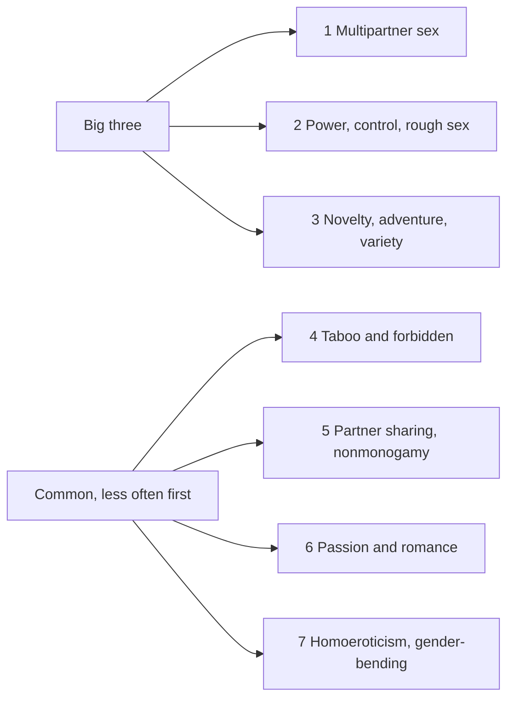
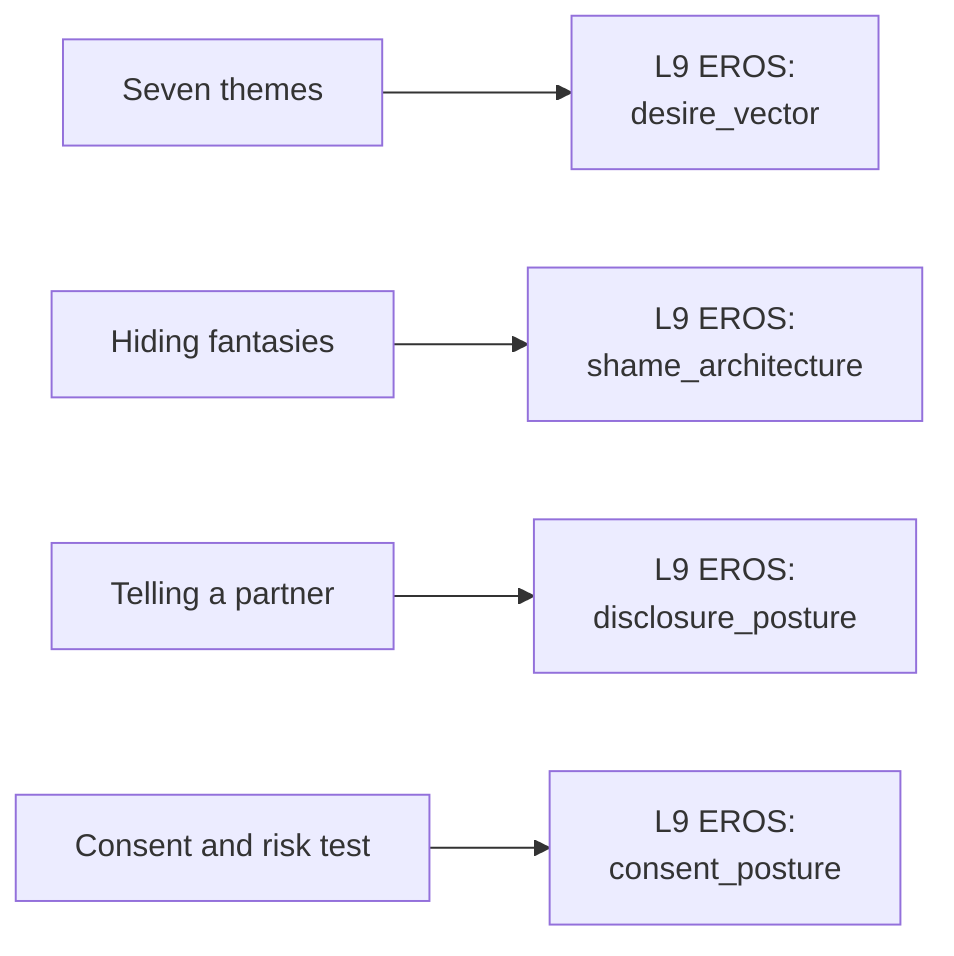

# 🧬 PSY.62 — Tell Me What You Want — Lehmiller (2018)
### Knowledge Entry — Distill

Lehmiller, a social psychologist, surveyed 4,175 Americans about their sexual fantasies. The book sorts the answers into seven themes and shows what predicts each one. It also gives his rules for acting on a fantasy.

## TABLE OF CONTENTS
- [Core Thesis](#1-core-thesis)
- [Mind Models](#2-mind-models)
- [Framework](#3-framework--structure)
- [Key Concepts](#4-key-concepts)
- [Heuristics](#5-heuristics--decision-rules)
- [Invariants](#6-invariants)
- [Pitfalls](#7-pitfalls--myths)
- [Application](#8-application)
- [Cross-References](#9-cross-references)
- [Provenance](#10-provenance--confidence)

---

## 1 · CORE THESIS

Sexual fantasies are common, varied, and mostly harmless, and seven themes cover most of them. People hide them out of shame and fear of a partner's reaction. Sharing and sometimes acting on them can improve sex and relationships, when consent is present and risk is acceptable.

---

## 2 · MIND MODELS

**Diagram 1 — the whole argument.**
Caption: *the book moves from the data, to who fantasizes about what, to what to do with the fantasy.*

**Diagram 2 — the central mechanism (from fantasy to action).**
Caption: *the book puts two checks between a fantasy and an act, and either failure keeps it in the mind.*

**Diagram 3 — the seven themes in rank order.**
Caption: *the first three are the big ones, and the other four are common but named less often as the single biggest fantasy.*

**Diagram 4 — mapped onto the 12-layer character stack.**
Caption: *the themes feed desire, the silence around them feeds shame, and the two checks feed consent.*

---

## 3 · FRAMEWORK / STRUCTURE

Eight chapters, framed by a preface and an introduction.

| Part | Governing move |
|---|---|
| Preface and Introduction (pp. ix-xxi) | Opens with fear and shame about fantasy. States the survey's scope and the main findings (porn influence, political leaning, fewer than a third acted). |
| Ch. 1, Tell Me What You Want (p. 1) | How the survey was built and who answered. |
| Ch. 2, The Seven Most Common Sexual Fantasies in America (p. 13) | The seven themes, with quoted narratives and the psychology behind each. |
| Ch. 3, Mars and Venus (p. 71) | How men's and women's fantasies differ. Concludes they are more alike than different (p. 99). |
| Ch. 4, What Do Your Sexual Fantasies Say About You? (p. 101) | Fifteen traits that predict fantasy content. |
| Ch. 5, Tell Me Who You Want (p. 131) | Who we imagine and how we see ourselves in fantasy. |
| Ch. 6, Can Science Save Your Sex Life? (p. 159) | Benefits of getting in touch with desire. |
| Ch. 7, Visiting Fantasy Island (p. 179) | When and how to turn a fantasy into action. |
| Ch. 8, The Path to Healthier Sex and Relationships (p. 211) | How to break the barriers to talking about desire. |

---

## 4 · KEY CONCEPTS

| Concept | What it is | Why it matters |
|---|---|---|
| **Seven themes** | Multipartner sex, power/control/rough sex, novelty/adventure/variety, taboo, partner sharing/nonmonogamy, passion/romance, erotic flexibility (p. 11). | A short vocabulary for what a character wants. |
| **Group sex** | The most common biggest fantasy. More than a third named it. Only 5 percent of men and 13 percent of women had never had such a fantasy (p. 14). | Wanting more than one partner is ordinary in this sample. |
| **BDSM** | Bondage, discipline, dominance, submission, sadism, masochism (p. 19). | Second most common. People favored bondage, submission, and masochism a bit more than dominance and sadism (p. 39). |
| **Novelty** | New acts, new places, or surprise (p. 28). | The theme with the most different meanings from person to person. |
| **Taboo** | Fantasies of what culture or religion forbids (p. 40). | More common as a biggest fantasy than love and romance in this sample. |
| **Erotic illusions** | Cues combined in a new way so the brain feels intense arousal (p. 66). | Explains why a fantasy can feel stronger than its parts. |
| **Gender-bending** | Cross-dressing, changing sex, or a cross-dressing or trans partner (p. 66). | About a quarter of men and women had imagined cross-dressing. Virtually all gender-bending fantasies were more common in men (p. 66). |
| **Sexual flexibility** | Fantasies inconsistent with one's own orientation (p. 66 ff.). | Straight men's same-sex fantasies were most often inside a threesome with a woman (p. 67). |
| **Traits that predict fantasy** | Imagination, strong sex drive, positive attitudes, thrill-seeking, separating sex from emotion, openness (p. 103). | Gives a character's profile a basis for what he imagines. |
| **Porn influence** | One in seven said their biggest fantasy came from something in porn. More porn linked to bigger bodies in fantasy (p. xviii). | A source of fantasy content in a character's media diet. |
| **Changing yourself in fantasy** | Most people alter their body or personality when they appear in their own fantasies (p. xviii). | Often reflects an insecurity. |
| **Consent and risk test** | Consent present, risk acceptable: the book's test for acting on a fantasy (pp. 181-184). | A clean rule the character or his partner might hold. |
| **Compulsion** | Any interest can become a problem if it takes over a life, whatever the desire (p. 184). | The book's line is loss of control and distress, not how unusual the desire is. |

---

## 5 · HEURISTICS & DECISION RULES

| Situation | Do this | Not this |
|---|---|---|
| Writing a character's biggest fantasy | Pick from the seven themes. Give the narrative specifics, the way participants did. | Invent a desire with no pattern behind it. |
| Writing a character who hides a fantasy | Give the reason: shame, a fear of refusal, or not knowing how to ask. | Make the fantasy itself the shame. |
| Writing a character who tells a partner | Show the fear first, then the reaction. Let it go well, badly, or oddly. | Assume the partner is shocked. |
| Writing a fantasy acted out | Let the real version differ from the imagined one: jealousy, awkwardness, or a better surprise. | Make the act match the fantasy exactly. |
| Writing men's and women's desire | Use the same seven themes for both. Vary the frequency. | Split desire into two incompatible planets. |
| Writing a straight character's same-sex fantasy | Put it inside a scenario with a clear frame, as the survey narratives did. | Treat it as a secret about his orientation. |
| Writing a character who believes a fantasy is "wrong" | Give him a source for the belief: a church, a school, a parent. | Treat the belief as personal taste. |
| Writing a fantasy that crosses the consent or risk line | Keep it as fantasy in the scene, or show the character reading it as a warning sign. | Write it as a plan the story treats as fine. |

---

## 6 · INVARIANTS

1. **Fantasies are common.** Most people have the big-three kinds (p. 70).
2. **Fantasy and action differ.** Under a third acted on their biggest fantasy (pp. xviii-xix).
3. **Silence maintains shame.** People worry what others would think if they knew (p. ix).
4. **Men's and women's fantasy themes are more alike than different.** The main difference is frequency (p. 99).
5. **Women's sexuality is described as more flexible than men's.** The book treats this as the key difference (p. 99).
6. **Culture shapes fantasy.** The more political and moral restriction, the more intense the fantasy of breaking it, in this data (p. xviii).
7. **Fantasy traits are correlational.** The book states it cannot say whether the trait or the fantasy came first (p. 103).

---

## 7 · PITFALLS / MYTHS

- Treating the sample as "Americans." It is 4,175 volunteers who found the survey on Facebook, Twitter or Reddit. They skewed younger (median age 32), more educated, and more affluent (p. 7). Conservative people were underrepresented (p. 8).
- Reading the percentages as population rates. The author says his results probably overestimate how many Americans have shared and acted on their fantasies (p. 8).
- Reading correlations as causes. The author flags the "chicken-and-egg problem" himself (p. 103).
- Treating the seven themes as a complete map. They are categories extracted from free-text answers, and the author merged words into groups (p. 10).
- Taking the "Mars and Venus" claim as a rule. The author warns against it (p. 99).
- Reading the political-party finding as a stable pattern. It is one survey from the mid-2010s.
- Taking his advice lines as universal. Where he refuses to recommend an act (for example, extreme BDSM that cuts or shocks), he calls it his own judgment and says what people do with their bodies is their choice (p. 182).
- Data caution: the self-report format records what people said, not what they did.

---

## 8 · APPLICATION

*Proposed for the Command, not ruled.*

- **Spine level:** L5
- **12-layer character stack:** L9 EROS desire_vector (primary); L9 EROS shame_architecture (primary); L9 EROS disclosure_posture (supporting); L9 EROS consent_posture (supporting); L10 SHADOW shadow_content (contextual); L6 DRIVE drive_texture (contextual).
- **plot_systems:** the fantasy-to-act gap is a scene engine. A character can have a fantasy for years, tell a partner, plan it, and find the real version surprising. Each step is a scene.
- **Setting:** none directly. The survey is American and online, so it fits the later eras best.

Lehmiller gives the 12 layers a measured vocabulary for desire. EROS currently holds named variables. This book adds a frequency-ranked menu of what people actually fantasize about, plus the predictors of each.

For the ORANGE work, the proposed addition is a fantasy ledger per character with four fields: the theme, whether the character has told anyone, whether he has acted, and how the real version differed from the imagined one. The fourth field is the book's best craft contribution. It turns "he got what he wanted" into a scene with a surprise.

The book's own consent-and-risk test works as a character rule, and as a plot hinge when two characters hold different lines. Explicit scenes follow the standing prose ruling: fantasy first, with the container as the one-line front-matter disclaimer ("Fantasy, not a how-to: what happens in these pages stays in them. Reader discretion advised.", ruled 10/4).

Gay and bisexual men are a small part of the sample. About 5.7 percent identified as gay or lesbian and 12.6 percent as bisexual (p. 8). A writer should read the themes as a general base and look to other shelf entries for gay men's specific material.

---

## 9 · CROSS-REFERENCES

| Related entry | Relation |
|---|---|
| [[🧬 PSY.61 — Sex at Dawn — Ryan & Jethá (2010)]] | Ryan and Jethá argue variety is a baseline drive. Lehmiller's data shows how common variety fantasies are. |
| [[🧬 MSX.75 — Opening Up — Taormino (2008)]] | Taormino's agreements method fits Lehmiller's step from fantasy to talk to act. |
| [[🧬 PSY.04 — Women and Kink — Rehor & Schiffman (2021)]] | A deeper source on the power-and-control theme. |
| [[🧬 PSY.02 — Understanding Threesomes — Scoats (2020)]] | A deeper source on the top fantasy theme. |
| [[🧬 MSX.82 — The Leatherman's Handbook — Townsend (1972)]] | A first-person guide to the power-and-control theme in gay men's culture. |

---

## 10 · PROVENANCE & CONFIDENCE

Full text, pdftotext extraction of a scanned copy, 293 PDF pages. Front matter confirms Justin J. Lehmiller, PhD, Tell Me What You Want, published in the US by Da Capo Press in 2018 and in Great Britain by Robinson (Little, Brown) in 2018. Printed page numbers equal the PDF page minus 28 in the body.

Read in full or near full: the preface and introduction, chapter 1's method and sample sections (pp. 7-8), chapter 2's theme list and its first three themes' openings, taboo and flexibility sections (to p. 68), chapter 3's closing section, chapter 4's opening, and chapter 7's risk and consent section (pp. 181-184).

Not read: most of chapter 2's detail on partner sharing and romance, the body of chapters 3 through 6, chapter 5 (who we imagine), and chapter 8 (communication barriers). Those rows in the Framework rest on the contents page and on chapter openings. Notes and index were not read.

The feeds keying is this distill's synthesis against the Command's 12-layer stack. Lehmiller uses none of that vocabulary. The `spine: [L5]` value follows the assigning brief.

## META
- Template: BVX-LEARN-v4.0
- Source classification: full-text pdftotext, deep read on the introduction, ch. 1 sample, ch. 2 themes, ch. 7 rules, contents page for the rest
- Created / Updated: 2026-10-04
