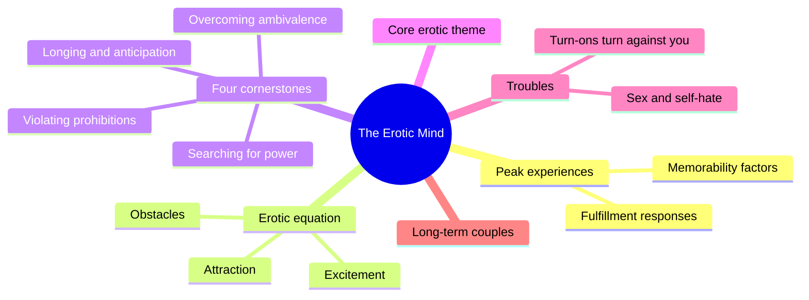
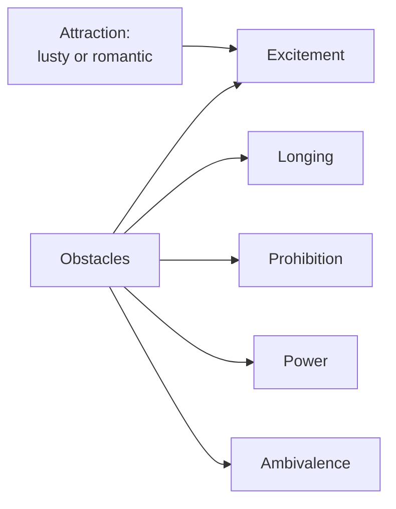
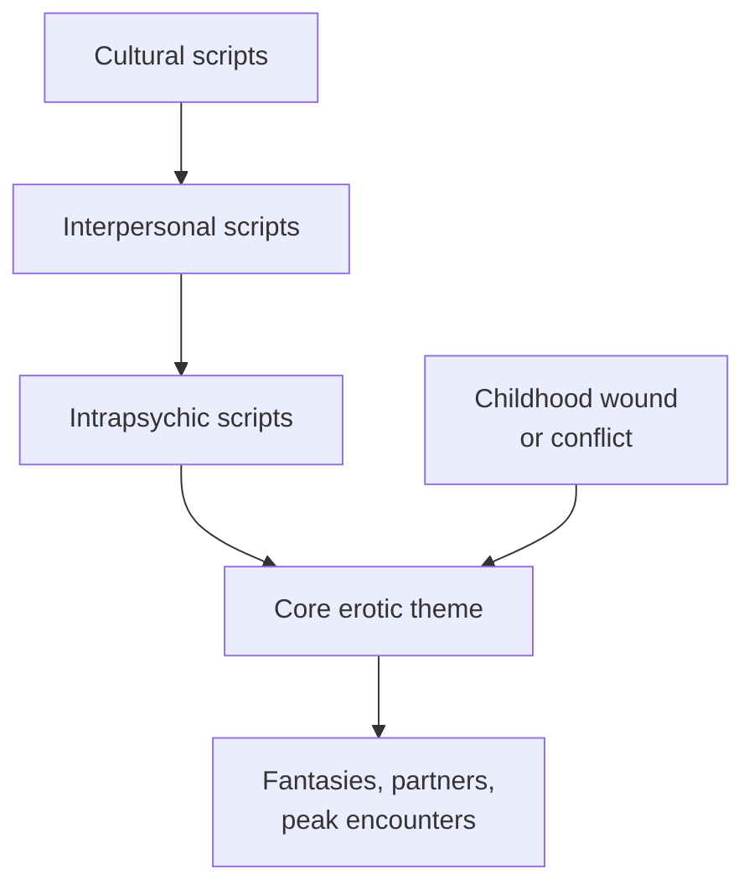
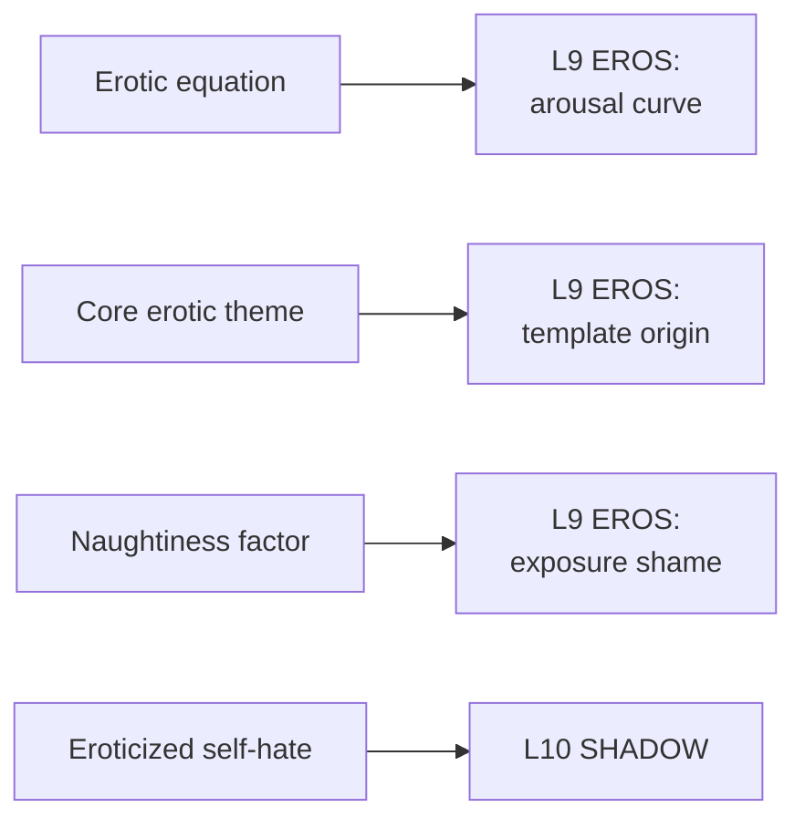

# 🧬 PSY.63 — The Erotic Mind — Morin (1995)
### Knowledge Entry — Distill

Jack Morin, a clinical psychologist and sex therapist, argues that arousal runs on obstacles and that each person carries one core erotic theme. He builds the case from peak-experience stories. The library keeps it as the best single model of what turns a character on and why.

## TABLE OF CONTENTS
- [Core Thesis](#1-core-thesis)
- [Mind Models](#2-mind-models)
- [Framework](#3-framework--structure)
- [Key Concepts](#4-key-concepts)
- [Heuristics](#5-heuristics--decision-rules)
- [Invariants](#6-invariants)
- [Pitfalls](#7-pitfalls--myths)
- [Application](#8-application)
- [Cross-References](#9-cross-references)
- [Provenance](#10-provenance--confidence)

---

## 1 · CORE THESIS

Excitement equals attraction plus obstacles. Obstacles come from four childhood challenges, and each person's pattern gathers into one core erotic theme. Turn-ons turn old wounds into excitement, and they can turn against the person.

---

## 2 · MIND MODELS

**Diagram 1 — the whole argument.**
Caption: *from the peak experience to the equation to the theme, then what goes wrong, then what keeps passion alive.*

**Diagram 2 — the central mechanism (the erotic equation).**
Caption: *a pull and a push, inside one person or between two, and the tension between them is the heat.*

**Diagram 3 — three levels of script, one theme.**
Caption: *many scripts, one theme; the theme is the pattern a reader or a therapist can name in a sentence.*

**Diagram 4 — mapped onto the 12-layer character stack.**
Caption: *Morin supplies the EROS layer its engine: curve, theme and the shadow that rides in a turn-on.*

---

## 3 · FRAMEWORK / STRUCTURE

Three parts, eleven chapters, and an appendix with the survey.

| Part | Chapters | Content |
|---|---|---|
| I. Realms of Passion | 1-5 | Peak experiences, the erotic equation, four cornerstones, emotional aphrodisiacs, the core erotic theme |
| II. Troublesome Turn-Ons | 6-8 | When turn-ons turn against you, sex and self-hate, winds of change |
| III. Positively Erotic | 9-11 | Long-term couples, signposts to erotic health, eros fulfilled |
| Appendix | | The Sexual Excitement Survey |

The extract carries no printed folios, so cites are PDF pages of the extract.

---

## 4 · KEY CONCEPTS

| Concept | What it is | Why it matters |
|---|---|---|
| **Erotic equation** | Attraction plus obstacles equals excitement (ch. 2, p. 54) | The book's single formula |
| **Resistance principle** | Tripp's idea that desire needs something resistant in the partner or situation (p. 54) | The source of the equation |
| **Lusty vs. romantic attraction** | Lust wants arousal and release; romance wants a person and a bond (ch. 2, p. 56) | A character can run on either or both |
| **Lust objectifies** | To desire is to treat the other as the stimulus, and it can validate (p. 57) | Being an object can be wanted, not only feared |
| **Longing and anticipation** | Arousal drawn from the gap between wish and reality (ch. 3, p. 81) | Partial satisfaction fuels obsession |
| **Violating prohibitions** | Rule-breaking turns shame into charge; Morin calls it the "naughtiness factor" (p. 89) | Restriction creates the turn-on it forbids |
| **Searching for power** | Dominance and submission as ways to move from helplessness toward control (p. 99) | Submitting can be a route to control |
| **Overcoming ambivalence** | Mixed feelings resolve into focus; the turn-on peaks as doubt ends (p. 106) | Doubt can be part of the heat |
| **Sexual scripts** | Cultural, interpersonal and intrapsychic (ch. 5, p. 141) | Borrowed from Simon and Gagnon |
| **Core erotic theme (CET)** | One unifying scenario beneath a person's scripts (p. 141) | The reusable key to a character |
| **Eroticized self-hate** | Low self-esteem fused with arousal (ch. 7, p. 197) | The most damaging kind of turn-on |
| **Pathology vs. neat-and-clean perspectives** | The two schools Morin rejects for a paradoxical view (Introduction, p. 12) | Obstacles are not always defects |

---

## 5 · HEURISTICS & DECISION RULES

| Situation | Do this | Not this |
|---|---|---|
| Building a character's turn-ons | Find his obstacles first | List body types and acts |
| A man obsessed with the unavailable | Show the gap, the crumbs and the frenzy (p. 81) | Call it neurosis |
| A man raised under strict rules | Let rule-breaking carry the charge (p. 89) | Make the rules purely a source of shame |
| A power dynamic | Ask what powerlessness it answers (p. 99) | Treat it as only a fetish |
| A man with mixed feelings | Let them resolve at the point of arousal (p. 106) | Resolve them before the scene |
| Finding a theme | Write it as a sentence: "being chosen," "being pursued" (p. 144) | Describe it as a list |
| A long relationship | Show intimacy cooling desire (p. 258) | Blame poor communication |
| A man who hates himself | Let the turn-on carry the hate (p. 197) | Separate the sex from the self |

---

## 6 · INVARIANTS

1. Arousal depends on attraction and an obstacle (p. 54).
2. Obstacles come from universal childhood challenges (p. 78).
3. Each person's turn-ons share a recurring theme (p. 141).
4. A theme begins in childhood and is often hidden (p. 141).
5. Turn-ons are built from wounds and conflicts (p. 141).
6. Intimacy and passion are two separate experiences (p. 258).
7. Peak sex joins excitement and fulfillment (p. 310).

---

## 7 · PITFALLS / MYTHS

- Treating the cornerstones as laws. Morin says they are common, not required (p. 78).
- Treating the equation as a rule for every man. It describes Morin's observations in therapy and his survey.
- Treating the survey as a population study. Morin's Sexual Excitement Survey has 351 respondents over two years. It is qualitative, with stories as data (Notes, ch. 1). It is 83 percent heterosexual among women and about 75 percent among men, with 16 percent of men gay. Percentages, such as 39 percent of peaks showing longing (p. 81), describe that group only.
- Treating a "core erotic theme" as proven. It is Morin's clinical construct, and a CET is read after the fact.
- The book is a 1995 self-help text and predates later work on desire. Some of its framing of gender, such as women's longing, reflects its sample.
- Morin gives gay men limited space. The data include few gay men.

---

## 8 · APPLICATION

*Proposed, not ruled.*

- **Spine level:** L5.
- **12-layer character stack:** L9 EROS `arousal_curve` (primary); L9 `template_origin` (primary); L10 SHADOW `shadow_content` (primary); L9 `exposure_shame` (supporting); L9 `intimacy_mode` (supporting).
- **plot_systems:** none.
- **Setting:** none.

Morin gives each character one hidden sentence. Proposed: a **core erotic theme** field, one line, written in the wound's own terms. For example, "being chosen after being passed over." Each scene then draws a script from that theme.

Proposed: list each lead's obstacles in a fixed order: the four cornerstones. Which does he need, and which does he avoid? Longing runs a long slow story. Power runs a short sharp one.

Proposed: write the naughtiness factor into DCUS. A school that polices sex builds the charge it forbids. That gives the setting a mechanism instead of a mood.

For the explicit work under 06.1, Morin gives the fantasy its logic. The scene's heat comes from the obstacle, so the writer keeps the obstacle on the page. The front-matter disclaimer carries the container.

---

## 9 · CROSS-REFERENCES

| Related entry | Relation |
|---|---|
| [[🧬 MSX.17 — Mating in Captivity — Perel (2006)]] | Perel says desire needs distance; Morin gives the resistance principle behind it |
| [[🧬 MSX.33 — The Space of Sex — Waldrep (2021)]] | A licensed space lowers obstacles; Morin says obstacles make heat |
| [[🧬 PSY.58 — Human Sexuality and Its Problems — Bancroft (2009)]] | Bancroft measures excitation and inhibition; Morin names what excites |
| [[🧬 PSY.10 — Magnificent Sex — Kleinplatz & Ménard (2020)]] | Both draw on peak experiences, with different samples |
| [[🧬 MSX.14 — The New Bottoming Book — Easton & Hardy (2001)]] | Power exchange in practice |

---

## 10 · PROVENANCE & CONFIDENCE

Full-text pdftotext extract of the HarperCollins edition (hardcover 1995). The copyright page confirms Jack Morin, Ph.D., 1995. Read in full: the Introduction; Chapter 2 on the erotic equation; Chapter 3 on the four cornerstones (all four, in part); the opening of Chapter 5 on the core erotic theme; the opening of Chapter 7 on sex and self-hate; the opening of Chapter 9 on long-term couples; the opening of Chapter 11; the survey sample notes.

Skipped: Chapter 1 stories, Chapter 4 emotional aphrodisiacs, Chapters 6 and 8 in full, most of Chapter 10, the survey instrument and the bibliography.

The extract has no printed page numbers, so page cites are PDF pages and approximate by one. The `feeds:` keying is this distill's own synthesis.

## META
- Template: BVX-LEARN-v4.0
- Source classification: full-text pdftotext extraction; the equation, cornerstones, theme and couples chapters read
- Created / Updated: 2026-10-04
