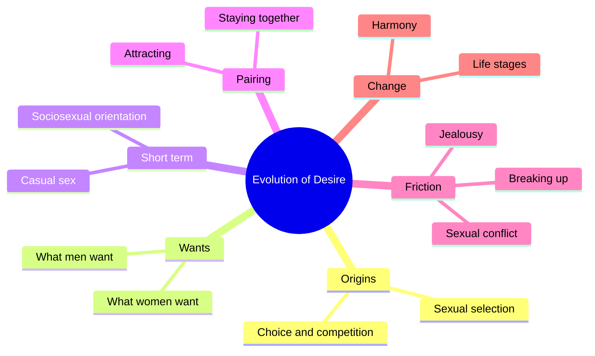
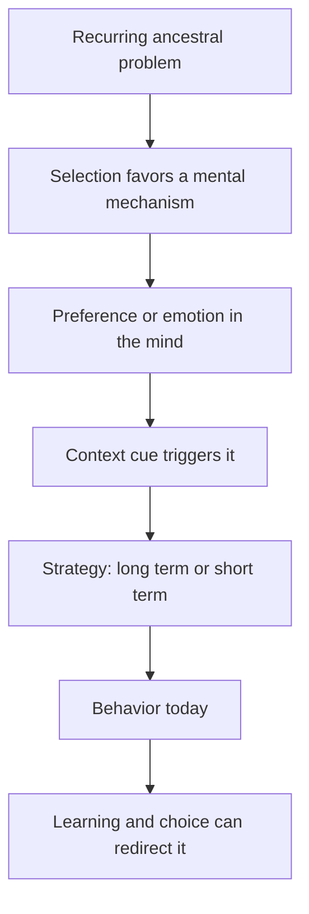
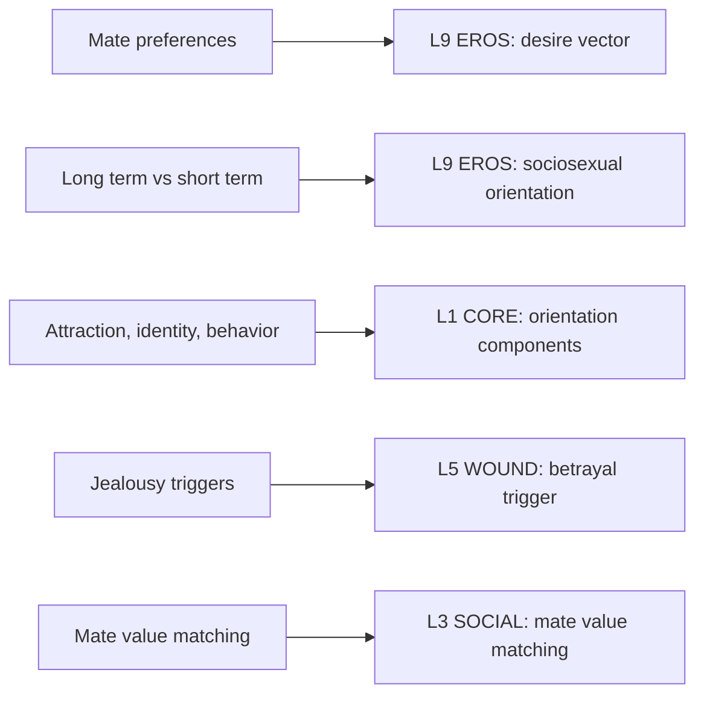

# 🧬 PSY.64 — The Evolution of Desire — Buss (2016)
### Knowledge Entry — Distill

Fantasy, not a how-to: what happens in these pages stays in them. Reader discretion advised.

David Buss's book argues that human mating follows strategies shaped by evolution. This is the revised and updated edition of a 1994 book. The library uses it as the standard evolutionary account of what men and women want in a mate.

## TABLE OF CONTENTS
- [Core Thesis](#1-core-thesis)
- [Mind Models](#2-mind-models)
- [Framework](#3-framework--structure)
- [Key Concepts](#4-key-concepts)
- [Heuristics](#5-heuristics--decision-rules)
- [Invariants](#6-invariants)
- [Pitfalls](#7-pitfalls--myths)
- [Application](#8-application)
- [Cross-References](#9-cross-references)
- [Provenance](#10-provenance--confidence)

---

## 1 · CORE THESIS

Humans carry mating strategies that solved problems for our ancestors. Women and men differ where their problems differed. Strategies are flexible, so conflict, jealousy, and breakup are normal outputs, not failures. Understanding them can change what people do.

---

## 2 · MIND MODELS

**Diagram 1 — the whole argument.**
Caption: *the book runs one engine, sexual selection, through ten stages of a mating life.*

**Diagram 2 — the central mechanism.**
Caption: *a recurring ancestral problem selects a mental mechanism, and context then triggers the matching strategy.*

**Diagram 3 — mapped onto the 12-layer stack.**
Caption: *Buss's preference lists land on EROS, his three orientation parts land on CORE, and his jealousy triggers land on WOUND.*

---

## 3 · FRAMEWORK / STRUCTURE

Ten chapters follow a mating life from origin to harmony.

| Chapter | Governing move |
|---|---|
| 1. Origins of Mating | Sexual selection, the evolutionary roots of mating, and a primer on sexual orientation (pp. 9-26). |
| 2. What Women Want | Why women are choosy, and what they prefer: status, resources, age, and more (pp. 32-53). |
| 3. What Men Want | Why men commit, and what they prefer in a mate (pp. 70-). |
| 4. Casual Sex | Short-term mating, sperm competition, and the sexes' different willingness (pp. 98-). |
| 5. Attracting a Partner | Tactics of display and competition. |
| 6. Staying Together | Mate retention and commitment, including jealousy (pp. 165-167). |
| 7. Sexual Conflict | Where the sexes' interests collide. |
| 8. Breaking Up | Why couples part. |
| 9. Changes over Time | Mating across a life. |
| 10. Harmony Between the Sexes | The conclusion: strategies are multiple, flexible, and open to change (pp. 270-273). |

---

## 4 · KEY CONCEPTS

| Concept | What it is | Why it matters |
|---|---|---|
| **Sexual selection** | Traits that evolve because they win mates, by competition and by choice (Ch. 1, pp. 10-11). | The engine of the whole book. |
| **Parental investment** | The cost a sex pays to reproduce. Women pay more, so they choose more (Ch. 2, pp. 32-34). | It explains different standards. |
| **Mate preference** | A weighted wish list. Kindness and intelligence rank high for both sexes (Ch. 3, p. 72). | A character's list is a sorted list, not one item. |
| **Mate value** | A person's overall desirability on the mating market (Ch. 2, p. 52). | It predicts who pairs with whom. |
| **Sociosexual orientation** | How inclined a person is toward casual versus committed mating (Ch. 4, pp. 99-100). | It is stable between people, though each person holds both strategies. |
| **Sperm competition** | Evidence from men's testis size that ancestral women sometimes mated with several men (Ch. 4, pp. 100-101). | A clue about short-term mating. |
| **Jealousy** | An adaptation triggered by threat to a valued relationship (Ch. 6, p. 166). | It shows when and why a character flares. |
| **Mate poaching** | Taking another person's partner (Ch. 4, pp. 99-100). | A tactic in the repertoire. |

---

## 5 · HEURISTICS & DECISION RULES

| Situation | Do this | Not this |
|---|---|---|
| Writing a pairing | Check whether the two sit near each other in value. | Pair a "10" with a "4" and call it love without friction. |
| Writing a gay male character's wants | Give him high weight on youth and looks, above what lesbians or straight women show. | Give him the preferences of a woman by default. |
| Writing a lesbian character's wants | Give her the same weights as a straight woman, aimed at women. | Reduce her to a stereotype. |
| Writing jealousy | Pick the trigger that matters to this character and give it a body reaction. | Treat jealousy as a flaw only one sex has. |
| Writing a person who wants casual sex | Make it a stable trait that also changes with context. | Make it a phase or a wound only. |
| Writing a long-term bond | Let the partners match on kindness and dependability first. | Match only on looks. |

---

## 6 · INVARIANTS

1. Both sexes want kindness, intelligence, and dependability in a long-term mate.
2. Women, on average, weigh status and resources more than men do.
3. Men, on average, weigh youth and looks more than women do. Gay men sit between straight men and women on looks, and they rank youth high.
4. People hold both short-term and long-term strategies, and context shifts the mix.
5. Jealousy is equally intense in both sexes, with different triggers.
6. No behavior is inevitable. Strategies bend with knowledge and context (Ch. 10, p. 270).

---

## 7 · PITFALLS / MYTHS

- Evolutionary psychology is contested. Critics doubt that preferences measured today show ancestral design.
- The core study used 10,047 people in 37 cultures, but it is self-report and many samples were urban or student (Preface, p. 13).
- The gay-and-lesbian findings rest on small or older studies, such as the 800-ad study (Ch. 3, pp. 85-86).
- Most jealousy data come from heterosexual couples, so the triggers are not tested on gay couples here.
- Averages describe groups. A person can sit far from them, and Buss says so (Ch. 10, pp. 270-272).
- The edition is revised to 2016, and its Tinder and dating-site notes are already dated.

---

## 8 · APPLICATION

*Everything here is proposed, never ruled.*

- **Spine level:** L5, as set by the batch brief.
- **12-layer character stack:** L9 EROS (desire_vector, sociosexual_orientation), L1 CORE (orientation_components), L5 WOUND (betrayal_trigger), L3 SOCIAL (mate_value_matching).
- **plot_systems:** a mate-market scene engine: two characters judge each other on mate value, and a mismatch drives a breakup.
- **Setting:** none direct.

Buss gives the character system two tools. The first is a weighted preference list for the EROS layer. The second is the three-part orientation split: attraction, identity, and behavior. A character can differ on each. For the ORANGE work, the useful lesson is that a character's casual-versus-committed lean is a stable trait that scenes can test. Fantasy comes first in the prose, and explicit scenes are allowed under the standing 06.1 ruling. The one-line disclaimer carries the container.

---

## 9 · CROSS-REFERENCES

| Related entry | Relation |
|---|---|
| [[🧬 PSY.56 — A Billion Wicked Thoughts — Ogas & Gaddam (2011)]] | Ogas and Gaddam borrow Buss's frame and test it on search data. |
| [[🧬 PSY.58 — Human Sexuality and Its Problems — Bancroft (2009)]] | A clinical text on the same topics, with a different method. |
| [[🧬 PSY.66 — Understanding Human Sexuality — Hyde, DeLamater et al. (2022)]] | A textbook that treats scripts and learning as causes alongside biology. |
| [[🧬 MSX.17 — Mating in Captivity — Perel (2006)]] | Perel writes about desire inside a long relationship, which Buss treats as strategy. |

---

## 10 · PROVENANCE & CONFIDENCE

Full-text pdftotext extraction, 374 pdf pages. The copyright page confirms David M. Buss, Basic Books, original edition 1994, revised 2003, revised and updated 2016. The file is the 2016 edition. Page cites are pdf pages, not printed pages.

Read: the Preface (pp. 7-13), the opening of Ch. 1 and its sexual-orientation section (pp. 9-26), the opening of Ch. 2 (pp. 32-35) with the status and age passages (pp. 42-43) and the mate-value passage (pp. 52-53), the opening of Ch. 3 (pp. 70-72) with its gay-and-lesbian preference passage (pp. 84-86), the opening of Ch. 4 (pp. 98-101), the jealousy section of Ch. 6 (pp. 165-167), and Ch. 10 (pp. 270-273).

Skipped: the rest of Ch. 2 to 4, Ch. 5, most of Ch. 6, Ch. 7, 8, and 9, the notes, and the bibliography. Confidence is medium. The framing is clear and well sourced, but the book is long and mostly sampled. The `feeds:` keying is this distill's own synthesis, and the book uses none of the 12-layer vocabulary.

## META
- Template: BVX-LEARN-v4.0
- Source classification: full-text extraction, targeted read of the Preface, Ch. 1-4, 6 (jealousy), and 10
- Created / Updated: 2026-10-04
