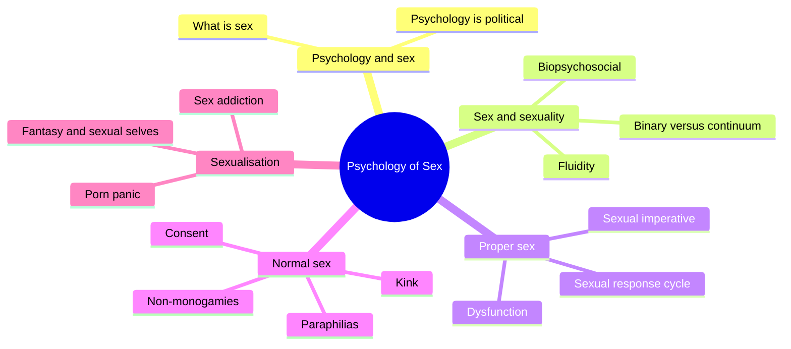
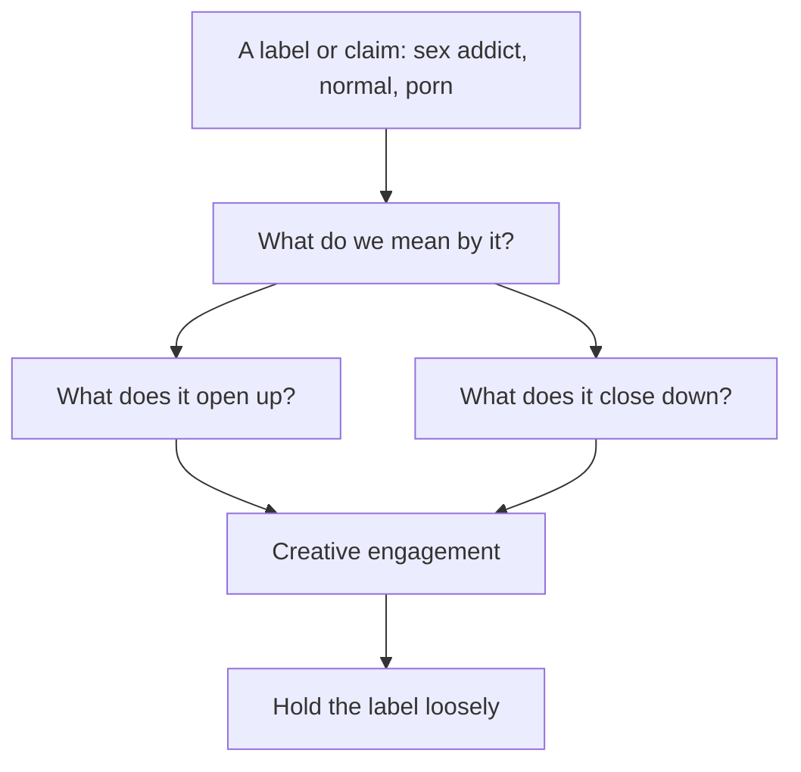
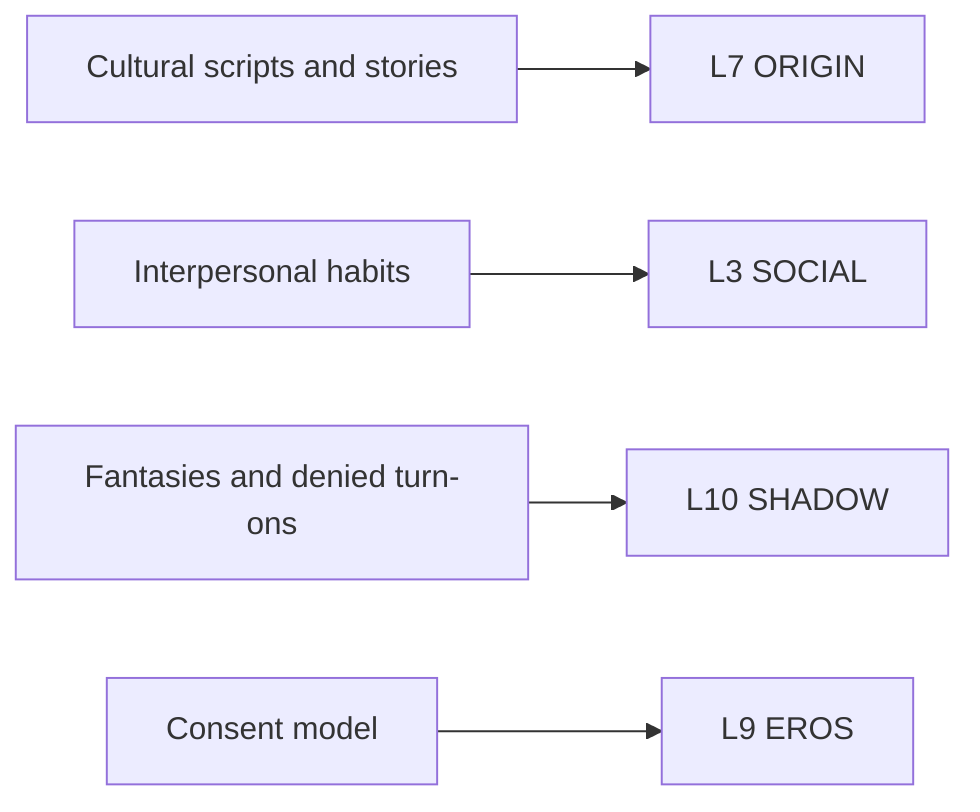

# 🧬 PSY.65 — The Psychology of Sex — Barker (2018)
### Knowledge Entry — Distill

Fantasy, not a how-to: what happens in these pages stays in them. Reader discretion advised.

Meg-John Barker, a psychotherapist and psychology lecturer, wrote this short Routledge guide to how psychology shapes ideas about sex. This shelf keeps it as the critical-psychology voice that questions the labels the other entries use.

## TABLE OF CONTENTS
- [Core Thesis](#1-core-thesis)
- [Mind Models](#2-mind-models)
- [Framework](#3-framework--structure)
- [Key Concepts](#4-key-concepts)
- [Heuristics](#5-heuristics--decision-rules)
- [Invariants](#6-invariants)
- [Pitfalls](#7-pitfalls--myths)
- [Application](#8-application)
- [Cross-References](#9-cross-references)
- [Provenance](#10-provenance--confidence)

---

## 1 · CORE THESIS

Barker argues that psychology both studies sex and builds the norms people measure themselves against. Two questions test any claim: what does it open up, and what does it close down? Learning from the margins, kink and non-monogamy, shows how consent and communication work for everyone.

---

## 2 · MIND MODELS

*Required. Minimum two diagrams, maximum five.*

**Diagram 1 — the whole argument.**
Caption: *five chapters move from what psychology is, through sexuality and sex, to the norm lines and the culture that polices them.*

**Diagram 2 — the central mechanism (the two-question test).**
Caption: *Barker's method is a loop: define the term, ask what it opens and closes, then engage creatively instead of accepting or rejecting it.*

**Diagram 3 — three models of consent.**
Caption: *each model fixes a gap in the one before it, and the third treats consent as ongoing talk, not a single moment.*

**Diagram 4 — mapped onto the 12-layer character stack.**
Caption: *Barker's sexual-self model has three levels, and each level lands on a different layer.*

---

## 3 · FRAMEWORK / STRUCTURE

The book is a five-chapter tour, each chapter built on the same two questions.

| Chapter (PDF pages) | Governing move |
|---|---|
| 1 Psychology and sex (10-22) | Defines psychology narrowly and broadly, shows it is political, and asks what sex is. |
| 2 Sex and sexuality (23-51) | Challenges the gay-straight binary with the Kinsey scale, fluidity, and a biopsychosocial view. |
| 3 'Proper' sex (52-74) | Traces the sex act, the response cycle, dysfunction categories, and the sexual imperative. |
| 4 'Normal' sex (75-102) | Questions the paraphilia list, learns from kink and non-monogamy, and compares models of consent. |
| 5 Sexualisation (103-128) | Reviews sexualisation, porn, sex addiction, fantasy, and the formation of sexual selves. |

---

## 4 · KEY CONCEPTS

| Concept | What it is | Why it matters |
|---|---|---|
| **Open up and close down** | Test any claim by what it makes possible and what it shuts out (ch. 5). | Neither accept nor dismiss a label. Weigh it. |
| **Clinician illusion** | Clinicians see only struggling clients and assume the practice is the cause (PDF p. 84). | Early kink research suffered from it. |
| **Paraphilia critique** | The list mixes consent, commonness, and harm without a clear line, and heterosexual attraction could meet the same test (PDF p. 82). | The list polices a boundary more than it describes disease. |
| **Learning from the margins** | Ask what kinksters, non-monogamous people, and others can teach everyone (PDF p. 83). | The margins show how consent works. |
| **Kink findings** | Studies find no higher distress among kinksters and no link to childhood abuse (PDF p. 84). | Barker reports these as the current research. |
| **Mononormativity** | The unspoken assumption that relationships are monogamous (PDF p. 87). | It hides the common reality of secret non-monogamy. |
| **Non/monogamy** | A continuum, with the slash marking blurred lines (PDF p. 90). | Choice runs across forms, and no single form wins. |
| **Charmed circle** | Rubin's diagram of sex ranked from accepted to outer limits (PDF pp. 92-94). | Sex hierarchies harm those placed low and those placed high. |
| **Benign variation** | All consensual sex is equally valid (PDF p. 96). | It replaces normal/abnormal with consent and ethics. |
| **Sexual imperative** | The pressure to have sex that is both normal and great (ch. 3 and PDF p. 127). | People walk a tightrope between boredom and excess. |
| **Sexual script theory** | Selves form at cultural, interpersonal, and intrapsychic levels (PDF pp. 123-124). | Gives a three-part map of a sexual self. |
| **Sexual stories** | Plummer's idea that identity stories (coming out, survivor) have a recognizable shape (PDF p. 124). | A coming-out scene follows a script the character knows. |

---

## 5 · HEURISTICS & DECISION RULES

| Situation | Do this | Not this |
|---|---|---|
| A character called a "sex addict" | Ask what the label gives him (company, relief) and what it takes (hope, uniqueness). | Treat the label as settled fact or as a lie. |
| A kink scene | Let motives vary: surrender, play, endurance, intimacy, care afterward (PDF p. 86). | Give kink one cause or a trauma. |
| A character's fantasies | Let the content be common and the denial be the problem (PDF p. 122). | Treat unusual fantasy as a symptom. |
| An argument over what counts as cheating | Let two partners find out their definitions differ (PDF p. 91). | Assume they agree. |
| A scene of asking | Show consent as ongoing: a button, a pause, a nod (PDF p. 98). | Treat one "yes" as covering the night. |
| A character who feels he is not sexy enough or not normal enough | Show the sexual imperative pressing from both sides. | Blame him alone. |
| A therapist figure | Let him ask about meaning, not only behavior. | Make him a fixer who names a disorder. |
| A coming-out story | Give it the shape the culture supplies: difference, finding others, naming (PDF p. 124). | Present it as invented from nothing. |

---

## 6 · INVARIANTS

1. **Psychology is political.** Its categories reflect and create social norms (ch. 1).
2. **A sex hierarchy harms both ends.** Those ranked low suffer, and those ranked high live in fear of falling (PDF p. 92).
3. **The same act has many meanings.** Spanking can mean humiliation, sensation, trust, or taboo (PDF pp. 86-87).
4. **Consent needs more than the absence of no.** People rarely say the word no (PDF p. 97).
5. **Hidden turn-ons spill over.** Turning toward them allows aware choice (PDF p. 122).
6. **Sexual selves form at several levels at once.** Culture, relationships, and the inner life all shape them (PDF pp. 122-123).
7. **Labels have costs and gains.** Weigh both before adopting or rejecting one (PDF pp. 116-117).

---

## 7 · PITFALLS / MYTHS

- **Short and popular.** At about 42,000 words, the book gives a flavor and sends readers to endnotes. Claims are compressed from studies the book does not reproduce.
- **UK-led view.** The author writes from British psychology and therapy. Several statistics are US samples.
- **Sampling.** Barker cites survey figures such as 5 percent in consensual non-monogamy (PDF p. 89) and over 50 percent with group-sex fantasies (PDF p. 118). Self-selected surveys can inflate or shrink such numbers.
- **Advocacy position.** Barker argues for pluralism and states that psychology is political. Read the book as a critical stance, not a neutral review.
- **Not a rebuttal of distress.** The sex addiction section accepts that people struggle with compulsive sex (PDF p. 116). It questions the label and the lists, not the pain.
- **Kink data.** The kink findings come from a few studies that Barker summarizes, and he calls for more research. The same applies to the fantasy theories of Morin and Kahr (PDF p. 122).
- **Chapters 2 and 3 skimmed.** This entry read their headings and one section each.

---

## 8 · APPLICATION

*Proposed for the ORANGE work, not ruled.*

- **Spine level:** L5.
- **12-layer character stack:** L9 EROS (consent_posture, primary); L10 SHADOW (shadow_content, primary); L7 ORIGIN (sexual_script_origin, supporting); L4 WILL (label_stance, supporting); L3 SOCIAL (agreement_style, supporting).
- **plot_systems:** a character who asks "what does this open up and close down" can steer any argument over a label.
- **Setting:** a school, clinic, or group that hands out labels gives a scene its stakes.

Barker gives the character system a way to write a label without taking sides. Each character has a stance toward the words used on him. A writer can show one man clinging to a diagnosis as a lifeline and another man refusing the same word as a cage.

The most useful tool is the denied turn-on. Barker says the danger lies in hiding it. A writer can let a character's fantasy be common and its denial be what drives him. The scene turns on what he does with it, not on what it is.

The second tool is the consent model. Three characters can follow three models: one waits for a no, one asks for a yes, one checks all night. The difference shows in a single touch.

The third tool is the sexual story. A coming-out scene has a shape: a feeling of difference, a find of others, a name. A writer can let the character know the shape and push against it.

Proposed addition: an L4 field `label_stance` (held loosely, held as destiny, refused) paired with an L9 field `consent_model` (waits for no, asks for yes, checks continuously). Both give a writer a one-word handle on a scene's politics.

Barker's examples run through kink, non-monogamy, and sex-addiction labels. These pair with [[🧬 MSX.80 — SM 101 — Wiseman (1996)]] and [[🧬 MSX.87 — Understanding Non-Monogamies — Barker & Langdridge, eds. (2010)]] for practice.

The ORANGE prose rulings apply as written. Explicit content is allowed, written as fantasy first, with the one-line container in the front matter.

---

## 9 · CROSS-REFERENCES

| Related entry | Relation |
|---|---|
| [[🧬 PSY.57 — Cruise Control — Weiss (2013)]] | Weiss uses the sex addiction frame that Barker questions. Together they give both sides. |
| [[🧬 MSX.46 — Deviations — Rubin (2011)]] | Barker's charmed circle and benign variation come from Rubin. |
| [[🧬 MSX.80 — SM 101 — Wiseman (1996)]] | Wiseman's practice of negotiation matches Barker's report of kink's gift to consent. |
| [[🧬 MSX.87 — Understanding Non-Monogamies — Barker & Langdridge, eds. (2010)]] | Barker's earlier co-edited volume on the same topic, with chapters on gay, bisexual, and queer BDSM practice. |
| [[🧬 MSX.47 — The Ethical Slut — Easton & Hardy (2017)]] | The practical guide to the relationship styles Barker surveys. |
| [[🧬 MSX.36 — The History of Sexuality — Foucault (1978)]] | The source of the claim that categories of sex are made by the sciences that describe them. |

---

## 10 · PROVENANCE & CONFIDENCE

Full text, pdftotext extraction, about 42,000 words, 155 PDF pages. Title page confirms: Meg-John Barker, *The Psychology of Sex*, Routledge, 2018, in the Psychology of Everything series. The extract carries no printed page numbers, so citations use PDF page numbers.

Read in full: Chapter 4 on normal sex, paraphilias, kink, non-monogamy, the charmed circle, and consent (PDF pp. 75-102 in part, 82-100 in full), and Chapter 5's sex addiction, fantasy, and sexual-selves sections (PDF pp. 113-127). Read in part: Chapter 1's opening (PDF pp. 10-11), and the heading structure of every chapter.

Skipped: Chapter 2's body (Kinsey scale, fluidity, sexual configurations, biopsychosocial detail), Chapter 3's body (response cycle, dysfunctions, sex therapy), Chapter 5's porn and sexualisation sections beyond their closing paragraphs, the further resources, and the notes.

Confidence is medium. The arguments are quoted from the text. The underlying studies sit in endnotes this entry did not check.

## META
- Template: BVX-LEARN-v4.0
- Source classification: full-text pdftotext extraction, deep read on chapter 4 and chapter 5's second half, headings elsewhere
- Created / Updated: 2026-10-04
