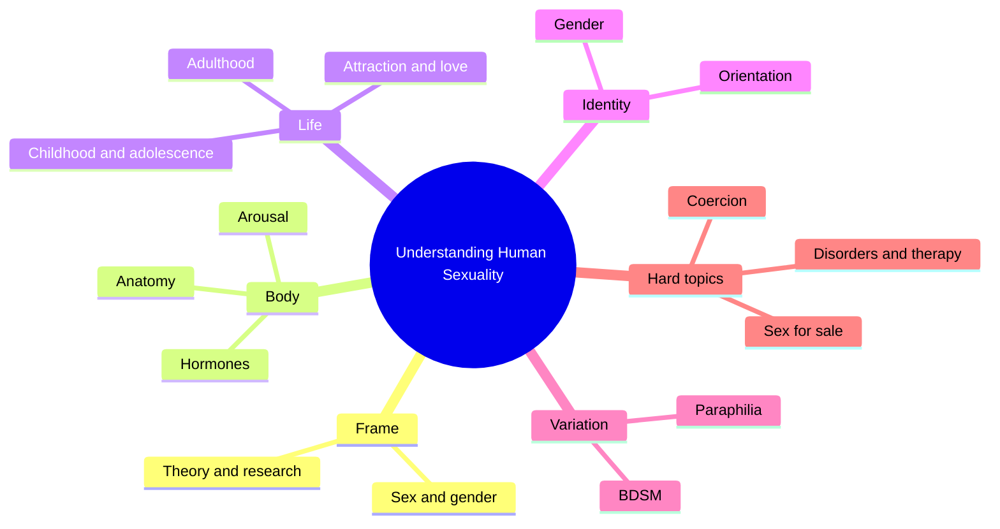
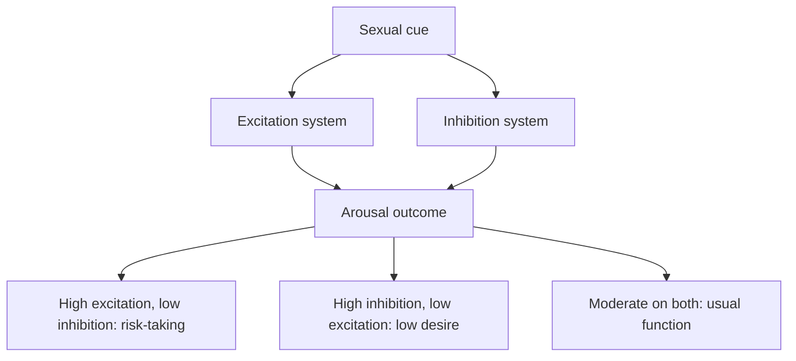
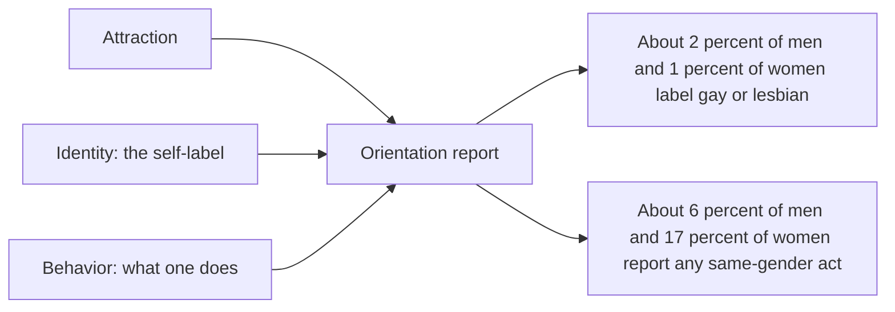

# 🧬 PSY.66 — Understanding Human Sexuality — Hyde, DeLamater et al. (2022)
### Knowledge Entry — Distill

Fantasy, not a how-to: what happens in these pages stays in them. Reader discretion advised.

This is the eighth Canadian edition of a long-running undergraduate textbook on sexuality. It gives the library a plain, current baseline on orientation, arousal, variation, and the social side of sex.

## TABLE OF CONTENTS
- [Core Thesis](#1-core-thesis)
- [Mind Models](#2-mind-models)
- [Framework](#3-framework--structure)
- [Key Concepts](#4-key-concepts)
- [Heuristics](#5-heuristics--decision-rules)
- [Invariants](#6-invariants)
- [Pitfalls](#7-pitfalls--myths)
- [Application](#8-application)
- [Cross-References](#9-cross-references)
- [Provenance](#10-provenance--confidence)

---

## 1 · CORE THESIS

Human sexuality has biological, psychological, and social causes. The book treats attraction, identity, and behavior as separate things. It sets definitions and evidence in plain terms and flags where research is thin, so a reader can sort fact from belief.

---

## 2 · MIND MODELS

**Diagram 1 — the whole argument.**
Caption: *the textbook builds sexuality from body, mind, and society, then moves to identity, variation, and trouble.*

**Diagram 2 — the central mechanism (the dual control model).**
Caption: *arousal depends on two systems, a gas pedal and a brake, and each person has a setting for both.*

**Diagram 3 — orientation as three separate measures.**
Caption: *attraction, identity, and behavior can disagree, so the answer to "how many" changes with the question.*

---

## 3 · FRAMEWORK / STRUCTURE

Eighteen chapters. The sampled ones sit in four zones.

| Zone | Governing move |
|---|---|
| Frame (Ch. 1-3) | Sexuality in context, theory (including queer theory and sexual scripts), and research methods. |
| Body and arousal (Ch. 4-9) | Anatomy, hormones, pregnancy, contraception, infections, and the arousal and dual control model. |
| Life and relationships (Ch. 10-13) | Childhood to adulthood, attraction and love, gender and sexuality. |
| Identity and variation (Ch. 14-15) | Sexual orientation and identity, then variations including paraphilia and BDSM. |
| Hard topics (Ch. 16-18) | Coercion, sex for sale, and sexual disorders and therapy. |

---

## 4 · KEY CONCEPTS

| Concept | What it is | Why it matters |
|---|---|---|
| **Sexual orientation** | Whom a person is emotionally, romantically, and sexually attracted to (Ch. 14, p. 396). | It is the base term for the CORE layer. |
| **Sexual identity** | A person's self-label, such as gay, bisexual, or queer (p. 396). | A label can differ from attraction. |
| **Kinsey scale** | A 0 to 6 scale from exclusively heterosexual to exclusively homosexual experience (p. 399). | It replaced a binary with a continuum, though it measures behavior only. |
| **Queer theory** | A view that questions fixed categories and challenges heteronormativity (Ch. 2, p. 36). | It gives a character a way to reject a label. |
| **Sexual script** | A learned plan for who, what, when, where, and why (Ch. 2, p. 37). | It guides scenes and shows why some feel awkward. |
| **Dual control model** | Excitation and inhibition as two arousal systems (Ch. 9, p. 239). | It lets a character's desire have a profile. |
| **Minority stress** | Stigma and discrimination cause mental-health strain (Ch. 14, p. 414). | It locates distress in the environment. |
| **Paraphilia** | An atypical sexual interest, a disorder only if it brings distress, impairment, or harm (Ch. 15, p. 427). | It separates taste from illness. |

---

## 5 · HEURISTICS & DECISION RULES

| Situation | Do this | Not this |
|---|---|---|
| Naming a character's orientation | Specify attraction, identity, and behavior separately. | Use one word for all three. |
| Writing a questioning character | Allow split attraction, such as emotional pull toward one gender and sexual pull toward another. | Force a clean label by the end of the chapter. |
| Writing desire in a scene | Give the character an excitation trigger and an inhibition trigger. | Make arousal automatic. |
| Writing a first encounter | Show both people following a script and both noticing where it breaks. | Have both improvise perfectly. |
| Writing distress in a gay character | Trace it to a stressor: rejection, bullying, or hiding. | Treat it as caused by orientation. |
| Writing a kink character | Make consent and well-being the test, not the taste. | Treat the taste as a symptom. |

---

## 6 · INVARIANTS

1. Orientation, identity, and behavior are three measures.
2. Orientation sits on a spectrum, not in two boxes.
3. Arousal has an excitation side and an inhibition side.
4. Social stress, not orientation, explains higher distress in sexual minorities, in this account.
5. Conversion therapy does not change orientation (Ch. 14, p. 415).
6. A paraphilia is a disorder only when it brings distress, impairment, or harm.

---

## 7 · PITFALLS / MYTHS

- The book is a Canadian edition. Its laws, polls, and examples are Canadian first.
- A textbook compresses. It summarises studies and does not weigh them in depth.
- Some data are old. The twin studies date from 1991 and 1993, and the authors note that they show genes are not the whole cause (Ch. 14, pp. 416-417).
- Survey rates vary with definition, and the book says "it depends on how you count" (p. 399).
- The book states that porn exposure links to harmful attitudes and behavior (Ch. 17, p. 511). Burke (MSX.84) calls the research inconclusive and contested.
- The text is long and its tone is neutral, so its framing of sex as a health topic is a choice, not the only frame.

---

## 8 · APPLICATION

*Everything here is proposed, never ruled.*

- **Spine level:** L5, as set by the batch brief.
- **12-layer character stack:** L1 CORE (orientation_components), L9 EROS (excitation_inhibition_balance, attraction_fluidity, kink_identity), L3 SOCIAL (sexual_script, client_script), L5 WOUND (minority_stress), L10 SHADOW (internalized_homonegativity).
- **plot_systems:** an arousal-profile engine: a scene names the excitation trigger and the inhibition trigger, and the beat turns on which one wins.
- **Setting:** none direct.

The most usable piece is the dual control profile. A character gets two numbers for his EROS layer, how easily he is switched on and how easily he is switched off. The second is the three-part orientation split, which supports characters whose labels do not match their lives. Fantasy comes first in the prose, and explicit scenes are allowed under the standing 06.1 ruling. The disclaimer line carries the container.

---

## 9 · CROSS-REFERENCES

| Related entry | Relation |
|---|---|
| [[🧬 PSY.64 — The Evolution of Desire — Buss (2016)]] | Buss reads the same orientation data through evolution. This book reads it through definition and measurement. |
| [[🧬 PSY.58 — Human Sexuality and Its Problems — Bancroft (2009)]] | Bancroft co-created the dual control model that this book summarises. |
| [[🧬 PSY.50 — Sexual Behavior in the Human Male — Kinsey (1948)]] | The source of the 0 to 6 scale. |
| [[🧬 MSX.36 — The History of Sexuality — Foucault (1978)]] | Foucault's categories-as-inventions match this book's queer-theory section. |
| [[🧬 MSX.84 — The Pornography Wars — Burke (2023)]] | Burke reports the contested side of the porn-effects research this book summarises. |

---

## 10 · PROVENANCE & CONFIDENCE

Full-text pdftotext extraction, 1,714 pdf pages with printed page markers. The front matter confirms the eighth Canadian edition, McGraw Hill Canada, 2022, adapted from the 14th US edition (copyright 2020). Authors are Janet Shibley Hyde, John D. DeLamater, E. Sandra Byers, and Lucia F. O'Sullivan. Page cites are printed pages.

Read: Ch. 2 on queer theory and sexual scripts (pp. 36-38), Ch. 9 on the excitation-inhibition model (pp. 239-240), most of Ch. 14 (pp. 395-402, 408-409, 414-417, 423), Ch. 15 on paraphilia and BDSM (pp. 426-427, 434-435), and Ch. 17 on commercial sex work and the closing pages on pornography (pp. 483-485, 510-511).

Skipped: Ch. 1, Ch. 3 to 8, the rest of Ch. 9 to 13, the rest of Ch. 14, 15, and 17, all of Ch. 16 and 18, and the glossary, references, and index. The orientation chapter is the deepest read. Confidence is medium because the book is a very large textbook, sampled by topic. The `feeds:` keying is this distill's own synthesis, and the book uses none of the 12-layer vocabulary.

## META
- Template: BVX-LEARN-v4.0
- Source classification: full-text extraction, targeted read of Ch. 2, 9, 14, 15, 17
- Created / Updated: 2026-10-04
