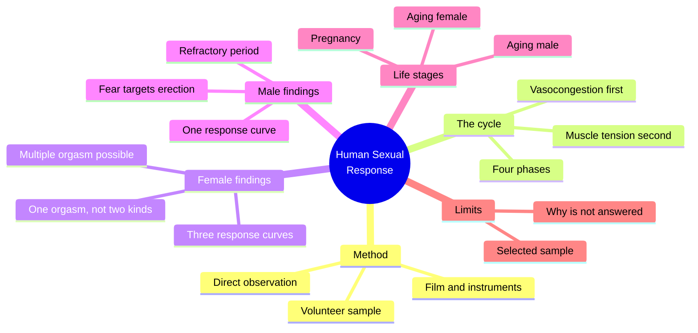
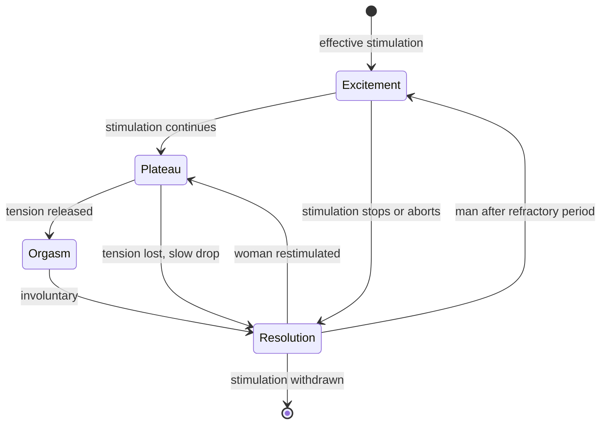
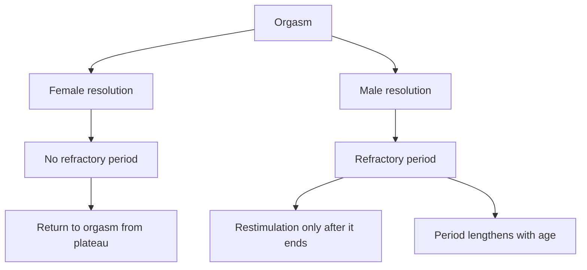
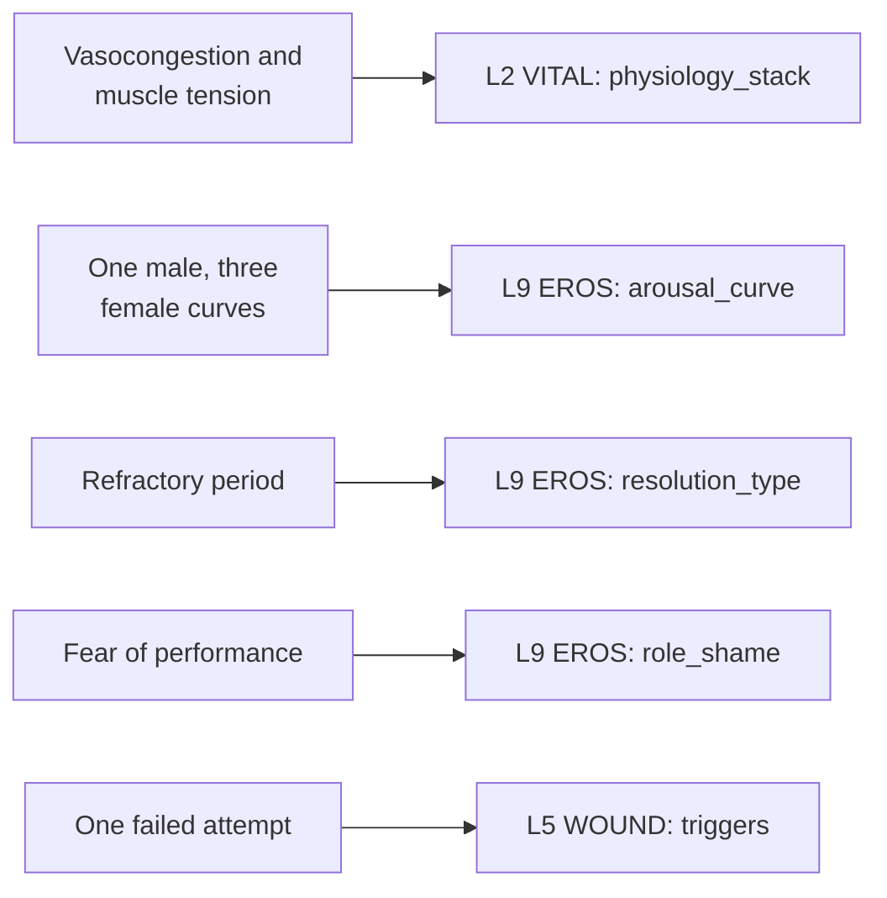

# 🧬 PSY.67 — Human Sexual Response — Masters & Johnson (1966)
### Knowledge Entry — Distill

William Masters and Virginia Johnson published the first laboratory record of how bodies respond to sex. The Command holds it as the baseline for what the body does, with its sample limits stated plainly.

## TABLE OF CONTENTS
- [Core Thesis](#1-core-thesis)
- [Mind Models](#2-mind-models)
- [Framework](#3-framework--structure)
- [Key Concepts](#4-key-concepts)
- [Heuristics](#5-heuristics--decision-rules)
- [Invariants](#6-invariants)
- [Pitfalls](#7-pitfalls--myths)
- [Application](#8-application)
- [Cross-References](#9-cross-references)
- [Provenance](#10-provenance--confidence)

---

## 1 · CORE THESIS

Masters and Johnson observed and measured roughly ten thousand sexual response cycles. They found two body-wide reactions, blood congestion and muscle tension, running through four phases in both sexes. Men and women respond more alike than culture says, and fear of performance, not anatomy, is what most often breaks response.

---

## 2 · MIND MODELS

*Required. Minimum two diagrams, maximum five.*

**Diagram 1 — the whole argument.**
Caption: *the book answers "what happens" with measurement and refuses "why"; read the left branches as the finding and the right branches as the limit.*

**Diagram 2 — the central mechanism (the four-phase cycle).**
Caption: *every phase after the first needs continued effective stimulation; remove it and the body drops back, which is why the book blames stimulation and fear, not anatomy, for stalled response.*

**Diagram 3 — the two sexes after orgasm.**
Caption: *the book's sharpest sex difference is not the peak but the aftermath; the woman can return to plateau, the man waits out a refractory period.*

**Diagram 4 — mapped onto the Command's 12-layer character stack.**
Caption: *the physical findings land on VITAL and EROS; the fear findings land on EROS, WOUND and SHADOW, which is where the book is most useful to a writer.*

---

## 3 · FRAMEWORK / STRUCTURE

The book has 19 chapters in five movements. The authors state their two guiding questions on pp. 3-4: what physical reactions develop, and why do people behave as they do. They answer the first and decline the second (p. 8).

| Movement | Chapters (pages) | What it does |
|---|---|---|
| Research in sexual response | 1-2 (pp. 3-16) | Defines the four phases and describes the volunteer sample |
| Female response | 3-10 (to p. 170) | Breasts, sex flush, clitoris, vagina, uterus, orgasm, pregnancy |
| Male response | 11-14 (pp. 171-220) | Extragenital reactions, penis, scrotum and testes, orgasm |
| Geriatric response | 15-16 (pp. 221-268) | What changes with age, and what fear adds |
| Generalities | 17-19 (pp. 269-310) | Male and female responses side by side; myotonia; four case histories |

Each organ chapter splits in two. Part 1 gives anatomy and physiology. Part 2 gives clinical consequences.

---

## 4 · KEY CONCEPTS

| Concept | What it is | Why it matters |
|---|---|---|
| **Four-phase cycle** | Excitement, plateau, orgasm, resolution (p. 4). The authors call the division "arbitrary" but useful | Gives a writer a shared vocabulary and a sequence of body events |
| **Vasocongestion** | Blood pooling in tissue. It is the "primary reaction" to stimulation (p. 7) | Explains erection, labial colour, breast size, sex flush and why unresolved arousal can ache (p. 118) |
| **Myotonia** | Muscle tension, the "secondary response" (p. 7). Voluntary early, involuntary late | Explains spasm, grimace, gripping and the clenching people use to push toward orgasm (pp. 272, 128) |
| **Sex flush** | A rash-like colour spreading from the epigastrium to chest, neck and face (p. 271) | A visible, hard-to-fake plateau sign |
| **Orgasmic platform** | Swelling of the outer third of the vagina that contracts at 0.8-second intervals in orgasm (p. 128) | The book's measurable test of female orgasm; contraction count tracks intensity (p. 136) |
| **Ejaculatory inevitability** | A 2 to 3 second span when the man feels it coming and cannot stop it (p. 214) | The male counterpart of a woman's 2 to 4 second onset awareness (p. 132) |
| **Refractory period** | A male-only stretch after ejaculation when restimulation fails (p. 279) | Sets the male pacing limit; it grows longer with age (ch. 16) |
| **Three stages of female orgasm (subjective)** | Suspension, then suffused warmth, then pelvic throbbing (pp. 134-135), from 487 women | A sensory script a writer can use scene by scene |
| **One orgasm, not two** | Clitoral and vaginal orgasm are "not separate biologic entities" (p. 67) | Ends the old two-kinds claim on physiological grounds |
| **Performance fear** | Fear of failing at the act changes arousal itself (p. 299) | The mechanism behind most of the book's clinical cases |

---

## 5 · HEURISTICS & DECISION RULES

| Situation | Do this | Not this |
|---|---|---|
| Writing a woman's response | Let her tell the partner what works. The book says the man is "infinitely more effective if he encourages vocalization on her part" (p. 65) | Give every woman the same touch, speed or finish |
| Writing a clitoral scene | Keep it indirect once the clitoris retracts at plateau; the book says direct contact leaves "a narrow margin between stimulation and irritation" (p. 65) | Follow a manual's rule of constant direct contact |
| Pacing a man after orgasm | Add a pause that lengthens with age (p. 279) | Let every man restart at once |
| Pacing a woman after orgasm | Allow a quick return if stimulation resumes at plateau level (p. 6) | Impose a rest she does not need |
| Writing a failure | Name what the character fears failing at: erection, orgasm, or being believed (pp. 216, 137) | Blame the body alone |
| Checking a faked climax | Use the tells the book names: areolar detumescence and platform contractions (p. 133) | Treat sound alone as proof |
| Writing an older couple | Keep desire and ability into the 80s with regular practice (p. 266) | Write age as the end of sex |

---

## 6 · INVARIANTS

1. Effective stimulation and a willing mind keep the cycle moving; removing either lets the body drop back (pp. 5-6).
2. Every response runs on vasocongestion first, myotonia second (p. 7).
3. The basic orgasm physiology stays the same across modes of stimulation (p. 132).
4. Intensity and duration vary within one person from one occasion to the next (p. 66).
5. A woman's response is shaped by psychosocial context, not only by the body (p. 127).
6. The aging body slows; it does not close (p. 266).
7. The authors report what the body does and decline to explain why (p. 8).

---

## 7 · PITFALLS / MYTHS

- **The four phases are dated.** Later clinicians added a desire phase (Kaplan, 1974) and a circular model for many women (Basson, 2000). Use the four phases for body events, not for a character's motive.
- **The sample is selected.** Volunteers came mostly from a university hospital community, weighted to higher education (pp. 11-15). Eleven Black family units appear, and the book says "Negro" (p. 15). The authors excluded "sociosexual aberrancy" (p. 12).
- **The origin sample is narrower still.** The first subjects were 118 female and 27 male prostitutes. Their data was left out of the published results (pp. 10-11).
- **The authors concede the limit.** They say no norms exist: "there are no established norms for male and female sexuality in our society" (p. 300).
- **Lab response may differ from home response.** The authors worried about the artificial setting and report it did not alter response in their couples (pp. 9, 305).
- **Two orgasm types were never a thing here.** The vagina and clitoris react in consistent patterns whatever the stimulus (p. 67). That finding is physiological, not a ruling on what women feel.
- **Impression, not statistics.** The book says it gives "general impression rather than statistical data" on orgasm (p. 128).

---

## 8 · APPLICATION

*Proposed for the ORANGE work and the 12-layer stack. Nothing here is ruled.*

- **Spine level:** L5, as assigned.
- **12-layer character stack:** L9 EROS (arousal_curve primary; resolution_type and role_shame supporting) · L2 VITAL (physiology_stack primary) · L5 WOUND (triggers supporting) · L3 SOCIAL (knowledge_map contextual) · L8 IMPRINT (sexual_script_acquisition contextual) · L10 SHADOW (shadow_content contextual).
- **plot_systems:** contextual. A failed attempt, a faked climax and an excused withdrawal each give a scene a hidden fact that two people hold differently.
- **Setting:** none.

Two rows of the existing stack gain from this book without a new name. First, `arousal_curve` can store the female curve as one of three shapes (Fig. 1-2, p. 4) and the male curve as one shape with a refractory length. Second, `role_shame` can name its target, with proposed values erection, orgasm or pretense, taken from pp. 216 and 137.

The strongest proposed addition is a `target` sub-setting on `role_shame`. The book's one behavioral finding is that men and women fear different failures. That difference decides which scene breaks a character.

A writer can also use the case-history format on pp. 301-309 as a short template for a character's early sexual history. Each history lists family speech about sex, first masturbation, first coitus, partners and marriage.

---

## 9 · CROSS-REFERENCES

| Related entry | Relation |
|---|---|
| [[🧬 PSY.50 — Sexual Behavior in the Human Male — Kinsey (1948)]] | The baseline the authors credit: Kinsey counted what people did, Masters and Johnson measured how the body did it (p. 3) |
| [[🧬 PSY.52 — Homosexuality in Perspective — Masters & Johnson (1979)]] | The authors' later study of gay and lesbian response; this 1966 book excludes it by design |
| [[🧬 PSY.58 — Human Sexuality and Its Problems — Bancroft (2009)]] | Bancroft's excitation and inhibition model explains why the same stimulus yields different curves; it supplies the "why" this book declines |
| [[🧬 MSX.36 — The History of Sexuality — Foucault (1978)]] | Foucault reads "the physiology of sex" as one more discourse that produces what it measures |
| [[BVX.1274]] | Kimmel's *Manhood in America* shows where the male performance demand came from |

---

## 10 · PROVENANCE & CONFIDENCE

The text is OCR of the Bantam paperback (June 1980), a reset of the 1966 Little, Brown edition, with "not one word omitted." The OCR has scanning errors; every quote was checked against nearby text and cleaned of obvious misreads. The title page and copyright page confirm the authors, the 1966 date and Reproductive Biology Research Foundation, St. Louis.

Read: chapter 1 (the cycle) and chapter 2 (the sample) in full; chapter 5 part 2 (clitoris, the vaginal-clitoral question); chapter 8 (uterus) in large part; chapter 9 (female orgasm) from the physiology through the sociology; chapter 14 (male orgasm) in full; the aging chapters' opening and closing sections; chapter 17 (similarities) and the Table 17-1 extract; chapter 19 (sexuality of study subjects) in large part.

Skipped: chapters 3, 4, 6 and 7 (breasts, external genitalia, vagina anatomy, artificial vagina); chapter 10 (pregnancy); chapters 11 to 13 (male extragenital, penis, scrotum) beyond pull quotes; chapter 18 (myotonia); the references and glossary. The OCR also scrambles some page headers, so a few page numbers are inferred from neighbouring running heads.

The `feeds:` keying is this distill's own synthesis. The book uses none of the stack's vocabulary. The `arousal_curve` variable is the stack's existing name; the schema pass table holds `sexual_response_physiology` as an alias of `physiology_stack`, so no new name is coined. Confidence is medium: the physiology is first-hand and detailed, and the behavioral sample is selected, small and dated.

## META
- Template: BVX-LEARN-v4.0
- Source classification: full-text OCR extraction, deep read on chapters 1, 2, 9, 14, 17, 19 and selected sections elsewhere
- Created / Updated: 2026-10-04
