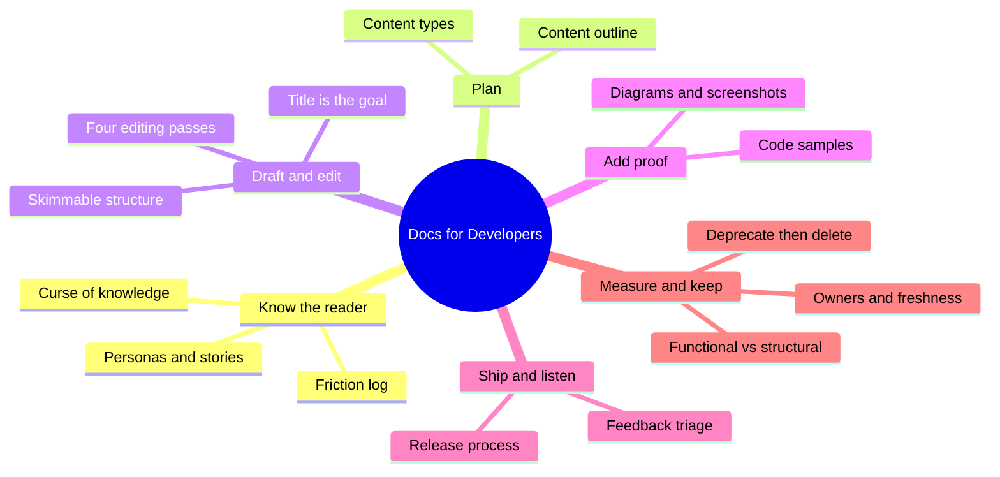
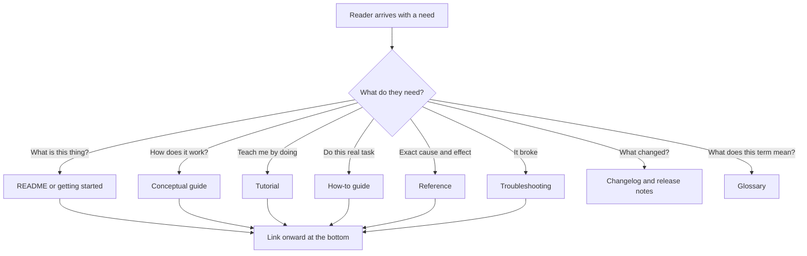
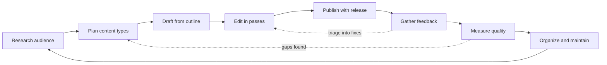
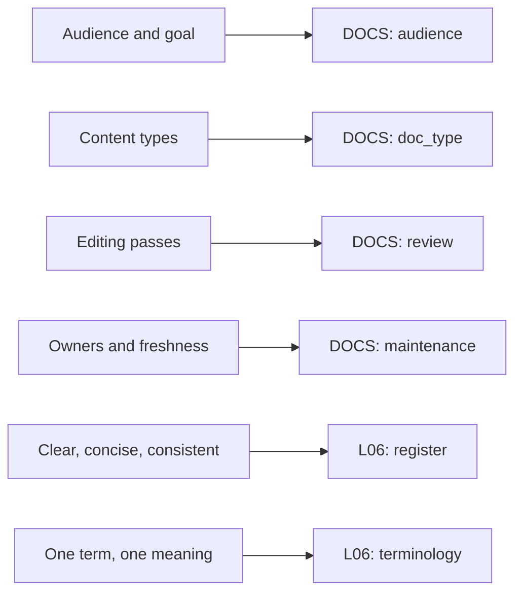

# 🧬 TEC.01 — Docs for Developers — Bhatti et al. (2021)
### Knowledge Entry — Distill

A field guide that treats documentation as a repeatable engineering loop (research, plan, draft, edit, publish, measure, maintain) and names the page types that loop should produce. It is the spine book for the Command's documentation SOP.

## TABLE OF CONTENTS
- [Core Thesis](#1-core-thesis)
- [Mind Models](#2-mind-models)
- [Framework](#3-framework--structure)
- [Key Concepts](#4-key-concepts)
- [Heuristics](#5-heuristics--decision-rules)
- [Invariants](#6-invariants)
- [Pitfalls](#7-pitfalls--myths)
- [Application](#8-application)
- [For the Documentation SOP (BOLO 95)](#for-the-documentation-sop-bolo-95)
- [Cross-References](#9-cross-references)
- [Provenance](#10-provenance--confidence)

---

## 1 · CORE THESIS

A document is good when it fulfills its purpose. Good docs come from a loop, not from talent: learn the reader, pick a page type, write one goal per page, edit in passes, ship with the code, measure, and keep the pages fresh or delete them.

---

## 2 · MIND MODELS

**Diagram 1 — the whole argument.**
Caption: read the book as one loop of eight moves, with the reader at the centre of every move.

**Diagram 2 — the central mechanism (the doc-type menu: pick the type from the reader's need).**
Caption: every reader question maps to one page type, and a page that answers two questions is two pages.

**Diagram 3 — the writer loop (the process the whole book walks).**
Caption: two feedback arrows matter most, because feedback and metrics send you back to research and planning, not just to editing.

**Diagram 4 — mapped onto the Command's systems.**
Caption: the book's loop supplies the SOP's spine, and its quality split supplies the style guide's priority order.

---

## 3 · FRAMEWORK / STRUCTURE

Eleven chapters in the order a doc is made, plus two appendices. The authors say to read in order on a first pass (Intro, p. xxv). A fictional team, Corg.ly, carries each chapter as a story.

| Ch. | Pages | Move | Governing question |
|---|---|---|---|
| 1. Understanding your audience | 1-21 | Research | Who reads this, what do they want to do, what is in the way? |
| 2. Planning your documentation | 23-44 | Plan | Which page types serve those needs? |
| 3. Drafting | 45-66 | Draft | How do I get from a blank page to a skimmable first draft? |
| 4. Editing | 67-81 | Edit | Does it help the reader, checked one aspect at a time? |
| 5. Integrating code samples | 83-99 | Prove | Does the sample work and teach? |
| 6. Adding visual content | 101-120 | Show | Does the picture beat the words? |
| 7. Publishing | 121-131 | Ship | Who approves, where does it live, how do people learn it exists? |
| 8. Gathering and integrating feedback | 133-146 | Listen | How do readers talk back, and what do we fix first? |
| 9. Measuring quality | 147-167 | Measure | Is it good, and how would we know? |
| 10. Organizing | 169-185 | Structure the set | Can readers find and navigate the whole? |
| 11. Maintaining and deprecating | 187-200 | Keep or remove | How do docs stay true to the code? |
| App. A / B | 201-213 | Extend | When to hire an expert; templates, style guides, tools |

The throughline: treat docs like code. Same tools, same review, same release, same triage, same automation, and the same toil warning (p. 193).

---

## 4 · KEY CONCEPTS

| Concept | What it is | Why it matters |
|---|---|---|
| **Curse of knowledge** (p. 3) | People assume others know what they know. In the tapping experiment, tappers predicted 51% song recognition; listeners managed 2.5%. | The writer is always the worst judge of the draft. Research and outside readers are the fix. |
| **Goal pair** (p. 5) | One engineering goal for the reader and one business goal for you, written down. | The goal becomes the title and the measurement target later. |
| **Need vs want** (p. 8) | The traveler wants a sports car and needs a bus ticket. | Interviews must dig past wants. |
| **Persona, user story, journey map** (pp. 15-17) | Three ways to condense research. Story format: "As a [user], I want [activity] so that I can [goal]." | Keeps the reader present during writing. |
| **Friction log** (p. 19) | A numbered journal of trying the product as a newcomer, expectation against reality. | Splits fixes into "docs" and "product bug". |
| **Content types** (p. 25) | Patterns for code comments, README, getting started, conceptual, procedural, reference, glossary, troubleshooting, change docs. | One page, one type. Users learn where things live. |
| **Documentation plan** (p. 41) | Seven answered questions plus a content outline: title, type, brief description per page. | Catches gaps before writing. |
| **Skimming** (p. 57) | Readers read at most about 28% of the words and scan in an F pattern. | Put the answer to "Will this help me?" in the first three paragraphs. |
| **Editing passes** (p. 69) | Technical accuracy, completeness, structure, clarity and brevity, in that order. | One aspect per pass is faster than all at once. |
| **Plussing** (p. 79) | Criticize an idea only if you add a constructive suggestion. | Makes review safe and specific. |
| **Code sample principles** (p. 87) | Explained, concise, clear, usable and extensible, trustworthy. | A broken sample costs trust in the product. |
| **Visual content tests** (p. 104) | Comprehension, accessibility, performance. | Each image must earn its place. |
| **Functional vs structural quality** (p. 149) | Does the doc reach its goal, versus is it well written. | Functional wins: good goal, okay prose beats polished prose with no result. |
| **Information architecture** (p. 170) | Sequences, hierarchies, webs, plus landing pages and navigation cues. | New pages have an obvious home. |
| **Toil** (p. 193) | Manual, repetitive, automatable, tactical work with no lasting value. | Automate only what you understand. |
| **Deprecation** (p. 197) | Mark, warn, link to the replacement, then delete. | Readers are never stranded. |

---

## 5 · HEURISTICS & DECISION RULES

| Situation | Do this | Not this |
|---|---|---|
| Starting any doc | Write audience, purpose, pattern at the top (p. 48) | Start typing prose |
| Naming a page | Shortest, clearest statement of the reader's goal; verb-first for tasks (p. 48) | A clever or feature-named title |
| A doc has several goals | Split it into several docs (p. 49) | One long page for every reader |
| Writing a procedure | Numbered steps, one action each, a goal sentence first, a check at the end (p. 54) | A paragraph of instructions |
| Procedure past about ten steps | Look for a simpler service or a split (p. 32) | Publish a marathon tutorial |
| Explaining "why" inside a how-to | Move it to a conceptual guide (p. 32) | Bury the steps in explanation |
| Stuck on the first draft | Write what you know, mark `[TODO]`, write out of order, change the medium (pp. 61-63) | Polish sentence one for an hour |
| Reviewing | Ask for one kind of feedback in one place (p. 77) | "Thoughts?" |
| Two reviewers disagree | Ask what the reader needs to know (p. 79) | Pick the louder reviewer |
| Links in a how-to | Put them at the bottom (p. 35) | Wikipedia-style links mid-step |
| Code sample needs the reader's data | Descriptive placeholders such as `replace_with_actual_bark` (p. 93) | `foo`, `bar`, gibberish |
| Showing a UI | Screenshot near the text, clean, plus a text description (p. 106) | Screenshot as the only copy of a code sample or address |
| Diagram feels dense | One idea per diagram; split into layers (p. 113) | One diagram with every arrow |
| Deciding to automate | Learn the manual process first, then automate (p. 130) | Script it on day one |
| Feature is going away | Callout, replacement link, migration guide before the announcement (p. 198) | Quietly hide the page |
| Page has few views and many bug reports | Consider deleting it and pointing to a shorter page (p. 199) | Keep repairing it |

---

## 6 · INVARIANTS

1. **A document is good when it fulfills its purpose.** (p. 149)
2. **One page, one goal.** The title states the goal. (p. 49)
3. **Readers skim.** Answer "Will this help me?" first. (p. 58)
4. **Docs ship with the code they describe.** (p. 126)
5. **Every document has an owner.** Shared duty means no duty. (p. 192)
6. **Test the procedure.** Following the steps must give the promised result. (p. 70, p. 127)
7. **Same term, same meaning** across the whole set. (p. 157)
8. **Function outranks form.** (p. 158)
9. **Stale docs are worse than none.** They cost trust in the product. (p. 188)
10. **Review docs like code**, with the same tools when possible. (p. 76)

---

## 7 · PITFALLS / MYTHS

- "The code is self-documenting." Good naming helps, but complex systems still need human-readable docs (pp. xxiv, 26).
- "Wait, it will all change anyway." The Corg.ly story is this exact mistake (pp. 2-3).
- Only writing advanced how-tos. New and evaluating users get lost without getting started pages (p. 29).
- Answering with an FAQ. FAQs decay into long uncurated lists. List issues and fixes instead (p. 39).
- Trusting the metric you can count. Word count and time on page are easy; task success is what matters (p. 158).
- Believing in learning styles. The book flags "visual learners" as debunked. Good visuals help nearly everyone (p. 105).
- Video as a cure-all. It is costly to make and to update (p. 118).
- Tool-first thinking. The authors stay tool-agnostic on purpose (p. xxv).
- Automating content reuse everywhere. It can hurt search and confuse readers. One canonical home plus links is safer (p. 183).
- Perfectionism before publishing. Almost no document is perfect at release (p. 122).

---

## 8 · APPLICATION

- **Spine level:** CRAFT-PROCESS. This is a process book about how to make and keep documents, not a story-structure source.
- **12-layer character stack:** not applicable. `feeds:` wires only to the documentation SOP (`DOCS`) and the style guide system (`L06`).
- **plot_systems:** not applicable.
- **Setting:** not applicable.

Chief wants documentation that stays true. This book gives the Command three things it can adopt without change. First, the doc-type menu (Diagram 2) tells a writer which page to make before writing. Second, the four editing passes and the plussing rule tell reviewers what to check and how to say it. Third, the maintenance chapter turns "keep docs fresh" into owners, dates, link checks, and a delete path. The functional-before-structural rule matches the plain register: a plain page that gets Chief to the result beats a beautiful page that does not.

---

## FOR THE DOCUMENTATION SOP (BOLO 95)

Page numbers are the printed book pages.

- **tutorial**: A procedure that teaches. It gives learners an environment, may supply test data, and lets them test an integration without real code (p. 32). Keep it to ten steps or fewer; longer means the use case is too big or the service is too complex (p. 32). Distinguished from a how-to: the tutorial is for learning, the how-to is for action with real code (p. 33). Getting started is a close cousin: quickest explanation, simplest install and use steps, "cool things they can do" (p. 29).
- **how-to**: Template is an intro paragraph, Prerequisites, Steps, Next steps (pp. 33-34). Keep the user on one page; put links at the bottom (pp. 34-35). Prerequisites double as an escape hatch (p. 34). Be selective, since how-tos are costly to maintain and edge cases can lead readers astray (p. 34). One action per step and a check at the end (p. 55).
- **reference**: Cause and effect: which action gives which result (p. 35). For APIs: every resource, endpoint, method, and parameter, with an example request and matching example response, plus status codes and error messages (pp. 35-36). Annotate code and autogenerate from source when you can (p. 36, p. 196). "Complete" for a reference means every command is present (p. 155). It is the source of truth once readers start building (p. 36).
- **concept/explanation**: Explains how the service works without implementation details (p. 30). Template: first paragraph, Overview, Related concepts, Additional resources (p. 30). One core concept per document (p. 31). Test it by asking a reader to read it and explain it back (p. 31). Put history and design theory in their own doc, not in a procedure (p. 60).
- **FAQ**: Discouraged. Prefer listing user issues with fixes, and if an FAQ is unavoidable keep it short and focused (p. 39).
- **README**: One text file, often Markdown, at the top of a repo or important subfolder (p. 27). Contents: what the code does, install, troubleshooting, maintainer, license, changelog, examples, links onward (p. 27). Template in Listing 2-1 (p. 28). Keep it "concise, informative, accurate, and up to date" and treat it as seed material for fuller docs (p. 28). Appendix B points to a README checklist (p. 206).
- **architecture/design doc**: Not a page type in its own right here. Design docs, meeting notes, and whiteboard diagrams are source material for conceptual docs (p. 30). The C4 model is the recommended way to draw architecture at levels of abstraction (p. 118). Overview diagrams belong in conceptual docs and low-level data-flow diagrams in reference (p. 115). Kubernetes requires a design doc as part of its release gate (p. 191).
- **API/code docs**: Code comments should be brief, relevant, and used liberally but not excessively; they record design decisions and tradeoffs (pp. 25-26). Code sample types are executable and explanatory (p. 85); principles are explained, concise, clear, usable and extensible, trustworthy (p. 87). Explain the why, not the what (p. 88). Match sample request to the exact response (p. 88). Wrap at 80 characters, use ellipses for gaps (p. 91). Test samples before embedding (p. 97).
- **release notes/changelog**: A changelog is a chronological historical record, most common for APIs, and can be automated. Release notes give context for the changes: what, why, how it was, how it will be (pp. 39-40). Entry template: Summary, Impact, Reasoning, Actions required, dated (p. 41). Also use release notes to announce doc updates for small releases (p. 126) and to announce deprecations (p. 198).
- **troubleshooting**: Document known issues and workarounds openly (p. 38). Lead with the fix, not the explanation of why (p. 38). Template: Issue, Description, Steps to fix (p. 38). Order by frequency or by where users hit them (p. 38). Put all error messages on one page so copy-and-paste search works, and repeat specific messages where they occur in a procedure (p. 39).
- **glossary/terminology**: A glossary defines service-specific terms so usage stays consistent; it need not be complete but must cover the key terms (p. 37). Limit external links in it (p. 37). Terminology consistency is one of the "three Cs" (p. 157). Templates suit glossary entries and error messages (p. 65).
- **style guide**: Use a public style guide for grammar and language choices and spend your own effort on product-specific decisions (p. 74). Named: Google Developers Style Guide, Microsoft Style Guide, MediaWiki (p. 207). Prose linters such as Vale can enforce a style guide (pp. 195-196, 208). Reading level target is about tenth grade (p. 151). Code samples follow the language's own style conventions (p. 93).
- **review and maintenance of docs**: Edit in four passes (p. 69). Use an editing checklist for self-review (p. 76). Request specific feedback, peer review, and technical review (pp. 76-78). Integrate feedback one reviewer at a time, then run a second round (p. 78). Publishing: release process, timeline, a single final approver, stop criteria decided in advance (pp. 123-127). Maintenance: user impact analysis, align docs with releases, owners (CODEOWNERS or owner comments), rewards, freshness metadata, link checkers, linters, generators (pp. 189-196). Deprecate with a callout and migration guide, then delete and redirect (pp. 197-199). Content audit labels: Keep, Remove, Review for accuracy, Merge, Split (p. 180).

**Rules we could adopt, in the book's own terms:**

1. Every doc opens with three lines: Audience, Purpose, Pattern. The title is the goal (p. 48).
2. Every doc is one type from the menu: tutorial, how-to, conceptual, reference, troubleshooting, glossary, release notes. A page that needs two types becomes two pages (p. 49).
3. Review in four passes, in order: technical accuracy, completeness, structure, clarity and brevity (p. 69).
4. Every doc has an owner and a `reviewed` date in its header; a stale date triggers a review (pp. 192-195).
5. Docs and the change they describe land together. No doc, no release (pp. 126, 190).
6. When a doc is retired, mark it deprecated with a pointer to the replacement, then delete it and redirect (pp. 197-199).

---

## 9 · CROSS-REFERENCES

| Related entry | Relation |
|---|---|
| [[BVX-LEARN v4 template]] | Shape source for the Command's own distills; the doc-type menu explains why the template fixes its sections |
| [[BOLO 92 — the style guide system]] | The register, terminology, and consistency rules feed the L06 layer |
| [[BOLO 95 — the documentation SOP]] | This book is its spine; the FOR THE DOCUMENTATION SOP section is the working extract |
| [[Diataxis Framework]] | Named in Appendix B (p. 206) as the templating and structuring guide; the four-way split of tutorial, how-to, reference, explanation echoes chapter 2 |

---

## 10 · PROVENANCE & CONFIDENCE

Full-text extraction of the book (about 7,700 lines). Read in full: front matter, foreword, introduction, all eleven chapters, both appendices, and the start of the bibliography. Not read: the index and the rest of the bibliography, which carry no argument. Page numbers are printed page numbers from the running text; the extraction preserves them at page breaks. Several extracted figures (outlines in figures 3-1 and 3-6, diagrams in ch. 6 and 10) came through as garbled text or missing images, so their content is inferred from the surrounding prose. The doc-type mapping in the SOP section is this distill's own synthesis; the book has no chapter titled by "tutorial" or "architecture doc", and where it is silent this entry says so. The `feeds:` keying against `DOCS` and `L06` is this distill's own wiring for BOLO 95 and BOLO 92. `zotero_key` is blank; not checked against the live Zotero database.

## META
- Template: BVX-LEARN-v4.0
- Source classification: full-text plain-text extraction; whole book read except index and bibliography tail
- Created / Updated: 2026-09-30
