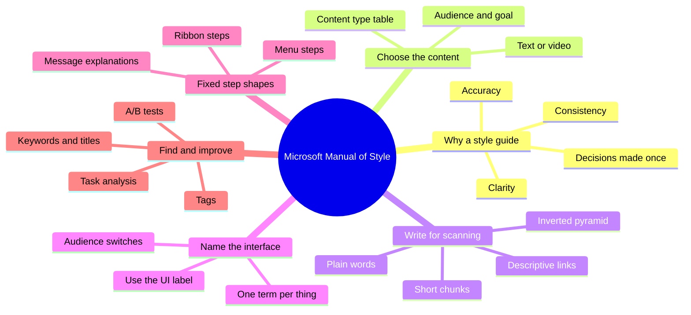
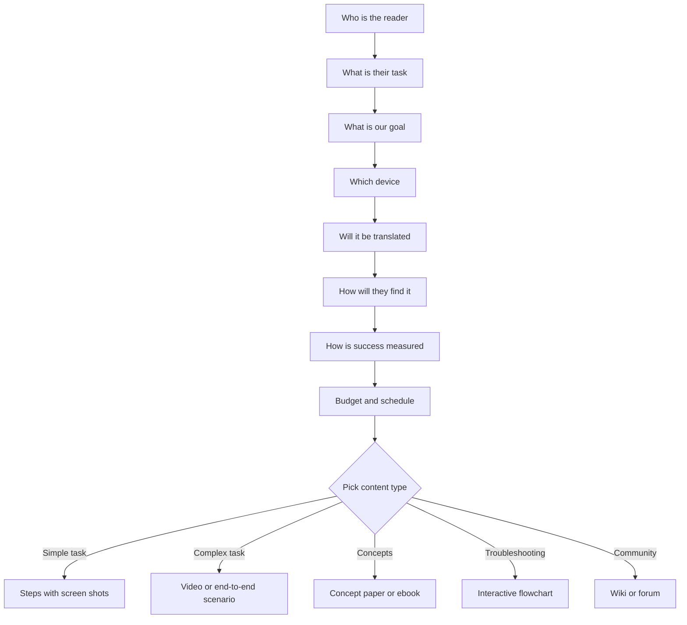
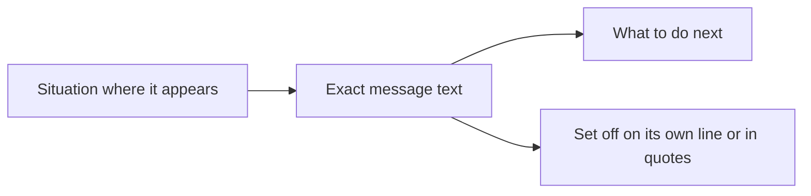
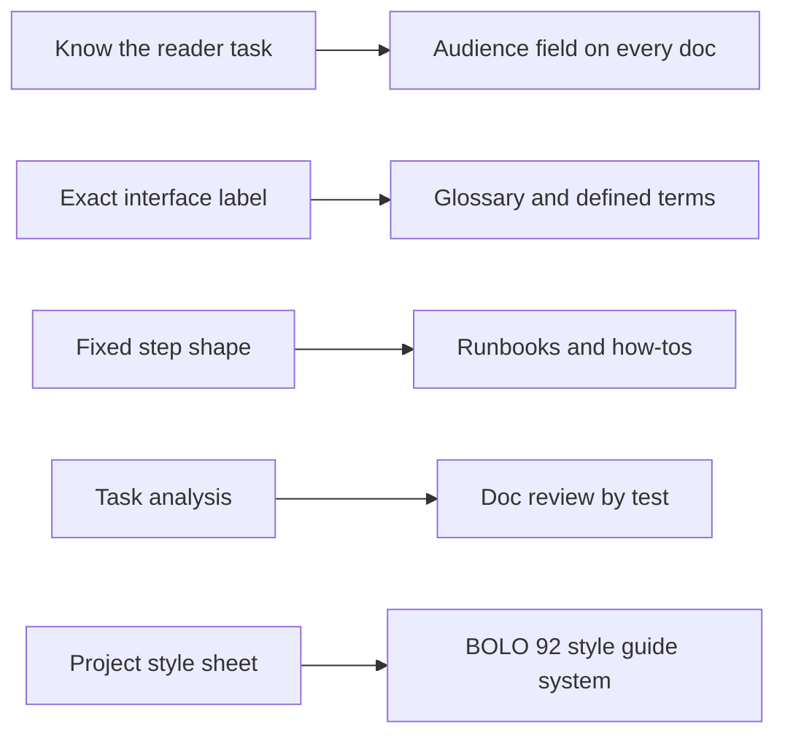

# 🧬 TEC.02 — Microsoft Manual of Style — Microsoft Corporation (2012)
### Knowledge Entry — Distill

The style guide that Microsoft writers and editors use to keep product words consistent, clear, and accurate. This library copy is an 87-page excerpt of the roughly 450-page book: it holds the front matter and full contents, Chapter 2 (web content), and Chapter 5 (the user interface).

## TABLE OF CONTENTS
- [Core Thesis](#1-core-thesis)
- [Mind Models](#2-mind-models)
- [Framework](#3-framework--structure)
- [Key Concepts](#4-key-concepts)
- [Heuristics](#5-heuristics--decision-rules)
- [Invariants](#6-invariants)
- [Pitfalls](#7-pitfalls--myths)
- [Application](#8-application)
- [For the Documentation SOP](#for-the-documentation-sop-bolo-95)
- [Cross-References](#9-cross-references)
- [Provenance](#10-provenance--confidence)

---

## 1 · CORE THESIS

A style guide exists to settle decisions once, so writers do not remake them: "1,000 decisions you don't have to make again." It works by three rules: know the reader's task, name every thing exactly as the interface names it, and keep steps in one fixed shape.

---

## 2 · MIND MODELS

**Diagram 1 — the whole argument.**
Caption: *read the book as one loop: pick the reader and format, write in fixed shapes, name things one way, then measure and revise.*

**Diagram 2 — the central mechanism (choosing the content, Ch. 2 pp. 19-21).**
Caption: *the format is the last choice; questions about reader, goal, cost, and language come first and can flip text to video or back.*

**Diagram 3 — the message explanation (Ch. 5, p. 75).**
Caption: *every explained message gets the same three parts in the same order, so a reader can act without hunting.*

**Diagram 4 — mapped onto the Command's systems.**
Caption: *the book's three anchors line up with the plain register and the doc-type rules the Command already runs.*

---

## 3 · FRAMEWORK / STRUCTURE

**How the book is built (Introduction, pp. xix-xxi).**
- **Part 1, General Topics.** Eleven chapters by subject: style and voice, web content, worldwide audience, accessible content, the user interface, procedures and technical content, practical issues of style, grammar, punctuation, indexes and keywords, acronyms.
- **Part 2, Usage Dictionary.** An A-to-Z list of more than 1,000 terms, from "abort" to "zoom in."
- **Cross-cutting boxes.** "International considerations" and "Accessibility considerations" appear inside topics instead of living only in their own chapters.
- **Example labels.** Each rule shows "Microsoft style" and "Not Microsoft style." The editors say they "don't presume to say that the Microsoft way is the only correct way."
- **Scope notes.** Legal rules and product-specific terms are left out on purpose; other guides (Chicago, AP) cover what this one does not (p. xxii).

**What this excerpt holds.** Front matter and contents (pp. iii-xxiv), Chapter 2 (pp. 19-32), Chapter 5 (pp. 51-97). Chapters 1, 3, 4, 6-11 and the dictionary appear only as contents lines.

---

## 4 · KEY CONCEPTS

| # | Concept | What it is | Why it matters |
|---|---|---|---|
| 1 | Guiding principles | "Consistency, clarity, and accuracy," plus a wish to "inspire as well as inform" (p. xix) | Names what every rule serves |
| 2 | Content-choice questions | Nine questions on reader, task, goal, format, device, translation, discovery, success, budget (p. 19) | The order to decide in |
| 3 | Reader-need table | Reader need mapped to content type and examples (pp. 20-21) | Stops the habit of defaulting to one format |
| 4 | Scannable text | Users "scan online text" and decide fast, so headings, lists, chunks, and white space carry the load (p. 21) | Layout is part of the writing |
| 5 | Inverted pyramid | "Give the conclusion first," keywords first (p. 22) | Reader gets the point in the first line |
| 6 | Descriptive links | Link text is the destination's title, four keywords or fewer (p. 23) | Links become the navigation |
| 7 | Evergreen content | Avoid dates and version names in costly content such as video (p. 24) | Cuts rework |
| 8 | Community content | Wikis and forums need editors, councils, or content managers; "stub topics" invite additions (p. 26) | Sets who owns the words |
| 9 | Task analysis | Top tasks, real users, three metrics: completion rate, "disaster rate," time (p. 28) | Review by measurement |
| 10 | SEO and tags | Use the reader's words in titles, headings, summaries, link text, and alt text (pp. 29-31) | Findability |
| 11 | Audience switch | Many rules change for general, developer, or mixed audiences (pp. 59, 72, 74) | One guide, several registers |
| 12 | Follow the UI | Use the interface's own label and capitalization; if the UI is inconsistent, use a stated fallback (pp. 66, 94) | Text matches the screen |
| 13 | One term per thing | "unavailable," not "dimmed," "disabled," or "grayed" (p. 64) | Removes synonym confusion |
| 14 | Step shape | "On the x tab, in the y group, click z." (p. 63) | Predictable procedures |
| 15 | Message kinds | Error, warning, confirmation, notification, each referred to by its main instruction (pp. 75-78) | Precise troubleshooting text |
| 16 | Project style sheet | The local override that beats the general guide (pp. 94-95) | Where a project narrows the rules |
| 17 | UI text early | "UI text problems often reveal product or service design problems" (p. 93) | Writing finds design bugs |

---

## 5 · HEURISTICS & DECISION RULES

| Situation | Do this | Not this |
|---|---|---|
| Choosing a format | Ask the nine questions, then pick from the need table (p. 19) | Default to the format you like |
| Small budget, many languages | Start with text; add video once results justify it (p. 19) | Localize video first |
| Simple task | Steps with screen shots (p. 20) | A long video |
| Complex task | Short video or scenario plus steps (p. 20) | One dense page |
| Long web page | TOC with links, back-to-top links, shorter pages (p. 21) | One endless scroll |
| A paragraph | One idea, point in sentence one (p. 22) | Buried conclusion |
| Asides | Break out as a note or tip (p. 22) | Fold into the paragraph |
| A link | "Use the title of the destination page" (p. 23) | "Click here," "more info," a long URL |
| Video length | Under two minutes; split long ones into a playlist (p. 23) | One 15-minute video |
| Video pacing | Steady pace; let the picture show obvious clicks (p. 24) | Narrate every action |
| Video wording | Avoid dates, version names, back-references (p. 24) | Point to "what we saw earlier" |
| Old blog post | Add a "may not be accurate now" disclaimer (p. 25) | Leave it looking current |
| Content that defines how the product works | Keep it off the wiki, because "a wiki can be modified" (p. 27) | Put release notes in an open wiki |
| Page title | 10 to 12 words, about 65 characters, key term first (p. 30) | Brand name first |
| Page description | 160 to 170 characters, specific to general, no "This article discusses" (p. 30) | Stock openers |
| Reviewing content | Task analysis, then A/B test (pp. 27-28) | Opinion |
| Menu step | "On the File menu, click Open." (p. 66) | "On File, click Open." |
| Ribbon step | "On the x tab, in the y group, click z." (p. 63) | "Click the x tab, then z in the y group" |
| Button in a step | "Click New." (p. 69) | "Click the New button." |
| Unavailable item | "unavailable" (p. 64) | "grayed" or "disabled" |
| Describing a message | Situation, exact text, next action (p. 75) | Bold or monospace to set it off |
| Message inside a sentence (for translation) | Put the message on its own line or in quotes (p. 76) | Splice it into the sentence |
| Steps that differ by device | A two-column table: device, action (p. 92) | Three prose variants |
| Both mouse and keyboard | List the mouse method first, every time (p. 87) | Shift+click as if a shortcut |
| UI text length | Leave room for 30 percent growth after translation (p. 93) | Fit the English exactly |

---

## 6 · INVARIANTS

1. Start from the reader and their task, not from the feature.
2. Put the key point first: title, heading, first sentence.
3. Use the reader's words, not the team's, for titles, keywords, and tags (p. 29).
4. Name every interface element by its label; the same thing gets the same word every time.
5. A procedure step has one fixed shape, and the interface name is bold.
6. Rules state their audience; a general reader and a developer get different words.
7. A project style sheet may override the general guide; without one, the guide holds.
8. Content that will be translated or read by assistive tools is written for them from the start, not patched later (pp. 23, 32, 76).
9. Published content is checked against real use, then changed.
10. A style guide is "a work in progress" and "a snapshot" (p. xix).

---

## 7 · PITFALLS / MYTHS

- **"Style is right versus wrong."** The editors label examples "Microsoft style" and "Not Microsoft style" because style is "convention and consensus" (p. xx).
- **A blog or wiki with no owner.** Wikis "in theory" run themselves; "in practice" they have editors (p. 26). A stale blog "impact[s] your credibility" (p. 24).
- **Video for everything.** It costs more, may fail accessibility, and is poor for long processes (p. 23).
- **Circular and broken links.** Search engines discount them and readers dislike them (p. 30).
- **Too much UI text.** "Too much text discourages reading"; do not use Help to fix a design problem (p. 93).
- **Synonym drift.** Dimmed, disabled, grayed, and unavailable are four words for one state; pick one (p. 64).
- **Possessives on interface names.** "The ribbon's benefits" is not Microsoft style; "the benefits of using the ribbon" is (p. 62).
- **Version numbers in evergreen content.** They date the page (p. 24). The Backstage entry also says never attach a version number to the term (p. 73).
- **Freezing the guide.** Terms such as "email" and "website" lost their hyphen and capital as usage moved (p. xix).

---

## 8 · APPLICATION

- **Spine level:** CRAFT-PROCESS. This is craft reference for how the Command writes instructions and names things, not story structure.
- **12-layer character stack:** none.
- **plot_systems:** none.
- **Setting:** none.

The book gives the Command a working pattern for the documentation SOP (BOLO 95) and the style guide system (BOLO 92): a short list of principles, topic chapters, an A-to-Z term list, and a project override. It agrees with the plain register the Command already rules: "write like the Claude Code docs, name first number second, define on first use, actor + verb every sentence." The book's inverted pyramid is "name first"; its one-idea paragraphs and plain-language rule are the same instinct. Its fixed step shape is "actor + verb": every step begins with where, then names the actor's action. It asks for "plain language," "simple sentences and short words" (p. 22), which fits the young-adult reading level ruled for research on 9/24.

Two cautions. First, most rules here are tied to Windows, Office, and Windows Phone screens; borrow the method (exact labels, one term per thing, fixed shapes), not the specific words. Second, the excerpt lacks the chapters on procedures, code examples, reference docs, and readme and release notes, so those answers must come from another source.

---

## FOR THE DOCUMENTATION SOP (BOLO 95)

What this excerpt says, type by type. Types the excerpt does not touch are skipped. The full-book chapters are known only from the contents list (pp. iii-xi), so they are noted as unread.

- **Tutorial.** The Ch. 2 table says a user who needs "to learn something complex that takes time and practice" gets online training or a technical white paper (p. 20). Video should "tell a story with a beginning, middle, and end," open by saying what the viewer will learn, and end by inviting them to try it (p. 23). Wikis suit "learning roadmaps" (p. 26).
- **How-to.** For a simple task the table gives "procedural text with screen shots" or a short screen-capture video (p. 20). Steps use the fixed shapes on pp. 60-70 and the bold rules on pp. 94-97. For steps that differ by device, use a two-column table of device and action (p. 92). List the mouse method before the keyboard method (p. 87). The full procedures chapter (Ch. 6, p. 99) is not in this excerpt.
- **Reference.** Ch. 5 is itself reference: element tables with a definition, a usage rule, and an example per row (pp. 60-62, 79-82). Ch. 6 "Reference documentation" (p. 114) and the A-to-Z usage dictionary are listed but unread.
- **Concept/explanation.** Readers who want "high-level concepts" get concept papers and ebooks (p. 20). Use "end-to-end scenario descriptions" for a complex or integrated feature (p. 20). Break notes and tips out of the main paragraph so it keeps one key point (p. 22).
- **FAQ.** Not named. Nearest: forums and community answers for "ongoing engagement" (p. 20), and wiki-friendly "tips and tricks" and "troubleshooting and workarounds" (p. 26).
- **README.** Only a contents line ("Readme files and release notes," p. 128). No content.
- **Architecture/design doc.** Only indirect. "Interactive posters" suit "a complex or integrated feature or scenario" (p. 20), with a component architecture paper as the listed example. Ch. 5 says UI text problems "often reveal product or service design problems" (p. 93), which supports writing early.
- **API/code docs.** Only contents lines ("Code examples," p. 117; "Reference documentation," p. 114). The excerpt does say that developer content may use terms general content must avoid, such as "control," "cursor," and "menu item" (pp. 59, 63, 85).
- **Release notes/changelog.** The wiki warning is the only content: do not put "release notes or other information that's essential to defining how the product works" on a wiki "because a wiki can be modified" (p. 27). Chapter 6 section on release notes (p. 128) and "Version identifiers" (p. 123) are unread.
- **Troubleshooting.** For "complex troubleshooting or decision making processes," use interactive flowcharts (p. 21). Wikis suit troubleshooting and workarounds (p. 26). Explain messages as situation, exact text, next step (p. 75); refer to an error "by its main instruction" and use the exact text (p. 76). Start with troubleshooting content to encourage community contribution (p. 27).
- **Glossary/terminology.** The book's Part 2 is a 1,000-term dictionary (pp. 235-420, contents only). The excerpt's clear rules: name things by the interface label; one term per thing; avoid the control's generic name in end-user text; audience decides whether "control," "disabled," or "cursor" is allowed (pp. 59, 64, 85).
- **Style guide.** Introduction pp. xix-xxiv describes how a style guide is built and governed: an editorial board, feedback address, errata page, "Other references" for what it omits, and example labels that avoid "correct." The "project style sheet" is the override layer (pp. 82, 94-95). Ch. 1 on voice is unread.
- **Review and maintenance of docs.** Evaluate content with feedback surveys, A/B tests, and task analysis using completion rate, "disaster rate," and time (pp. 27-28). Keep blogs on a schedule, add age disclaimers, tag entries, fix broken links (pp. 24-25, 30). Assign editors or councils to community content (p. 26). Check UI text against a seven-question checklist (p. 94).

**Rules we could adopt, in the book's own terms.**
- **Nine questions first.** Before drafting any doc, answer reader, task, goal, format, device, translation, discovery, success, and budget (p. 19). Record the answers in the doc's front matter.
- **One step shape.** Every procedure step opens with where, then the action: "On the x tab, in the y group, click z." Interface names in bold (pp. 63, 95).
- **One term per thing.** The Command glossary picks one word for each state and bans the synonyms, as the book does with "unavailable" (p. 64).
- **Conclusion first, links for background.** Put the point in the title and first sentence, and "link to background and related information rather than summarizing" (pp. 22-23).
- **Evergreen unless dated on purpose.** Keep dates and version numbers out of long-lived docs (p. 24); keep defining docs such as release notes out of open-edit spaces (p. 27).
- **Measure before "fixed."** Review a doc by having someone use it to do the task and recording success, failure, and time (p. 28).

---

## 9 · CROSS-REFERENCES

| Related entry | Relation |
|---|---|
| [[BOLO.95]] | The documentation SOP this entry feeds |
| [[BOLO.92]] | The style guide system this entry feeds |
| [[BOLO.67]] | The plain register; this book's plain-language rules agree |
| [[TEC.01]] | Sibling technical-communication source in the TEC area |

---

## 10 · PROVENANCE & CONFIDENCE

- **Source read:** the full extracted text of the 87-page PDF, front to back. Every claim above is from that text, with page numbers from the book's own numbering.
- **Excerpt, not the whole book.** The full fourth edition runs about 450 pages. This copy holds the copyright page, contents, foreword, introduction (pp. xvii-xxiv), Chapter 2 (pp. 19-32), and Chapter 5 (pp. 51-97, ending mid-table at the bold-formatting guide). Chapter 1 (voice, bias-free writing), Chapters 3-4 (global English, accessible writing), Chapters 6-11 (procedures, readme and release notes, capitalization, lists, tables, grammar, punctuation, indexes, acronyms), and the usage dictionary are not in the text. Statements about them come only from the contents pages and are marked "unread."
- **Confidence: medium.** High for what Chapters 2 and 5 say; low for anything about the missing chapters. Chapter 5's rules are specific to 2012-era Windows, Office, and Windows Phone.
- **Inference.** Everything under Application and the SOP section's "rules we could adopt" is inference, kept apart from the extraction above.
- **Recommended follow-up.** If the SOP needs the book's procedure, reference-doc, code-example, and release-notes guidance, the Chief would need to attach the full book's Chapter 6 in Zotero, then "rescan Zotero."

## META
- Template: BVX-LEARN-v4.0
- Source classification: book excerpt, corporate style guide, full text of excerpt read
- Created / Updated: 2026-09-30 / 2026-09-30
