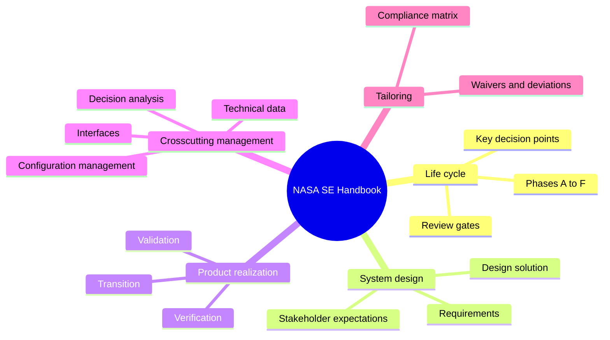
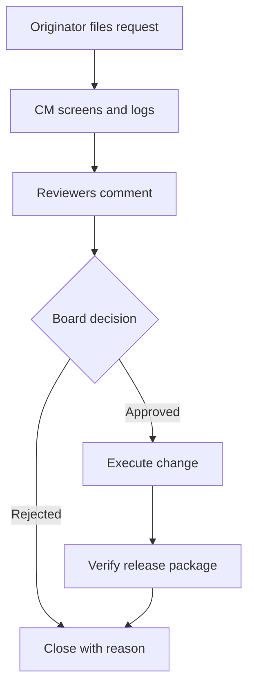
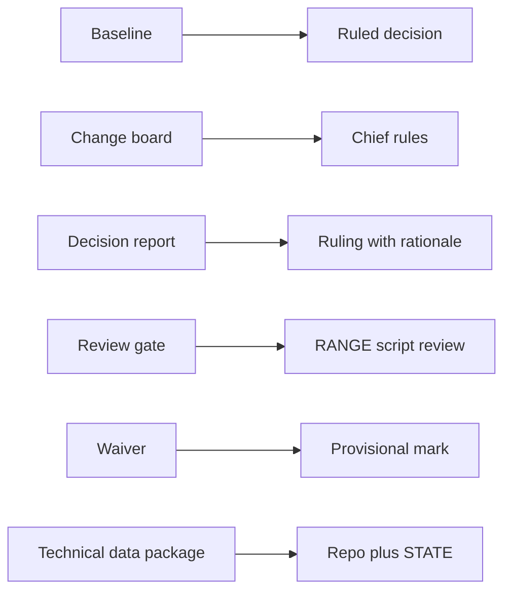

# 🧬 TEC.03 — NASA Systems Engineering Handbook — NASA (2016)
### Knowledge Entry — Distill

NASA's own guide to building large systems, Rev 2 (2016, replacing the 2007 Rev 1). It is not a writing book. It is in the library for what it says about documents: which ones a project needs, when each becomes official, and who may change it.

## TABLE OF CONTENTS
- [Core Thesis](#1-core-thesis)
- [Mind Models](#2-mind-models)
- [Framework](#3-framework--structure)
- [Key Concepts](#4-key-concepts)
- [Heuristics](#5-heuristics--decision-rules)
- [Invariants](#6-invariants)
- [Pitfalls](#7-pitfalls--myths)
- [Application](#8-application)
- [For the Documentation SOP](#for-the-documentation-sop-bolo-95)
- [Cross-References](#9-cross-references)
- [Provenance](#10-provenance--confidence)

---

## 1 · CORE THESIS

A large project stays sane when its documents mature in steps. Each document starts preliminary, becomes a baseline at a review gate, and after that changes only through a recorded request, a board decision, and an audit. Rationale, decisions and lessons are written down as the work happens.

---

## 2 · MIND MODELS

**Diagram 1 — the whole argument.**
Caption: *the handbook has three engines (design, build, manage), and every one of them produces documents that a review gate then approves.*

**Diagram 2 — the central mechanism (baselines grow at review gates).**
Caption: *a document is never just "done"; it is preliminary, then baselined at a named gate, then changed only by board approval.*

**Diagram 3 — the change-control loop (how a baselined doc changes).**
Caption: *every change is proposed, screened, reviewed, decided by a board, executed, verified, and only then closed.*

**Diagram 4 — mapped onto the Command's systems.**
Caption: *NASA's crew grades are already in the Command; the handbook's document controls fit the rest of the operation.*

---

## 3 · FRAMEWORK / STRUCTURE

The handbook has six chapters and about twenty appendices. Page numbers below are the printed ones.

| Chapter | Pages | What it holds |
|---|---|---|
| 1. Introduction | 1-2 | Purpose and depth. |
| 2. Fundamentals | 3-15 | The 17 common processes ("the SE engine"), verification versus validation, competency model. |
| 3. Life cycle | 17-41 | Phases Pre-A to F, key decision points (KDPs), the product maturity table, tailoring. |
| 4. System design | 43-76 | Stakeholder expectations, technical requirements, logical decomposition, design solution. |
| 5. Product realization | 77-112 | Implementation, integration, verification, validation, transition. |
| 6. Crosscutting management | 113-172 | Planning, requirements management, interfaces, risk, configuration management, technical data, assessment (reviews), decision analysis. |
| Appendices | 173-259 | Glossary, requirement checklist (C), verification matrix (D), SEMP outline (J), IRD outline (L), CM plan outline (M), ConOps outline (S), Phase E (T). |

The throughline: the same seventeen processes repeat every phase, and the documents they produce mature on a schedule set by the life-cycle gates.

---

## 4 · KEY CONCEPTS

| Concept | What it is | Why it matters |
|---|---|---|
| **Key Decision Point (KDP)** | The point where an authority decides go or no-go for the next phase, sometimes with a "lien" to fix within a set time (p.17) | A gate is a decision by a named person, not a meeting. |
| **Entrance and success criteria** | Every review states what must exist to start it and what counts as passing (Table 6.7-1, p.161) | A review without criteria is a status talk. |
| **Baseline** | An agreed, documented description at a point in time that later changes are measured against (p.146) | Gives the doc set a known state. |
| **Four baselines** | Functional (set at SDR), allocated (PDR), product (CDR), as-deployed (ORR) (p.146-148) | Detail grows in stages; each stage is locked before the next starts. |
| **Configuration item (CI)** | A thing chosen to be controlled, with a unique ID and its own documents (p.146) | You decide what is controlled before you control it. |
| **Configuration Control Board (CCB)** | A board chaired by someone with change authority; members can commit their teams (p.148) | Changes need an owner who can say yes. |
| **Configuration status accounting** | The recorded current and historical state of every controlled item and every pending change (p.149) | Anyone can see what is current. |
| **Engineering change, major/minor** | Major changes hit cost, safety, interfaces or training; minor ones fix docs without breaking interchangeability (p.149) | Two speeds of change. |
| **Waiver and deviation** | A recorded agreement to skip a requirement; it does not change the baseline (p.149) | An exception is written, not silent. |
| **Technical data package** | The full description of an item: drawings, lists, specs, standards, quality provisions; it grows from sketches to complete drawings (p.72, 154) | The bundle that lets someone else build or maintain the thing. |
| **Data call** | A request asking each team to justify the data it wants, before paying to produce it (p.154) | Stops unneeded documents at the door. |
| **ConOps** | The early, time-ordered story of how the system will be used, stated without the design; the base for later plans and handbooks (p.50-51) | Written first; drives requirements. |
| **Operations Concept** | A separate, later doc from the operations team on how the flight and ground systems work together (p.51) | Two docs, two owners, two names. |
| **Interface documents** | IRD (requirements), ICD (control), IDD (definition), ICP (plan) (p.137) | Each shared boundary gets a controlled doc; all sides must agree to change it. |
| **Bidirectional traceability** | Every requirement links up to its parent and down to its children (p.130) | Nothing orphaned, nothing unjustified. |
| **Rationale** | The reason, assumptions, relationships and constraints behind a requirement, kept current (p.60) | The "why" survives staff changes. |
| **Decision report** | Written record of a decision: criteria, options, weights, scoring, risks, recommendation, dissent (p.170-171) | The decision record template. |
| **Tailoring vs customization** | Tailoring seeks relief from a mandatory rule and needs a waiver; customization changes how a rule is met and is only noted (p.34) | Two-tier exception handling. |
| **SEMP** | Systems Engineering Management Plan; the foundation doc for the technical work; a living document (App J, p.223) | One plan says how the work runs. |

---

## 5 · HEURISTICS & DECISION RULES

| Situation | Do this | Not this |
|---|---|---|
| Writing a requirement | One subject, one "shall," active voice, a rationale beside it (p.57, 197) | A paragraph that mixes several requirements and reasons |
| A value is unknown | Write a best estimate marked TBR, with who resolves it and by when (p.198) | Leave a blank or an open "TBD" |
| A doc must be verifiable | Ban vague words: "easy," "robust," "appropriate," "fast," "and/or," "etc." (p.200) | Adjectives nobody can test |
| Requirement describes an operation | Move it into the ConOps (p.198) | Mix operations with product requirements |
| Requirement assigns a person a task | Move it to the statement of work (p.198) | Put task assignments in a spec |
| A doc is baselined | Change it only by a request, a board decision, and a status update (p.148) | Edit it in place |
| Deciding how much analysis | Match rigor to how clear-cut the decision is; emergencies write the report after (p.165) | Full analysis for every choice |
| Choosing between designs | Keep assumptions, models and results in the archive (p.70) | Keep only the winner |
| Small project | Fold the plan into the project plan and use the outline as a topic list (p.223) | Skip the topics or build a full binder |
| Asking for a deliverable | Ask why it is needed first (a data call) (p.154) | Order every possible document |
| Progress reporting | Use red, yellow, green zones on agreed measures (p.159) | Free-text status |

---

## 6 · INVARIANTS

1. A document has a maturity state (preliminary, baseline, update) and the state is stated.
2. A baseline changes only through a recorded proposal, a decision by someone with authority, and verification (p.148).
3. Every controlled item has a unique identifier (p.146, 151).
4. Skipping a rule needs a written waiver or deviation; it does not alter the rule (p.149).
5. Requirements trace both up and down (p.130).
6. The reason for a decision is recorded with the decision, including assumptions and dissent (p.171).
7. Each type of data has a named owner responsible for entering it (p.154).
8. Terms mean the same thing across the document set; a project glossary is the referee (p.198, 224).
9. The plan itself is a living document, updated as needed across the life cycle (p.224).

---

## 7 · PITFALLS / MYTHS

- Treating the review as the point: the review approves a baseline; the baseline is the point.
- Writing a "requirement" that is really an operation, a task, or a solution instead of a need (p.198).
- Editing baselined docs in place, so "current" is a guess. The handbook says improper configuration management can release "incorrect, ineffective, and/or unsafe" products (p.143).
- Building a CM tool first and the process second; the handbook says weigh the two (p.145).
- Confusing verification (built right, tested against requirements) with validation (right thing built, checked against stakeholder need) (p.11, 89).
- Same-purpose docs in different formats, so one set can't be reused for the other (Phase E transition, p.254).
- Full-weight process on a small job. Tailoring is expected for every size (p.34).

---

## 8 · APPLICATION

- **Spine level:** CRAFT-PROCESS. This is a source about running a body of work, not story structure.
- **12-layer character stack:** none.
- **DOCS (BOLO 95):** primary. Review gates, baselines, change control, decision reports and the document-by-maturity table map onto architecture docs, design docs, decision records, and review/maintenance. See `feeds:` for the wiring and the next section for the pointers.
- **L06 (style guide system, BOLO 92):** supporting. Shall/will/should strengths and the tailoring-versus-customization rule carry over.

The handbook is heavy on purpose. The Command is one person's operation, so the borrowable part is the discipline, not the paperwork: name the gate, say what a pass looks like, lock a doc when it passes, record every later change with a reason, and keep the decision beside its rationale. The handbook itself says small projects should fold plans into one document and use the outlines as topic lists (App J, p.223), and that rigor should scale with risk (p.34). That matches the standing rule "write like the Claude Code docs, name first number second, define on first use, actor + verb every sentence" (BOLO 67). The handbook's own requirement checklist agrees: one thought per statement, active voice, no vague words.

NASA's crew grades are already the Command's seat names (CDR, MS, PS). Other terms worth borrowing, each with a plain meaning:

- **Baseline:** the last approved version of a doc set.
- **KDP:** a go or no-go decision by Chief.
- **Entrance and success criteria:** what must exist to start a review, and what counts as passing.
- **Lien:** a condition attached to a pass that must be cleared by a date.
- **Waiver:** a recorded exception to a rule.
- **Data call:** the question "do we need this doc at all?"
- **Dissent:** an objection recorded with the decision.
- **TBR:** to be resolved, with an owner and a date.

---

## FOR THE DOCUMENTATION SOP (BOLO 95)

The book covers project documents, not user-facing docs, so several types get nothing. Pointers use printed page numbers.

- **tutorial:** not covered.
- **how-to:** not covered. Nearest is the procedure-level detail expected in verification procedures and operator manuals (Table 5.3-1, p.94; Phase D products, p.30), which are written before use and baselined.
- **reference:** Requirement sets and the verification matrix (App D, p.201) are lookup docs: every "shall" gets a unique ID, a source doc, a method, and a status. Technical data management (Ch 6.6, p.151-155) adds master lists, metadata for retrieval, exchange formats, and a named owner per data type.
- **concept/explanation:** The Concept of Operations (Ch 4.1, p.50-51; App S, p.251). It is written early, without the design, in time order, and covers normal and off-nominal cases. It says "what," not "how," and is the base for later plans. The book separates it from the Operations Concept, which the operations team writes later.
- **FAQ:** not covered.
- **README:** not covered. The nearest idea is the SEMP intro: "the foundation document" that tells everyone how the technical work runs and can be a standalone doc or a section of a larger plan (App J, p.223).
- **architecture/design doc:** The design solution definition and the technical data package, which "evolves from phase to phase, starting with conceptual sketches or models and ending with complete drawings" (p.72). Design is verified by peer review against requirements (p.72), and concerns roll up to the next review. Level of detail is set by the phase (p.72).
- **API/code docs:** Interface documents: IRD, ICD, IDD, ICP (p.137). App L (p.236-238) gives the IRD outline by interface type. Changes need agreement from every side; late interface changes cost the most (p.138).
- **release notes/changelog:** The change record. Every engineering change carries a request, rationale, board disposition and closure (Fig 6.5-4, p.148), and status accounting keeps a historical record (p.149). Change types: major, minor, waiver (p.149).
- **troubleshooting:** not covered directly. Related: anomaly tracking and discrepancy records inside verification reports (p.94) and Phase E operations (App T, p.254).
- **glossary/terminology:** App B (p.176) is the handbook's glossary. Rules: the SEMP uses the same terms as the governing directive (App J.2, p.224); requirements use one term per thing and key terms sit in a project glossary (App C, p.198-199); shall, will and should have fixed meanings (App C.1, p.197).
- **style guide:** App C is a style guide for one doc type: active voice, one shall per statement, positive statements, TBDs minimized, rationale attached, "the project's template and style rules" complied with (p.197-198). Its list of banned vague words is on p.200.
- **review and maintenance of docs:** The strongest coverage. Reviews (Table 6.7-1, p.161-164): each has a purpose, timing, entrance and success criteria, and a result. SRR freezes requirements; PDR approves the design-to baseline; CDR approves the build-to baseline; ORR checks that user docs match the deployed system. Table 3.0-1 (p.19) lists product maturity by gate. Configuration management (p.143-150): five elements are planning, identification, change management, status accounting, verification. Requirements validation has six questions: written correctly, technically correct, satisfy stakeholders, feasible, verifiable, not redundant (p.60). CM plans get re-evaluated after significant change and periodically (App M, p.239). Decision reports: p.170-171.

**Rules we could adopt**

1. **Mark maturity.** Every doc in the SOP carries a state: draft, baselined, or superseded (Table 3.0-1).
2. **Gate with criteria.** Each doc type states what must exist to start review and what counts as a pass (Table 6.7-1).
3. **Change by request.** A baselined doc changes only through a logged request with a reason, a ruling by Chief, and a status update (Fig 6.5-4).
4. **Decision records carry the nine parts.** Summary, problem, setup rationale, scoring, final matrix, risks, recommendation, dissent, references (Table 6.8-1). For small choices, use the short form and write it after (p.165).
5. **One statement per rule.** In the style guide, one rule per line, active voice, no vague words, rationale attached (App C).
6. **Exceptions are written.** A skipped rule gets a waiver line; a changed method gets a note (Ch 3.11).

---

## 9 · CROSS-REFERENCES

| Related entry | Relation |
|---|---|
| [[BVX-LEARN TEC docs entries]] | Sibling sources for the documentation SOP; this one supplies the control and review side. |
| [[BOLO 95 documentation SOP]] | Target of the DOCS feeds. |
| [[BOLO 92 style guide system]] | Target of the L06 feeds. |
| [[Agent formation doctrine]] | The formation's "one script reviewer at the fan-in" is the same idea as a gate with success criteria. |

---

## 10 · PROVENANCE & CONFIDENCE

Full-text plain-text extraction (about 13,000 lines, 297 pages). The extraction interleaves two-column pages, so some quotes were rebuilt from broken columns. Read closely: the table of contents; Table 3.0-1 and the Phase D and Phase E boxes; Ch 3.11 (tailoring); the ConOps section of Ch 4.1; the requirements section of Ch 4.2; design-solution verification and trade-study text in Ch 4.4; Ch 6.3 (interfaces); Ch 6.5 (configuration management); Ch 6.6 (technical data); Ch 6.7 (reviews, Table 6.7-1); Ch 6.8 (decision analysis and the Table 6.8-1 decision report); Appendices C, J, L, M, N, T. Skimmed or skipped: product realization detail (Ch 5), risk management (Ch 6.4), the glossary, technology assessment (App G), HSI plan (App R), and the acronym list. The mappings from NASA practice to the Command's documentation SOP are this distill's own synthesis. The year is 2016 (Rev 2; the extraction says it supersedes the December 2007 Rev 1). Appendix N (peer reviews) is removed in this edition and points to online guidance not in the file. `zotero_key` is blank: not checked against the library in this pass.

## META
- Template: BVX-LEARN-v4.0
- Source classification: full-text extraction; deep read on document-control, review, decision, requirements and interface sections
- Created / Updated: 2026-09-30
