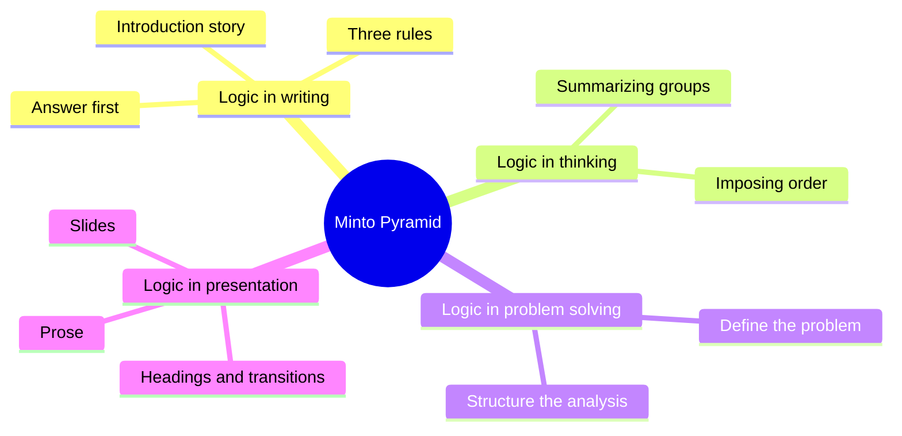
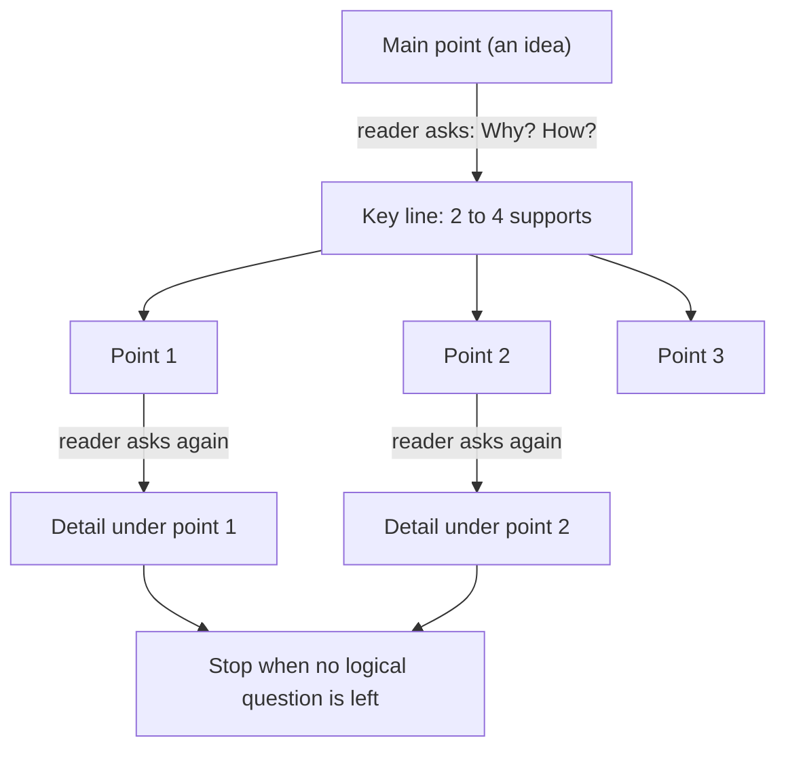
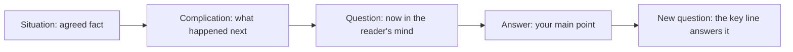
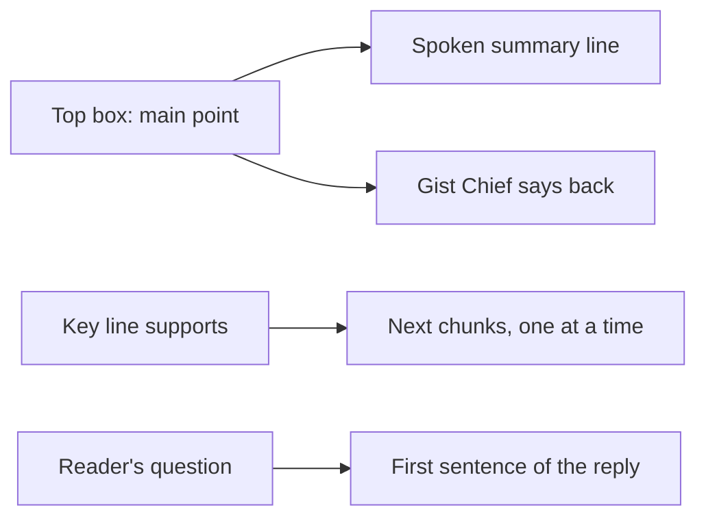

# 🧬 TEC.04 — The Minto Pyramid Principle — Minto (2010)
### Knowledge Entry — Distill

The standard text on ordering ideas so a reader can follow them: a pyramid with one main point on top, built by a former McKinsey writer. It is in the library for BOLO 6, transmission pedagogy, as the source for how each Claude reply to Chief should be shaped.

## TABLE OF CONTENTS
- [Core Thesis](#1-core-thesis)
- [Mind Models](#2-mind-models)
- [Framework](#3-framework--structure)
- [Key Concepts](#4-key-concepts)
- [Heuristics](#5-heuristics--decision-rules)
- [Invariants](#6-invariants)
- [Pitfalls](#7-pitfalls--myths)
- [Application](#8-application)
- [Cross-References](#9-cross-references)
- [Provenance](#10-provenance--confidence)

---

## 1 · CORE THESIS

Readers understand best when the main idea comes first and the supporting ideas sit in groups beneath it. Each group needs a summary above it, one kind of idea inside it, and a reason for its order. A writer who builds that pyramid before drafting thinks more clearly and writes faster.

---

## 2 · MIND MODELS

**Diagram 1 — the whole argument.**
Caption: the book is one structure (the pyramid) used at four stages, from thinking to the page.

**Diagram 2 — the central mechanism (the pyramid as a question-and-answer dialogue).**
Caption: every statement raises one question, and the line below answers it, so the reader never has to guess why a point is there.

**Diagram 3 — the introduction story that sets the reader's question.**
Caption: you start from what the reader already agrees with, and the main point is the Answer to the Question that story raises.

**Diagram 4 — mapped onto the Command's systems.**
Caption: the pyramid supplies the shape of a reply, the spoken line, and the unit that Chief says back.

---

## 3 · FRAMEWORK / STRUCTURE

Four parts, twelve chapters, three appendices. The preface says Part One alone is enough to apply the method to simple documents (Preface, p. xi in the extraction).

| Part | Chapters | Pages | What it does |
|---|---|---|---|
| 1. Logic in Writing | 1-5 | 1-72 | Why a pyramid, its substructures, how to build one, how to write introductions, deduction versus induction |
| 2. Logic in Thinking | 6-7 | 75-117 | Check that grouped ideas hold together and say something |
| 3. Logic in Problem Solving | 8-9 | 121-166 | Define a problem and structure the analysis so it fits a pyramid |
| 4. Logic in Presentation | 10-12 | 170-208 | Show the pyramid in headings, slides, and prose |

The throughline: think bottom-up, present top-down (ch. 1, p. 8), and test every grouping against three rules before writing (p. 10).

---

## 4 · KEY CONCEPTS

| Concept | What it is | Why it matters |
|---|---|---|
| **The pyramid** (ch. 1, p. 1) | Ideas in tiers under one thought. | A reader takes sentences one at a time, so presorted ideas are easier to follow. |
| **Magical number seven** (p. 3) | Short-term memory holds about seven items, some people five. Three is convenient, one is easiest. | Past four or five items the mind groups them, so the writer should group first. |
| **State the logic of a group** (p. 4) | Naming the category lets you remember three headings instead of nine items. | A group without a stated logic does not reduce load. |
| **Top-down order** (p. 5) | The summarizing idea comes before the ideas summarized. | Otherwise readers invent their own grouping, and often invent a wrong one (Zurich example, pp. 5-7). |
| **Three rules** (pp. 10-11) | Each idea summarizes those below it. Ideas in a group are the same kind. Ideas in a group are in logical order. | They are testable, so "be logical" becomes a checklist. |
| **Plural-noun test** (p. 11) | If you can name the group with one plural noun (reasons, steps, problems), the ideas are the same kind. | A fast check for mixed groups. |
| **Idea** (p. 14) | A statement that raises a question because it tells the reader something new. | A label such as "background" raises no question and does no work. |
| **Vertical relationship** (pp. 13-17) | Question above, answer below, repeated until the reader has no more logical questions. | Controls when each fact appears. |
| **Horizontal relationship** (p. 17) | A group is either deductive (argument in steps) or inductive (like ideas under a plural noun), never both. | Tells you how to summarize the group. |
| **Situation, Complication, Question, Answer** (pp. 18-19, 37-38) | The story that opens a document. | Fixes the question your main point answers. |
| **Key line** (p. 41) | The row of support points directly under the main point. | Doubles as the plan of the document. |
| **Four common questions** (p. 49) | What should we do, how do we do it, should we do it, why did it happen. | Most documents answer one of these. |
| **Intellectually blank assertion** (p. 95) | "For three reasons" with no idea in it. | Readers answer the first sub-point they hear and talk past you. |
| **Transitions** (pp. 182-186) | Link sections by a short story or by repeating a key word from the section before. | Tells the reader where they stand. |
| **Next Steps** (p. 187) | A closing list, used only for actions the reader will not question. | A doubt-raising step belongs in the body. |

---

## 5 · HEURISTICS & DECISION RULES

| Situation | Do this | Not this |
|---|---|---|
| Starting to write | Try top-down first: subject, question, answer, then situation and complication (pp. 22-26, 31) | Dictate everything "to get it down" (p. 31) |
| Thinking is not ready | Bottom-up: list the points, find their relations, draw the conclusion (p. 26) | Force a top box you cannot defend |
| A group has more than four or five items | Group them and name the logic (pp. 3-5) | A flat list of nine |
| Choosing deduction or induction on the key line | Induction when you can; it needs less effort to read (p. 33) | A three-step argument whose third step raises no question |
| A group will not label with one plural noun | Split it or find the misfit (p. 11; ch. 6) | Keep it because the items feel related |
| Writing the introduction | Only what the reader already agrees is true; two to three paragraphs (pp. 33, 43) | New information or a long history |
| Listing sections | State each as an idea (pp. 42-43) | Topic labels like "Background" |
| Linking sections | Repeat the key word of the last point, or tell a mini story (pp. 183-185) | "The next chapter looks at..." (p. 182) |
| Ending | Stop, or give Next Steps that are self-evident (p. 187) | "Please call with any questions" filler |
| Wording headings | Parallel, one level per style, never a lone heading (ch. 10, pp. 174-175) | Mixed forms at one level |

---

## 6 · INVARIANTS

1. **Any single document supports one single thought** (p. 8).
2. **The summarizing idea comes before the ideas it summarizes** (p. 5).
3. **Ideas at any level summarize the ideas grouped below them** (p. 10).
4. **Ideas in a group are one kind and in a logical order** (pp. 10-11).
5. **A point should raise a question only when you are ready to answer it, and answer a question only after it is raised** (p. 15).
6. **The introduction holds only what the reader already knows or will accept** (p. 33).
7. **Deduction and induction are the only two ways a group can argue** (p. 17).
8. **You cannot know exactly what you think until you say or write it** (p. 13).

---

## 7 · PITFALLS / MYTHS

- "Clearer writing means simpler sentences." Style matters, but structure is the larger cause and the easier fix (Intro to Part One, p. 1 of the part).
- Announcing categories instead of ideas: "three reasons," "Background" (pp. 43, 95).
- Putting history in the body. Events belong in the introduction (p. 32).
- A section such as "Our Assumptions" before the main points. It answers a question not yet raised (p. 15).
- Overstructured deduction, where the last step raises no question (pp. 33-34).
- Adding facts to the introduction that the reader does not know. This bends the Question (p. 33).
- Limit of the book itself: it targets professional documents read by busy people. It does not address learning, memory over days, or a reader who must struggle to learn. The evidence is Minto's consulting practice, not controlled studies.

---

## 8 · APPLICATION

- **Spine level:** CRAFT-PROCESS. A process book about shaping ideas, not a story-structure source.
- **12-layer character stack:** not applicable. `feeds:` wires to `TEACHING` and `DOCS`.
- **plot_systems:** not applicable.
- **Setting:** not applicable.

SOP §7 rule 5 already says to put the answer first. Minto backs that rule and adds six things the rule does not yet say. First, the top point must be an idea, so "here are three things" fails (p. 95). Second, the answer is defined by the reader's question, so Claude names that question before choosing the answer (pp. 18-19). Third, items in one group must be the same kind, with a plural-noun test (p. 11). Fourth, a group needs a reason for its order (pp. 11-12). Fifth, the opening may hold only what Chief already agrees with (p. 33). Sixth, a point appears only after the question that calls for it has been raised (p. 15).

**Proposed rules for how Claude teaches Chief in chat. All proposed. Chief has not ruled on any.**

1. **Reply length (proposed).** One reply is one pyramid level: a main point and at most three supports. More than four or five items means group them first (pp. 3-4). Deeper detail waits for the next reply.
2. **The spoken line (proposed).** The spoken line is the top box, written as an idea, never a label like "three steps" (p. 95). It fits one breath.
3. **The teach-back loop (proposed).** The thing Chief says back is the top box. If the gist matches the top box, it locks, and the supports are optional. This keeps "one tiny part" the size of one idea.
4. **Answer-first structure (proposed).** The first sentence of the reply answers the question Chief asked. Context before it must be something he already agrees with, and a section named "Background" is banned (p. 43).
5. **Order within a reply (proposed).** Before sending, Claude can name the order: argument, time, structure, or importance. If it cannot, the group is not ready (pp. 11-12).
6. **When to check understanding (proposed).** After each key line point, not after the whole reply. The point has answered its question, so Chief says it back, and only then does Claude open the next point (pp. 15, 182-186).
7. **Multi-reply lessons (proposed).** Open each next reply by repeating the key word of the last locked point, so Chief sees the link (p. 183).
8. **Drills are the exception (proposed).** Answer-first fits explanations. For a drill, Claude asks the question first and gives the answer after Chief tries. The conflict with answer-first is this distill's own observation, drawn from McGuire's attempt-before-answer rule ([[PSY.45]]), not from Minto.

---

## 9 · CROSS-REFERENCES

| Related entry | Relation |
|---|---|
| [[PSY.45]] Teach Yourself How to Learn | The other half of BOLO 6. Minto gives the shape of a reply, McGuire gives the loop around it |
| [[TEC.01]] Docs for Developers | Its "title is the goal" and "most important information first" echo the pyramid for documents |
| [[TEC.02]] Microsoft Manual of Style | Sentence-level style. Minto covers the order of ideas above the sentence |
| [[SOP §7]] | Rule 5 (answer-first) is the standing rule this book backs |
| [[BOLO 6 — transmission pedagogy]] | The working order this distill serves |

---

## 10 · PROVENANCE & CONFIDENCE

Source is a pdftotext extraction of the book (about 12,000 lines, with heavy scanning noise such as "n1ajor" for "major"). Read in full: front matter, introduction to Part One, chapters 1-3, and the parts of chapter 4 on the story form, key line, introduction length, and the four common patterns. Read in part: chapter 5 (deduction and induction), chapter 6 (the order types, summarized from chapter 1), chapter 7 (blank assertions), and chapter 10 (headings, transitions, next steps). Not read in detail: Part Three (problem solving), chapters 11-12, the appendices, and the index. Page numbers come from the book's own contents list at each section's start. The extraction places folios inconsistently, so a few cites may be one page off inside a section. The year 2010 is the copyright line in the extraction, and the preface is dated 1996, so the text is an older edition reissued. The Application section is this distill's own synthesis for a chat setting, and `feeds:` wiring to `TEACHING` and `DOCS` is this distill's own keying. `zotero_key` is blank and not checked against the live Zotero database.

## META
- Template: BVX-LEARN-v4.0
- Source classification: full-text plain-text extraction with scan noise; Parts One, Two (partly), and Four (partly) read
- Created / Updated: 2026-10-04
