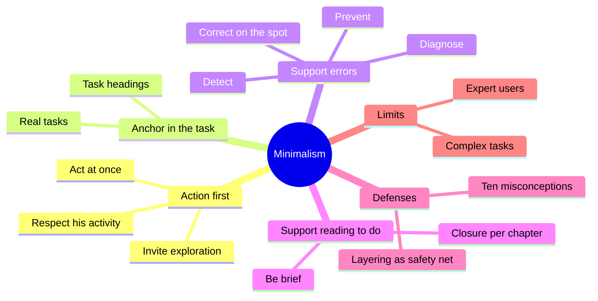
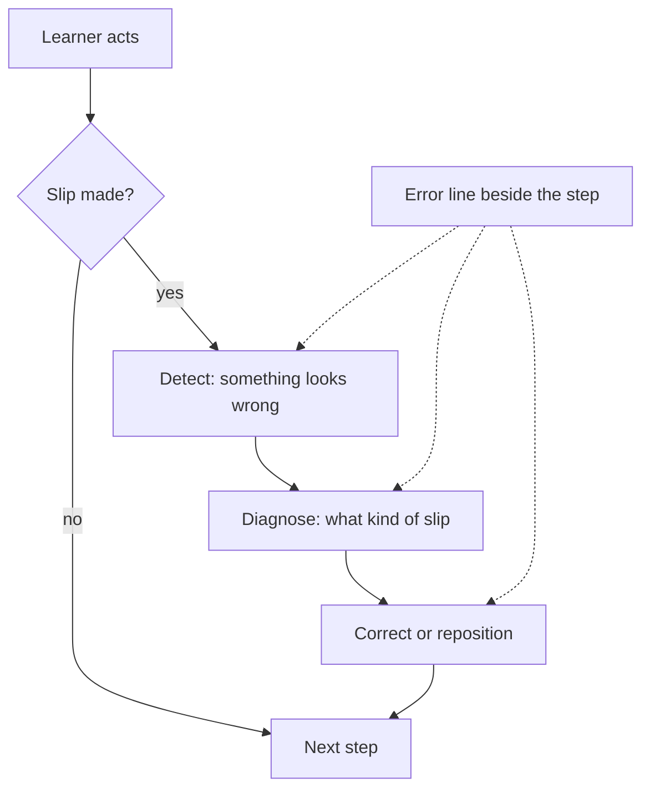
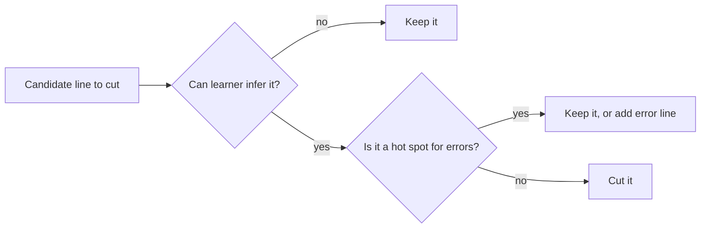
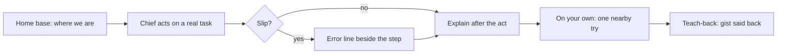

# 🧬 TEC.05 — Minimalism Beyond the Nurnberg Funnel — Carroll (1998)
### Knowledge Entry — Distill

An MIT Press collection, edited by John Carroll, that restates "minimalism": a method for writing training and help so that learners act on real tasks at once and recover from their own errors. The title points back to Carroll's 1990 book, The Nurnberg Funnel. It is in the library because it is the strongest evidence that a learner who acts first learns faster than one who reads first, and because it says exactly how much to cut and when not to.

## TABLE OF CONTENTS
- [Core Thesis](#1-core-thesis)
- [Mind Models](#2-mind-models)
- [Framework](#3-framework--structure)
- [Key Concepts](#4-key-concepts)
- [Heuristics](#5-heuristics--decision-rules)
- [Invariants](#6-invariants)
- [Pitfalls](#7-pitfalls--myths)
- [Application](#8-application)
- [For Transmission Pedagogy (BOLO 6)](#for-transmission-pedagogy-bolo-6)
- [Cross-References](#9-cross-references)
- [Provenance](#10-provenance--confidence)

---

## 1 · CORE THESIS

Learners are drawn to act on real tasks, and acting is how they learn. Good instruction lets them act at once, supports their errors, and cuts only what they can infer. Cutting text is the result of that design, not the method, and it costs the designer more analysis, not less (ch. 3, pp. 56-58).

---

## 2 · MIND MODELS

**Diagram 1 — the whole argument.**
Caption: four principles hang from one root, the learner's need to act, and the chapters after the second test and defend them.

**Diagram 2 — the central mechanism (error recovery on the spot).**
Caption: a learner who errs must notice, name, and fix the slip, and the help works best when it sits beside the step that failed.

**Diagram 3 — the cut test.**
Caption: cut a line only if the learner can infer it and it is not a hot spot, so check the learner before cutting.

**Diagram 4 — mapped onto the Command's systems.**
Caption: Carroll's loop puts the act before the explanation, the opposite order from a lecture, and the proposed rules attach at the act and the slip.

---

## 3 · FRAMEWORK / STRUCTURE

Fifteen chapters by different authors. The core is Chapters 1 to 3. Later chapters apply, test, and argue with it. Page numbers are printed pages.

| Ch. | Pages | Author | Move |
|---|---|---|---|
| 1. Reconstructing Minimalism | 1-17 | Carroll | History, and why the 1980s manuals failed learners (pp. 2-3) |
| 2. Principles and Heuristics | 19-54 | van der Meij and Carroll | Four principles, eleven heuristics (p. 21) |
| 3. Ten Misconceptions | 55-90 | Carroll and van der Meij | What minimalism is not (pp. 55-57) |
| 4-6, 8, 10-12, 14 | 91-348, 375-392 | Anson, Rosenbaum, Hackos, Redish, van der Meij, Smart, Johnson, Brockmann | Industry use, training, expert users, rhetoric (contents) |
| 7. Complex Tasks | 179-218 | Mirel | Scaling to complex domains (contents) |
| 9. Layering | 247-272 | Farkas | A safety net for thin text (p. 247) |
| 13. Action-Centered Docs | 349-374 | Draper | Derives the principles from one idea (pp. 358-361) |
| 15. Agenda | 393-410 | Kearsley | Open questions (contents) |

The four principles (p. 21): choose an action-oriented approach, anchor the tool in the task domain, support error recognition and recovery, support reading to do, study, and locate. The authors call them principles and heuristics, not rules, because each needs judgment (p. 20).

---

## 4 · KEY CONCEPTS

| Concept | What it is | Why it matters |
|---|---|---|
| **Production paradox** (ch. 2, p. 21) | To learn, a person must act, yet to act well he must first learn. | The designer's job is to manage this, not remove it. |
| **Paradox of the active user** (ch. 1, p. 6) | The urge to do real work undercuts the motivation to "just learn". | Why lectures lose people. |
| **Learning by doing** (ch. 1, p. 3) | Support real tasks from the start and throughout. | The root of the method. |
| **Real task** (ch. 2, p. 29) | A modest job the learner recognizes as genuine. | It holds motivation and prior knowledge together. |
| **Minimalist invitation** (ch. 2, p. 24) | Wording that asks the learner to try. | It measurably raises exploration. |
| **Training wheels** (ch. 3, p. 65) | Block the harmful consequences of an error and say so. | The learner explores safely. |
| **Error types** (ch. 2, pp. 33-34) | Semantic (wrong method), syntactic (right method, wrong execution), slip (keystroke). | Syntactic errors are the easiest to predict and help. |
| **Detect, diagnose, correct** (ch. 2, p. 38) | The three steps of recovery. Diagnosis is optional. | Error help should serve whichever step is missing. |
| **Hot spot** (ch. 2, p. 34) | A place where many learners slip. | Six to eight test users find most of them. |
| **Fading** (ch. 3, p. 62) | Reminders get shorter on each repeat. | Support thins as skill grows. |
| **Closure and home base** (ch. 2, pp. 45-46) | Each chapter starts and ends in a known state. | Readers enter anywhere. |
| **Coordinative information** (ch. 3, p. 67) | Tells the learner how the manual and the screen line up. | Joins two sources of information. |
| **Layering** (ch. 9, p. 247) | Extra help held behind the minimal text. | A safety net for thin text. |
| **Guided exploration** (ch. 3, p. 63) | Exploration with support and a prepared mind. | Different from trial and error. |

---

## 5 · HEURISTICS & DECISION RULES

| Situation | Do this | Not this |
|---|---|---|
| Starting a lesson | Give a simple real task first, explain after (ch. 2, pp. 22-23, 43) | Open with an overview of the tool |
| Inviting a try | "Please try it", "See what happens" (p. 24) | "You can also..." (p. 24) |
| After a related task | Offer one nearby try, "On your own" (ch. 3, pp. 64-65) | Open-ended "explore" |
| Choosing a task | A modest job he recognizes at once (ch. 2, p. 29) | A toy exercise with no meaning |
| Writing headings | Name the task (pp. 31-32) | "Tips for users" (p. 32) |
| Step likely to slip | Put a detect-diagnose-fix line beside it (p. 41) | A troubleshooting section at the back |
| Error line density | About one per three actions (p. 35) | None, or all at the end |
| Harm is severe | Block it and say it was blocked (ch. 3, p. 72) | Let the learner wreck the state |
| Deciding what to cut | Cut what he can infer, keep hot spots (ch. 3, pp. 60-61) | Slash text at random (ch. 3, p. 56) |
| Repeating a step | Shorten the reminder each time (ch. 3, p. 62) | Cut every reminder after one use (ch. 2, p. 46) |
| Explaining | Short, and after the act (p. 43) | A long prerequisite lecture |
| Starting a section | Start from a named home base (pp. 45-46) | Depend on the last section |
| Unsure the text works | Test with six to eight real learners (p. 34) | Trust the writer's eye (ch. 3, p. 62) |

---

## 6 · INVARIANTS

1. People want to act on real tasks from the first minute (ch. 1, pp. 3, 6).
2. Errors are the rule, not the exception, and cost a quarter to half of learning time (ch. 2, p. 33).
3. Brevity is a result of the design, never the whole design (ch. 3, pp. 56-58).
4. Cutting well takes more analysis of the learner, not less (ch. 3, pp. 58, 60).
5. Writers forget novices' difficulties, so test with the real audience (ch. 3, p. 62).
6. Few readers read in order, so each unit must stand on its own (ch. 3, p. 70).
7. Guided exploration is not trial and error (ch. 3, p. 63).
8. The evidence base is mainly software tasks and procedural skill, and the authors say so (ch. 3, pp. 76-77).

---

## 7 · PITFALLS / MYTHS

The book names ten misconceptions (ch. 3, p. 56). The ones that matter here:

- "Minimalism means cut text." Brevity is derived, and random cutting does not give minimalism (pp. 56-58).
- "Incomplete means unanalyzed." Leaving gaps works only after analyzing what the learner knows (pp. 59-61).
- "Minimalism means trial and error." Exploration needs support and a prepared mind (p. 63).
- "It ignores people who learn by reading." No compelling evidence shows skills are learned by reading alone, and even self-declared read-first learners start acting as they read (pp. 66-67).
- "It dwells too much on errors." Few conventional manuals helped with errors, and 86 percent of the error help on the page was unmarked (p. 71).
- "Errors are always good teachers." Some errors are a snakepit of side effects, and some annoy from the first keystroke (pp. 71-72).
- "It only works for simple domains." The authors say it scales, and Mirel's Chapter 7 treats the question (pp. 76-78).
- Counterweight from inside the book: cutting text risks a failed task, wasted time, or a wrong mental model, and Farkas urges a second layer (ch. 9, p. 249).
- Scope caution: the experiments use word processors, spreadsheets, and Smalltalk. Chat tutoring is outside that base.

---

## 8 · APPLICATION

- **Spine level:** CRAFT-PROCESS. A method book about instruction and help, not a story source.
- **12-layer character stack:** not applicable. `feeds:` wires to TEACHING and DOCS.
- **plot_systems:** not applicable.
- **Setting:** not applicable.

Most of the library's teaching sources say what to do after the learner has seen something. Carroll says what the learner sees first: a task to do. He also says what to do when the learner slips, and it is a short line beside the step, not a section at the back (ch. 2, p. 41). For Claude in a chat window, a step that Chief runs from a reply is exactly Carroll's case, because the reply is the manual and the terminal is the screen.

The DOCS layer gets the other half. Replies and SOP pages are Chief's manuals. Their headings should name the task, each should start from a stated place, and each should carry its own error lines (ch. 2, pp. 31-32, 41, 45).

Tension with PSY.48: that book says to give the frame first, and Carroll says to act first. They meet in headings that name the task structure (ch. 2, p. 31). One line of frame is cheap and does not delay the act. A long overview does (ch. 2, p. 22).

---

## FOR TRANSMISSION PEDAGOGY (BOLO 6)

All rules below are **proposed, not ruled**. Chief rules later. They sit beside ruled rules 13 to 16 and repeat none of them. The ruled worked example (rule 16) covers how a procedure is shown. These rules cover order, error help, cutting, and where a reply starts. The book studies software manuals, so each rule carries over by analogy.

**Proposed rule 1. For anything Chief can do, he acts first and the explanation follows (action first).**
When a part is a task Chief can run in his own files or tools, Claude's reply opens with the action and gives the why after it (ch. 2, pp. 22-23, 43). Claude words the action as an invitation, such as "Run it and see what prints" (p. 24). After Chief finishes, Claude offers one nearby try, tied to what he just did (ch. 3, pp. 64-65). The proposed rule does not apply to ideas Chief cannot act on, where PSY.48's bridge fits.

**Proposed rule 2. Put the error line beside the step that goes wrong (support error recovery).**
For any step Chief might get wrong, Claude writes one line right under it: what Chief will see if it went wrong, what that means, and the fix. Claude adds this about once every three steps in a procedure (ch. 2, p. 35), and skips it where nothing can go wrong. It never goes in a block at the end (p. 41). Where a slip can wreck state, Claude says to take a backup first, which is a training wheel (ch. 3, p. 65). The one-in-three density comes from the book's manuals, and in chat Claude should treat it as a start.

**Proposed rule 3. Cut what Chief can infer, never at random (cut what the learner does not need).**
Before cutting a line, Claude checks it against what the Command's record says Chief already knows, such as STATE.md and the session notes, and cuts only what he can infer (ch. 2, p. 44). A step that is a likely slip stays in (ch. 3, p. 61). Claude does not shorten a reply just to hit a length (ch. 3, p. 56). The Command's plain register already limits length, and this rule says what to cut inside that limit. The book's own caution applies: a wrong cut leaves a stuck learner (ch. 3, p. 60; ch. 9, p. 249).

**Proposed rule 4. Every reply starts from a named home base and finishes its task (closure).**
Each teaching reply opens with one clause that says where Chief is, such as "back in the layer system, part 3", and closes the task it opened. Chief often reads after a gap, and few readers go in order (ch. 3, p. 70; ch. 2, pp. 44-46). A reply therefore does not depend on the last one for its steps. It may still link to it.

**Strongest single rule from this book:** rule 2. It is the one thing in the book Claude can do in every procedure Chief runs, it has the cleanest numbers in the book (33% faster detection and 73% more successful correction, ch. 2, p. 35), and no ruled rule covers it.

---

## 9 · CROSS-REFERENCES

| Related entry | Relation |
|---|---|
| [[PSY.48]] | How Learning Works. Frame-first against Carroll's act-first. Resolved by task-naming headings (ch. 2, p. 31). |
| [[PSY.44]] | Make It Stick. Supports learning from errors that get feedback. Carroll's error line is the feedback, placed beside the step. |
| [[PSY.43]] | Efficiency in Learning. Its worked example with a faded last step matches fading here (ch. 3, p. 62). |
| [[TEC.01]] | Docs for Developers. Shares task headings and audience-first writing. |
| [[TEC.02]] | Microsoft Manual of Style. Procedure formatting and the style of action steps. |
| [[BOLO 6 — transmission pedagogy]] | The working brief these distills serve. |
| [[Teach-back loop (BOLO 95)]] | The ruled loop. Rule 4 gives each reply a start, and rule 1 puts an act before the gist. |

---

## 10 · PROVENANCE & CONFIDENCE

Full-text extraction of the 1998 volume (about 144,000 words). Title, editor, publisher, and year were confirmed from the title page and copyright page (MIT Press, with the Society for Technical Communication). Read in full or near full: the table of contents, Chapter 1 sections 1.1 to 1.5, Chapter 2 in full, Chapter 3 sections 3.1 to 3.5 and 3.7 to 3.8, the opening of Chapter 9 (Farkas) through its risk section, and Chapter 13 section 13.2 (Draper). Not read: the rest of Chapter 3 and Chapter 9, and Chapters 4 to 8, 10 to 12, 14, and 15, which are practitioner, rhetorical, and agenda pieces. Their entries in the Framework table come from the contents page only.

Page numbers are printed pages from the running headers and a page break can shift a cite by one. The percentages come from the authors' own manual tests and were not independently checked. The mapping to the TEACHING and DOCS layers, the tension with PSY.48, the diagrams, and every proposed rule are this distill's own synthesis, carried by analogy from software manuals to chat. `zotero_key` is blank and unchecked. `confidence` is medium because the book is largely unread past Chapter 3.

## META
- Template: BVX-LEARN-v4.0
- Source classification: full-text plain-text extraction; chapters 1 to 3 read, chapters 9 and 13 sampled, others unread
- Created / Updated: 2026-10-04
