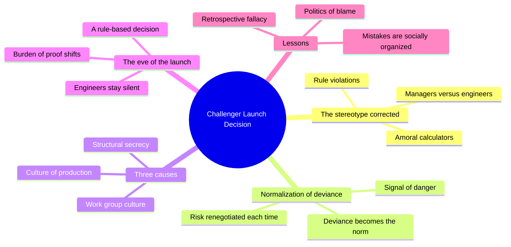
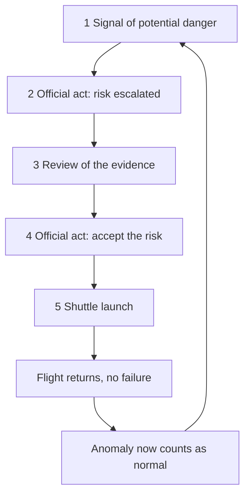
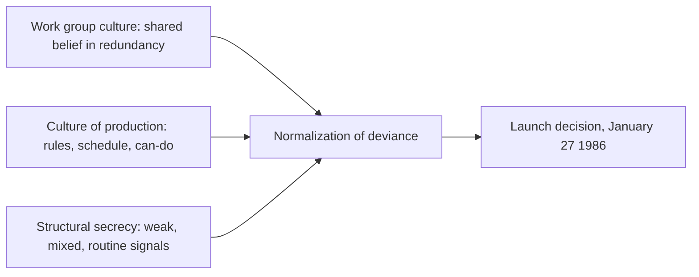
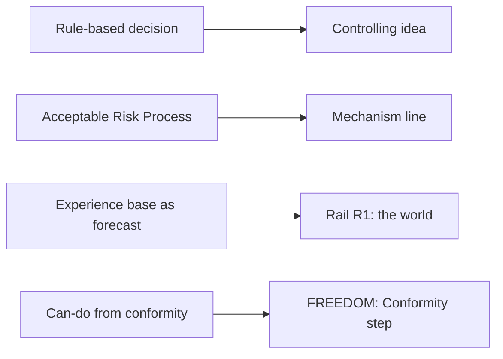

# TEC.06 — The Challenger Launch Decision — Diane Vaughan (1996)
### Knowledge Entry — Distill

A sociologist's ten-year reconstruction of why NASA launched the space shuttle Challenger in January 1986, held here as the main case behind OXO's controlling idea.

## TABLE OF CONTENTS
- [Core Thesis](#1-core-thesis)
- [Mind Models](#2-mind-models)
- [Framework](#3-framework--structure)
- [Key Concepts](#4-key-concepts)
- [Heuristics](#5-heuristics--decision-rules)
- [Invariants](#6-invariants)
- [Pitfalls](#7-pitfalls--myths)
- [Application](#8-application)
- [Cross-References](#9-cross-references)
- [Provenance](#10-provenance--confidence)

---

## 1 · CORE THESIS

Engineers and managers followed NASA's rules and still launched Challenger. Over years they redefined O-ring damage as acceptable risk. Vaughan calls this the normalization of deviance, locked in by work group culture, production pressure and structural secrecy.

---

## 2 · MIND MODELS

**Diagram 1 — the whole argument.**
Caption: *the book replaces one story (bad managers broke rules) with another (good people followed rules), and builds the second from three causes.*

**Diagram 2 — the central mechanism (a loop that runs once per flight).**
Caption: *every pass through the loop ends with a launch and a safe landing, so every pass makes the next acceptance easier.*

**Diagram 3 — why the loop never broke (three causes, one outcome).**
Caption: *no single cause is enough; Vaughan says each alone is insufficient, and together they explain why this group normalized the deviance and others did not.*

**Diagram 4 — mapped onto the theme system.**
Caption: *each source term lands on one named part of the ruled theme method, so a writer can pull it by name.*

---

## 3 · FRAMEWORK / STRUCTURE

Vaughan writes one long case study in four moves. Page numbers are the printed ones.

| Move | Chapters (pages) | What it does |
|---|---|---|
| Set the scene | 1 Eve of the Launch (1-32) · 2 Learning Culture, Revising History (33-76) | Tells the night of the launch, then explains the common story (managers broke rules) and why it fails. |
| Build the theory | 3 Risk, Work Group Culture, and the Normalization of Deviance (77-118) | Defines risk as constructed and gives the five-step decision sequence (p.65). |
| Trace the history | 4 (1981-1984, pp.119-152) · 5 (1985, pp.153-195) | Follows each O-ring anomaly and the decision that accepted it. |
| Add the causes | 6 Culture of Production (196-237) · 7 Structural Secrecy (238-277) | Shows why the work group's view could not be challenged. |
| Return and conclude | 8 Eve Revisited (278-333) · 9 Conformity and Tragedy (334-386) · 10 Lessons Learned (387+) | Re-reads the launch night with the theory and draws the lessons. |

The book proves its claim by return. Chapter 8 retells the launch night in thick detail, and chapter 9 sets that against the stereotyped version (p.334).

---

## 4 · KEY CONCEPTS

| Concept | What it is | Why it matters |
|---|---|---|
| **Normalization of deviance** | Engineers first treated joint damage as a deviation. They then reinterpreted it as within the norm, then labeled it acceptable risk (p.65). | The mechanism of the whole book. It needs no villain. |
| **Acceptable Risk Process** | Five steps: signal of danger, official act raising risk, review of evidence, official act accepting risk, launch (p.65). | A repeatable loop. Each pass sets the precedent for the next. |
| **Amoral calculator hypothesis** | The popular claim that managers knowingly put schedule before safety (p.336). | Vaughan tests it and rejects it. Participants denied it, and the rules they followed were NASA's own (pp.336-339). |
| **Risk is constructed** | People assess risk through a worldview shaped by their position, not as a fixed fact (p.62). | Explains how two honest groups read the same damage differently. |
| **Work group culture** | The SRB (solid rocket booster) work group built its own norms and a belief in redundancy, one decision at a time (p.394). | The first cause. The group wrote its own standard. |
| **Culture of production** | Environmental pressure plus three imperatives: the original technical culture, bureaucratic accountability, political accountability (p.396). | The second cause. Following the rules felt like doing the job well. |
| **Structural secrecy** | Organization structure, specialization and regulatory relations kept signals from reaching people who could challenge them (p.397). | The third cause. No one hid anything, and the structure hid it anyway. |
| **Weak, mixed, routine signals** | Warning signs were interspersed with good news, shrunk after analysis, or repeated until normal (p.397). | Why danger stopped looking like danger. |
| **Burden of proof shift** | Thiokol's engineers felt they had to prove it was unsafe. Vaughan finds the burden moved because their position moved (p.343). | Both sides were partly right. Neither side broke a rule. |
| **Social organization of a mistake** | Mistakes are "socially organized and systematically produced" (p.394). | The sentence to quote when a writer wants the system, not the person. |
| **Politics of blame** | After disasters, public focus lands on one operator and the system is spared (p.392). | A system's defense. It restores confidence and changes nothing. |
| **Retrospective fallacy** | Looking back, people alter the past to make errors look foreseeable (p.393). | A warning for any scene told in hindsight. |

---

## 5 · HEURISTICS & DECISION RULES

| Situation | Do this | Not this |
|---|---|---|
| Writing a harmful decision inside an institution | Let each person cite the rule they followed. | Give one manager a hidden motive to explain it. |
| Showing danger signs | Mix them with good news, shrink them with analysis, repeat them until routine. | Make every sign loud and ignored. |
| Writing the person who objects | Give them real evidence gaps and a rule that silences them (pp.381, 398). | Make them a lone hero blocked by a villain. |
| Showing a reviewer or safety office | Make them depend on the group they review (p.398). | Make them a corrupt gate. |
| Explaining why nobody spoke | Show each person doing "everything in their power" inside their role (p.380). | Show cowardice as a flaw of character. |
| A scene told after the fall | Show the public and the investigators picking one culprit (pp.389-393). | Let the narrator know what the characters could not. |
| Raising the stakes | Repeat a precedent that worked. A safe landing is the best argument for the next launch. | Escalate with a single new crisis. |

---

## 6 · INVARIANTS

1. **A rule can be the cause.** Managers abided by all internal NASA rules, and the decision still failed (p.335).
2. **Success rewrites the norm.** Each launch that returned made the damaged joint look safer (pp.120, 396).
3. **Pressure acts before choice.** Production pressure affected "all participants' decision making prerationally" (p.335).
4. **Hidden, not concealed.** Structural secrecy came from structure and specialization, not from a cover-up (p.397).
5. **Culture shows the menu, people pick the item.** Culture lists the choices available, and only people's words and acts show the pick (p.385).
6. **Blame falls on the operator.** The accepted story after a failure is usually "operator error" (pp.392-393).

---

## 7 · PITFALLS / MYTHS

- **Myth:** managers put schedule above safety. Vaughan finds no rule broken and no one who admitted it (pp.336-339). Pressure existed, and it worked through the culture.
- **Myth:** managers against engineers. Most participants were both, and the engineers did not all agree (p.334).
- **Pitfall:** reading "no villain" as "no responsibility." Vaughan says individual responsibility spanned every level, including Congress, the White House and NASA's top administrators (pp.389-390).
- **Pitfall:** treating one case as a law. Vaughan calls the three-part account "a nascent theory" (p.394). It was built from one organization.
- **Pitfall:** hindsight. The post-disaster charts that show the temperature trend (Figure 13.2, p.382) were only possible because the disaster made temperature visible (p.382).
- **Caution:** Vaughan stresses the engineers lacked a firm quantitative case. She also notes they did have the data to build one (pp.381-382). The tragedy was avoidable in principle.

---

## 8 · APPLICATION

*Everything below is proposed for BOLO 80, marked provisional, never ruled. The ruled items are only those named in ssot_07.*

- **Spine level:** L6. The book is evidence for the controlling idea, the mechanism line and rail R1.
- **12-layer character stack:** none directly. It sources how a character inside a system reads danger as normal.
- **plot_systems:** the five-step loop is a ready pattern for a repeated scene sequence (signal, review, accept, proceed).
- **Setting:** it suits the institutions in the civilization gauges (the Coast, Providence, the Power Line) but feeds no setting layer.

**What the book adds to the ruled controlling idea.** Vaughan is the cleanest proof that the idea can be literally true. Nobody lied, nobody broke a rule, and seven people died. The idea says nobody has to be evil. The book shows what "has to" means. The system supplies every push, and the people supply only competence.

**What it tests.** The mechanism line says the system "trains you, measures you, then calls the result your nature." Vaughan's version is stricter. The system also trains the people who measure. The reviewers were enculturated (p.398). A story that shows only the trainee and not the trainer misses half the mechanism.

**PROPOSED additions to the theme system.**

1. **The citation test (scene-level).** In any scene where the system does harm, every actor can name the rule or norm they followed. If a scene needs a hidden motive, it argues a different idea.
2. **The precedent loop (rail R1 evidence).** The world's forecast gets stronger each time a character's deviation goes unpunished. R1's "they already know how you'll turn out" can be dramatized as a record of past safe launches.
3. **FREEDOM gauge note.** The engineers live at Conformity, and their conformity feels like skill. That fits the top step, control that feels like freedom, because Vaughan says conformity was the source of the can-do attitude (p.397).
4. **Motif candidate: the waiver or signed form.** A paper that declares the danger acceptable. It could tie to R1 and the step *You're managed, not free*. Nothing in the ruled motifs covers paperwork.

**Touchstone check.** Nothing here touches TS 1:1 (the bounded container). No handshake row changes.

---

## 9 · CROSS-REFERENCES

| Related entry | Relation |
|---|---|
| [[BVX.1205]] | O'Neil, *Weapons of Math Destruction*. Same shape in code: operators do the job and the score never learns it is wrong. |
| [[BVX.1206]] | Zimbardo, *The Lucifer Effect*. Cites Challenger as a systemic failure (ch.10), but repeats the amoral-calculator reading Vaughan rejects. |
| [[MSX.36]] | Foucault on biopower. Supplies the mechanism line's register; Vaughan supplies a case where the norm rewrites itself. |
| [[BVX.0236]] | Coyne on the value spectrum. The method behind the FREEDOM and FAIRNESS gauges. |
| [[BVX.0054]] | Lyons on the moral blind spot. A person-level cause. Vaughan argues the opposite level. |

---

## 10 · PROVENANCE & CONFIDENCE

Source: full text of the 1996 University of Chicago Press edition (ISBN 0-226-85176-1 paper), from a scanned text layer with OCR noise. Quotes were checked against the text.

**Read in full or near full:** chapter 9 (pp.334-386); chapter 10 sections on the causes, science, technology and risk (pp.387-399); chapter 3's definition of risk and the five-step sequence (pp.62-65); chapter 4's opening, the first erosion and the Criticality 1 waiver (pp.120-121, 131-133).

**Not read:** chapter 1 (the night of the launch), most of chapter 2, chapter 5 (1985), chapters 6 and 7 beyond what chapters 9 and 10 summarize, chapter 8, the notes and appendices. Claims about those chapters rest on Vaughan's own summaries in chapters 9 and 10. Page cites are printed pages (PDF page minus 17).

**Inference:** all of section 8 and the `feeds:` entries are this distill's own wiring to the theme system (ssot_07), proposed, not ruled. Vaughan uses no theme vocabulary.

**Confidence:** high for the theory and the launch-night argument. Medium for any detail of 1981-1985 history, which was read only as summarized.

## META
- Template: BVX-LEARN-v4.0
- Source classification: full-text book, deep extraction on 3 of 10 chapters, summary-level on the rest
- Created / Updated: 2026-10-04
