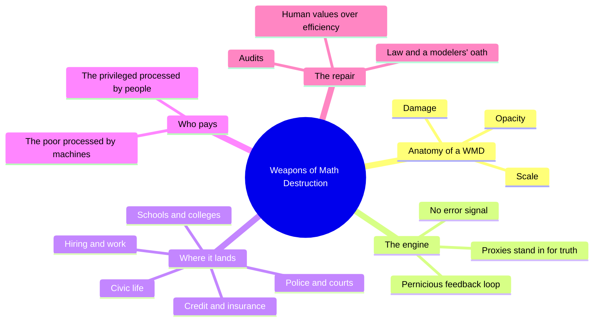
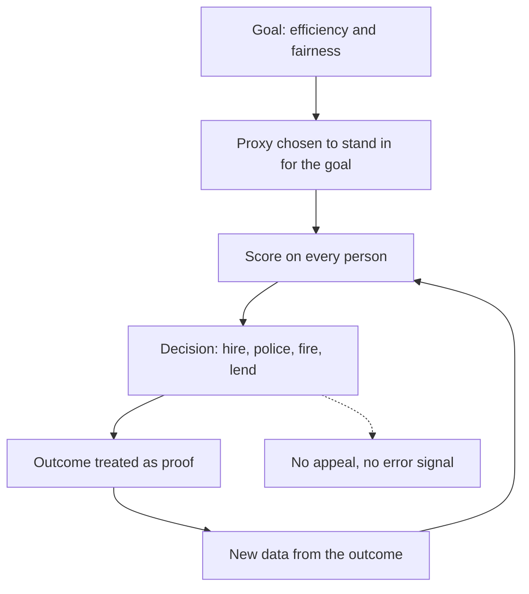
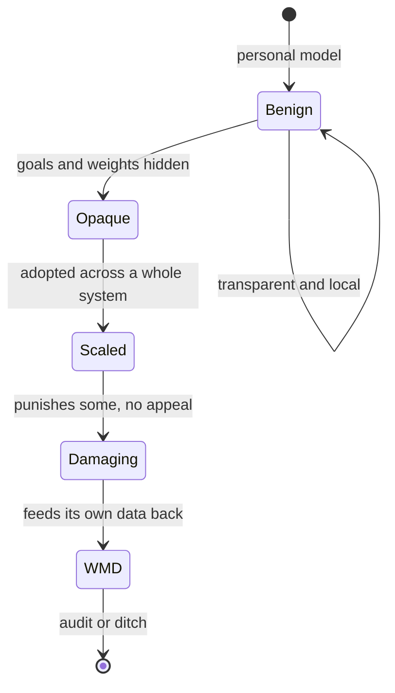
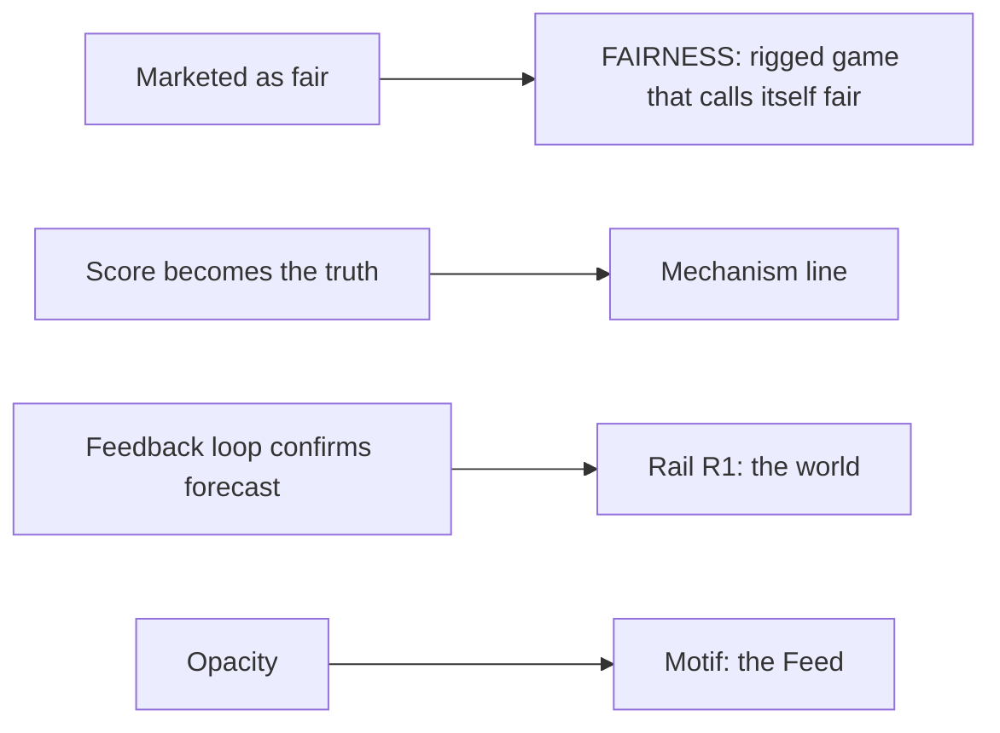

# TEC.07 — Weapons of Math Destruction — Cathy O'Neil (2016)
### Knowledge Entry — Distill

A former hedge-fund quant's field guide to scoring systems that sort people at scale, held here as the data-age evidence for OXO's controlling idea.

## TABLE OF CONTENTS
- [Core Thesis](#1-core-thesis)
- [Mind Models](#2-mind-models)
- [Framework](#3-framework--structure)
- [Key Concepts](#4-key-concepts)
- [Heuristics](#5-heuristics--decision-rules)
- [Invariants](#6-invariants)
- [Pitfalls](#7-pitfalls--myths)
- [Application](#8-application)
- [Cross-References](#9-cross-references)
- [Provenance](#10-provenance--confidence)

---

## 1 · CORE THESIS

Models are opinions embedded in mathematics. A model that is opaque, scaled up and damaging becomes a weapon of math destruction. It feeds on its own results and never learns that it is wrong.

---

## 2 · MIND MODELS

**Diagram 1 — the whole argument.**
Caption: *one three-part test (opacity, scale, damage) is applied to model after model across a life: school, court, work, credit, vote.*

**Diagram 2 — the central mechanism (a loop with no way to say "wrong").**
Caption: *the score's output becomes the data that justifies the score, so the model looks more accurate each time it is more unfair.*

**Diagram 3 — how a harmless model becomes a WMD.**
Caption: *the same model is benign while one family uses it and dangerous once a whole system must use it and cannot see inside.*

**Diagram 4 — mapped onto the theme system.**
Caption: *O'Neil's terms land on the FAIRNESS gauge, rail R1, the mechanism line and the Feed motif.*

---

## 3 · FRAMEWORK / STRUCTURE

O'Neil walks one reader through a lifetime of scores. Chapter names are the book's own. The text has no print page numbers, so cites use chapter and "seg." (the page of the text extract).

| Part | Chapters | What it does |
|---|---|---|
| The idea | Introduction · 1 Bomb Parts: What Is a Model? | Gives the Washington teachers case, defines a model, and states the three-part test. |
| The author | 2 Shell Shocked | O'Neil's own turn from hedge funds to critic (not read in depth). |
| The WMDs | 3 Arms Race (college) · 4 Propaganda Machine (ads) · 5 Civilian Casualties (justice) · 6 Ineligible to Serve (jobs) · 7 Sweating Bullets (work) · 8 Collateral Damage (credit) · 9 No Safe Zone (insurance) · 10 The Targeted Citizen (civic life) | One system per chapter, each tested against the same three questions. |
| The way out | Conclusion | Audits, an oath, new law and a new definition of success. |

---

## 4 · KEY CONCEPTS

| Concept | What it is | Why it matters |
|---|---|---|
| **Model** | A simplified picture of the world used to predict. It has goals, inputs and a definition of success. | "Models are opinions embedded in mathematics" (Ch.1, seg.24). The values are chosen, not found. |
| **Weapon of math destruction** | A model with opacity, scale and damage (Ch.1, seg.31). | A test, not an insult. It lets a writer check any system. |
| **Opacity** | The scored person cannot see the model or how it scores them (Ch.1, seg.29). | Keeps people from gaming it, and from protesting it (Intro, seg.14). |
| **Scale** | The model can grow to cover everyone (Ch.1, seg.30). | At scale a model's norms exert "something very close to the power of law" (seg.30). |
| **Damage** | The model works against the scored person's interest. | O'Neil says the test is not whether some benefit, but that "so many suffer" (seg.31). |
| **Proxy** | A number that stands in for something hard to measure. | Credit scores stand in for reliability. Zip codes stand in for race (Ch.5, seg.76). |
| **Pernicious feedback loop** | The model's output creates the data that confirms it. | Policing sends more police, which finds more crime, which sends more police (Ch.5, seg.76). |
| **Missing error signal** | A good statistical model learns from mistakes. A WMD has no way to see its own (Intro, seg.13). | Of the 206 fired teachers, "how does it ever learn if it was right? It doesn't." |
| **Processed by people or machines** | The wealthy get personal input. The masses get scored in bulk (Intro, seg.14). | A clean marker of who the system serves. |
| **Arms race** | A rank that grades on a curve makes every school chase the same numbers (Ch.3, seg.52). | A job done well by each school adds up to a rat race (seg.53). |
| **Positive feedback loop** | A way to ask the scored whether the score makes sense (Conclusion, seg.173). | The fix O'Neil prefers to a ban. |
| **Moral imagination** | The human act of putting better values into the model (Conclusion, seg.169). | "Big Data processes codify the past. They do not invent the future." |

---

## 5 · HEURISTICS & DECISION RULES

| Situation | Do this | Not this |
|---|---|---|
| Showing a scoring system | Ask three questions: can the person see it, does it reach everyone, does it hurt someone with no appeal? | Call it evil because it is a machine. |
| Writing the system's builder | Give them a laudable goal and a real result (Ch.1, seg.30). | Give them contempt for the people scored. |
| Showing a verdict | Let a person get a score that no one can explain (Intro, seg.12-14). | Let the algorithm be a clear villain with a face. |
| Showing who is hurt | Show the poor scored by machine and the rich heard by a person (Intro, seg.14). | Show everyone hurt equally. |
| Showing "proof" the model works | Use the result the model itself caused (Intro, seg.14). | Use an outside test the model could fail. |
| Showing a clever player | Let a character raise their own score by chasing the proxy (Ch.3, seg.52-53). | Let them win by cheating the rules. |
| Showing a fix | Pair an audit of outputs with a way for the scored to push back (Conclusion, seg.172-173). | End on a hero who deletes the code. |

---

## 6 · INVARIANTS

1. **A model carries a goal.** Someone chose what counts as success, so every model has an author's values in it (Ch.1, seg.24).
2. **Without feedback, error persists.** A system that cannot see its mistakes keeps making them (Intro, seg.13).
3. **The score becomes the fact.** The harmful models "define their own reality and use it to justify their results" (Intro, seg.13).
4. **Scale turns nuisance into law.** The same model is minor in one house and binding in a nation (Ch.1, seg.30).
5. **Models codify the past.** They repeat who succeeded before (Conclusion, seg.169).
6. **Opacity protects the system.** Hidden rules keep the scored from questioning them (Intro, seg.14).

---

## 7 · PITFALLS / MYTHS

- **Myth:** the book is against math. O'Neil built a benign meal-planning model as her own example (Ch.1, seg.28-29), and says "mathematical models should be our tools, not our masters" (Conclusion, seg.171).
- **Pitfall:** treating every bad outcome as a WMD. She says room remains for quibbles, and some WMDs lack full opacity or scale (Ch.1, seg.31).
- **Pitfall:** treating the harm as universal. Some people benefit from the same systems (Ch.1, seg.31).
- **Caution:** the book is American and from 2016. Its claims on later models are untested here.
- **Caution:** her "three elements" are a judgment, not a measurement. O'Neil applies them by argument, and the book offers no scoring method.
- **Caution:** she accepts trade-offs. In some cases, a fair model must be less accurate (Conclusion, seg.173). A writer should not pretend the choice is free.

---

## 8 · APPLICATION

*Everything below is proposed for BOLO 80, marked provisional, never ruled.*

- **Spine level:** L6. It is the strongest evidence for the FAIRNESS gauge and the mechanism line.
- **12-layer character stack:** none directly. A character who builds or runs a score could draw on it.
- **plot_systems:** the loop in Diagram 2 is a ready pattern for a repeated scene sequence.
- **Setting:** it fits the Sync score and the Feed, which SSOT 07 keeps as setting and motif.

**What the book adds to the ruled controlling idea.** The idea says nobody has to be evil when everyone does their job. O'Neil gives the engine for the algorithm age. Each builder solves a real problem, each user follows the tool, and the tool's output is its own proof. She also gives the word for it, a weapon, without a villain.

**What it tests.** The idea works best when the job is done well. O'Neil says the models often punish with high efficiency. The mechanism line says the system "trains you, measures you, then calls the result your nature." She adds a hinge the line lacks. The model **does not learn**, so the call can never be corrected from inside.

**PROPOSED additions to the theme system.**

1. **The three-question audit (world-scene test).** For any score-based power in OXO, a scene names the three: who can see how it works, who it covers, who it hurts with no appeal. Opacity, scale and damage all present means the scene is on-theme.
2. **A "who gets a person" marker on FAIRNESS.** Add one signal to world scenes: who is heard by a human and who is scored in bulk (Intro, seg.14). It would sharpen the step *Some people get a head start* without a new step.
3. **A proof-from-itself beat for the −−− FAIRNESS step.** "They cheat you and give you a grade for it" fits a scene where the system cites its own output as the evidence that it works (Intro, seg.14).
4. **An "arms race" scene type.** Where each character does their job well and the sum is a rat race, as in the Texas Christian University story (Ch.3, seg.52-53). It dramatizes the controlling idea with no antagonist.

**Touchstone check.** None of these touches TS 1:1.

---

## 9 · CROSS-REFERENCES

| Related entry | Relation |
|---|---|
| [[BVX.1204]] | Vaughan, *The Challenger Launch Decision*. People followed the rules and the system's own signals fooled them. O'Neil's loop is Vaughan's loop with code. |
| [[BVX.1206]] | Zimbardo, *The Lucifer Effect*. Situation and system over the person. O'Neil is the same claim about scoring systems. |
| [[MSX.36]] | Foucault on biopower. The norm replaces the law. O'Neil's "power of law" at scale (seg.30) is the same move in numbers. |
| [[BVX.0236]] | Coyne, the value spectrum behind the FAIRNESS gauge. |

---

## 10 · PROVENANCE & CONFIDENCE

Source: full text of the 2016 Crown edition (first edition; ISBN 9780553418811 hardcover), from an ebook extract with no print pagination. Quotes were checked against the text. Chapter attributions of "seg." numbers were inferred from the order of the extract and are approximate to within a few pages at chapter edges.

**Read in full or near full:** the Introduction (the Washington teachers case, Sarah Wysocki, IMPACT); Chapter 1's model definition and the three-part test; the college-ranking story (Chapter 3, TCU and the arms race); the predictive policing section (Chapter 5); the first pages of Chapter 6 (Kyle Behm, personality tests); the full Conclusion (death spiral, audits, the oath, law, regulation).

**Not read:** Chapter 2; Chapter 4 (online ads); the rest of Chapters 6 and 7 (work scheduling, "clopening"); Chapters 8, 9 and 10 beyond heading hits (credit, insurance, civic life); the notes. Claims about those chapters are limited to what the Introduction and Conclusion summarize.

**Inference:** section 8 and the `feeds:` entries are this distill's own wiring to ssot_07. O'Neil has no theme vocabulary.

**Confidence:** high for the three-part test, the feedback loop and the conclusion's remedies. Medium for chapter-level case details outside the read portions.

## META
- Template: BVX-LEARN-v4.0
- Source classification: full-text book, deep extraction on the Introduction, Chapters 1, 3 and 5, and the Conclusion; sampled elsewhere
- Created / Updated: 2026-10-04
