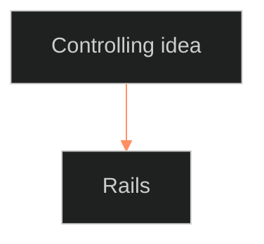

# BOLO 104 · the visuals pass · brief (MS, one per slice)

Repo root: C:\Users\U01_LEECHSEED\Desktop\_setsunadev. Write every file as UTF-8, LF endings.

Chief ruled 10/5 ("All recs go"): the documentation SOP has a new section 5, Visuals. Read it first: `ShroomsQ/_CANON/_SSOT/07_STYLE_GUIDES/📐 ssot_07_2_documents_style.md`, section "**5 · Visuals**" (rules 5.1–5.5). You apply it to the core-doc pages in YOUR SLICE under `ShroomsQ/_CANON/_DOCS/`.

## Do, per doc folder in your slice

1. **`1-concept.md`: open with a mind model (rule 5.3).** Put it right under the H1, before the first H2. It shows the whole system or doc in one view: the hub, its main parts, and how they connect.
2. **`2-reference.md`: add a structure diagram when the page has more than five H2 components (5.3).** Put it under the H1, before the first H2. Pick the shape by the job (5.2): a tree for a hierarchy, a flow for a pipeline, a state diagram for change over time.
3. **Optional, where it earns its place:** one flow on `3-how-to.md` for a multi-step procedure, or one on `4-tutorial.md`. Never more than one extra per page.
4. **Skip** any folder whose `2-reference.md` says `state: retired`.

## Every diagram

- **Same claim as the words (5.1).** Draw only what the page already says. No new facts, names, numbers or links. Use the page's own words for the labels.
- **Caption first (5.4):** one italic line directly above the diagram, telling the reader what to look at: `*The mind model: four parts feed one argument; the motifs carry it to the page.*`
- **Mermaid (5.5)**, in a fenced block, with this init line first so it draws in the Command's colors:

````

````

- **Syntax that never breaks:** use `flowchart TD` or `flowchart LR` (for mind models too: one hub node with spokes), or `stateDiagram-v2`. Do NOT use `mindmap`, `timeline` or `C4`. Quote every label in `["…"]`. No parentheses, colons or quotes inside a label unless the whole label is quoted. Node ids are short letters/numbers only. Keep each diagram at 15 nodes or fewer; group with `subgraph` if needed.
- Add nothing else to the page. Do not touch front matter, OPEN lines, headings or the text.

## Also

- Your list of long sentences (rule 3.2) may be non-empty: run `python _tools/docs/long_list.py _tools/docs/work/long.<your slice>.v2.txt <your system folders>` once at the start and fix any it lists, splitting them as the words pass did.
- Do not consult other agents. Do not edit outside your slice.

## Reply

Two lines: diagrams added (concept · reference · extra) · folders skipped and why.
